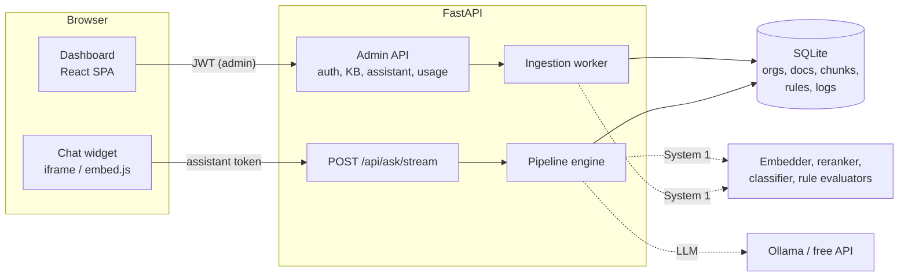

# Lumen: multi-tenant AI Knowledge & Decision Assistant

Organizations sign up, upload PDF policies, and get a secure public assistant URL they can embed on any website.
Visitors ask natural-language questions and receive **grounded answers with document and page references**.
Questions that need a decision ("Am I eligible for the Merit Scholarship?") are **decomposed and decided by small
System 1 models and application logic**. The LLM only handles language.

> **Free to run.** The default LLM is [Ollama](https://ollama.com) with `qwen2.5:3b` running locally. No account, no API key.

## Contents
[Quick start](#quick-start) · [Architecture](#architecture) · [Knowledge base](#knowledge-base) · [AI architecture](#ai-architecture) · [Security](#security-and-multi-tenant-isolation) · [API](#major-api-endpoints) · [Tests and evaluation](#tests-and-evaluation) · [Limitations](#known-limitations-and-production-improvements) · [Requirements checklist](docs/REQUIREMENTS_CHECKLIST.md)

---

## Quick start

### Option A: Docker (one command)
```bash
docker compose up --build
```
Open <http://localhost:8000>. The first start downloads the model (about 2 GB) into a volume; the assistant answers
once `ollama-pull` finishes. System 1 models (about 150 MB) download on first question.

### Option B: local development
Prerequisites: [uv](https://docs.astral.sh/uv/) (installs Python 3.12 for you), Node 20+, and [Ollama](https://ollama.com/download).

```bash
# 1. LLM (free, local)
ollama pull qwen2.5:3b

# 2. Backend
cd backend
cp .env.example .env          # optional, defaults work
uv sync
uv run uvicorn app.main:app --port 8000

# 3. Frontend (separate terminal)
cd frontend
npm install
npm run build                 # served by the backend at http://localhost:8000
# or: npm run dev             # hot reload at http://localhost:5173 (proxies /api to :8000)
```

### Load the demo data
With the server running:
```bash
cd backend
uv run python ../scripts/make_sample_data.py      # (re)generates the sample PDFs
uv run python ../scripts/seed_and_eval.py         # creates 2 orgs, uploads PDFs, runs 19 questions
```

| Organization | Email | Password |
|---|---|---|
| Northfield University | `demo-northfield@example.com` | `demo-password-1` |
| Acme Corp | `demo-acme@example.com` | `demo-password-2` |

(Demo-only credentials for local use. The seed script prints each assistant URL; open `/demo.html?token=<token>` for the embed demo.)

### Environment variables (`backend/.env.example`)
| Variable | Default | Purpose |
|---|---|---|
| `LLM_PROVIDER` | `ollama` | `ollama` (free, local), `openai_compat` (e.g. free Groq key), `mock` (no model) |
| `OLLAMA_URL`, `OLLAMA_MODEL` | `localhost:11434`, `qwen2.5:3b` | local model |
| `OPENAI_BASE_URL`, `OPENAI_API_KEY`, `OPENAI_MODEL` | Groq defaults | optional hosted free tier |
| `JWT_SECRET` | dev value | **change in production** |
| `PUBLIC_URL` | empty | origin used in assistant URL / embed code (empty = request host) |
| `EMBED_BACKEND` | `fastembed` | `hash` is an offline fallback used by tests |
| `RULES_LLM` | `false` | allow the LLM to propose extra rule cards (gated, see below) |

Limits (10 PDFs, 20 pages, 10 MB) are `MAX_DOCS`, `MAX_PAGES`, `MAX_PDF_MB`.

### Run the tests
```bash
cd backend && uv run pytest -q      # 81 tests, offline, no model needed
```

---

## Architecture



**Components**
- **Frontend** (`frontend/`): React + Vite + Tailwind + Motion. Landing, auth, dashboard (overview, knowledge, assistant, usage) and the public chat page `/a/:token`. `public/embed.js` adds the floating bubble; `public/demo.html` is the external demo site.
- **Backend** (`backend/app/`): FastAPI. `main.py` (routes), `ingest.py` + `pdfproc.py` (processing), `retrieval.py`, `engine.py` (pipeline), `classifier.py`, `rules.py`, `models_s1.py`, `llm.py`.
- **Tenant** = `Organization`. Every row (`documents`, `chunks`, `rules`, `question_logs`) carries `org_id`; every query filters on it.

**Question data flow** (`POST /api/ask` or the streaming variant used by the UI)
1. Validate the assistant token (server-side) and resolve the organization. Reject empty or oversized questions.
2. **Retrieve** from that organization's chunks only: BM25 + dense embeddings fused with RRF, reranked by a cross-encoder.
3. **Classify** the question (System 1).
4. **Grounding guard**: if retrieval support is too weak and no policy matches, answer "not in the knowledge base" without calling the LLM.
5. **Route**: decision path (eligibility with facts) or retrieval path (direct, policy, procedural, comparison).
6. Decision path: choose policy, extract facts, run Boolean checks in parallel, score evidence, combine.
7. **Answer** with the LLM, validated against the decision. Return answer, references, decision trace, step timings.

---

## Knowledge base

- **Upload validation** (synchronous, meaningful errors): `.pdf` only, magic-bytes check, max 10 MB, max 20 pages, encrypted and image-only PDFs rejected, max 10 documents per organization.
- **Processing** (background task with live stages in the UI): per-page text extraction (`pypdf`), page-bound chunking (about 650 characters, never crossing a page), `bge-small-en-v1.5` embeddings, then rule-card extraction. Failures set `status=failed` with a user-facing message instead of crashing.
- **References**: every chunk stores `document` and `page`; answers return `[{document, page, snippet}]` and the UI renders them as clickable source chips.
- **Retrieval**: hybrid lexical (BM25) + dense, fused with Reciprocal Rank Fusion, then reranked by `ms-marco-MiniLM` cross-encoder. The reranker's calibrated score is the "evidence support" signal.
- **Manage**: list with page/size/passage/rule counts, delete, replace, view original (authenticated).

---

## AI architecture

The assignment's core point is that an LLM should not do everything. Here the work is split into three layers:

| Layer | What it does | Technology |
|---|---|---|
| **LLM** (language) | Extracts the facts a visitor stated; phrases the final answer | Ollama `qwen2.5:3b` (swappable) |
| **System 1 models** (decisions) | Classification, Choice, Boolean, Score | bge embeddings + logistic regression; embedding/overlap policy chooser; rule evaluators; cross-encoder |
| **Application logic** | Routing, grounding guard, combining decisions, missing-information handling, answer validation | plain Python (`engine.py`) |

**Four decision types**
- **Classification**: what kind of question is this? (`classifier.py`: logistic regression on sentence embeddings, trained at startup on labelled seed examples: direct, policy, procedural, comparison, eligibility.)
- **Choice**: which policy/benefit does the question concern? (`choose_policy`: name overlap blended with embedding similarity against each benefit's rule descriptors.)
- **Boolean**: is each condition met? (`rules.evaluate`: pure code, returns pass / fail / unknown.)
- **Score**: how strongly do the documents support an answer? (cross-encoder; also drives the abstain decision.)

**Rule cards**: at upload time, typed conditions (`field operator value`, e.g. `gpa >= 3.5`, page 1) are mined from policy text by a deterministic pattern miner. Conditions found include GPA, year of study, months of service, attendance, notice days, remote days per week, "must not hold X", and "must have X approval". An optional LLM pass (`RULES_LLM=true`) may propose more, but a proposal is kept only if it is numeric, attaches to a benefit the miner already found, and is not a restatement of an existing rule. (Small local models over-generate, so this is opt-in.)

**Worked example** ("I'm a second-year student with a 3.6 GPA and I already have a sports scholarship. Am I eligible for the merit scholarship?")

```
retrieve  5 passages (org-scoped)                         [System 1]
classify  eligibility                                     [System 1]
choose    Merit Scholarship                               [System 1]
extract   year=2, gpa=3.6, holds_sports_scholarship=true  [LLM + patterns]   ┐ parallel
score     evidence support 91%                            [System 1]         ┘
decide    year>=2 PASS | gpa>=3.5 PASS | holds sports FAIL  [System 1, parallel]
combine   AND(all) -> NOT ELIGIBLE                        [App logic]
answer    LLM phrases the app-written reasons; validated   [LLM + guard]
```

**Safety nets that make a 3B model dependable**
- Facts come from deterministic patterns first; the LLM fills only gaps.
- The LLM receives app-written, plain-English reasons and may not add conditions.
- A contradiction guard compares the generated text to the verdict and swaps in the deterministic text if they disagree.
- Missing facts produce a follow-up question ("need info"), never a guess.
- If the LLM is unreachable, a deterministic answer is returned and the UI flags it.

**Why this design**: decisions are fast, testable and explainable (each check shows the rule, your value and the page); the LLM is used where language is genuinely needed; and quality does not depend on model size.

---

## Security and multi-tenant isolation

- **Isolation at the query level**: retrieval, rules and logs are always filtered by `org_id`; the org is derived server-side from the token or JWT, never from the request body.
- **Assistant token**: `ast_` + 24 random bytes (URL-safe), unique and indexed. It carries no credentials or content. It authorizes only `POST /api/ask*` and `GET /api/public/assistant/{token}`. Regenerating invalidates the old token immediately.
- **Admin auth**: bcrypt password hashes; HS256 JWT with a `typ=admin` claim. The admin dependency rejects anything that is not such a JWT, so an assistant token can never reach admin routes (tested).
- **Documents are private**: PDFs live outside static paths and are served only through an authenticated, owner-checked route.
- **Errors**: unhandled exceptions return a generic message; no stack traces leak.
- **Abuse**: input length limits, per-token/IP rate limit (in memory).

Isolation is verified by `backend/tests/test_isolation.py` (cross-tenant questions, retrieval scoping, cross-tenant document access, assistant token on admin API, JWT used as assistant token, token regeneration, public config leakage) and by the cross-tenant probes in the evaluation set.

---

## Major API endpoints

| Method | Path | Auth | Purpose |
|---|---|---|---|
| POST | `/api/auth/register`, `/api/auth/login` | none | create account / sign in (returns JWT) |
| GET | `/api/auth/me` | JWT | current organization |
| GET | `/api/kb/documents` | JWT | documents and limits |
| POST | `/api/kb/documents` | JWT | upload a PDF (validated, processed in background) |
| PUT | `/api/kb/documents/{id}` | JWT | replace a PDF |
| DELETE | `/api/kb/documents/{id}` | JWT | delete a PDF and everything derived from it |
| GET | `/api/kb/documents/{id}/file` | JWT | download original (owner only) |
| GET | `/api/kb/rules` | JWT | rule cards learned from your documents |
| GET / PATCH | `/api/assistant` | JWT | URL, token, embed code, appearance |
| POST | `/api/assistant/regenerate` | JWT | rotate the assistant token |
| GET | `/api/usage` | JWT | asked / answered / unable, daily counts, recent |
| GET | `/api/public/assistant/{token}` | token | public assistant config (name, color, greeting) |
| **POST** | **`/api/ask`** | token | `{token, question}` returns answer, references, decision trace |
| POST | `/api/ask/stream` | token | same pipeline over SSE (step, token, replace, final events) |
| GET | `/api/health` | none | LLM / embedding status |

Interactive docs: `/docs`.

**Error handling** (all return a readable `detail`): invalid or non-PDF file, empty file, encrypted or scanned PDF, size/page/document limits, invalid token, empty question, no relevant knowledge, LLM failure (deterministic fallback), decision-model failure, document-processing failure (document marked failed with a reason), rate limiting.

---

## Tests and evaluation

- **Scenario battery**: `cd backend && uv run python ../scripts/scenario_battery.py` runs 44 extra questions (boundary values, typos, caps, off-topic, cross-tenant, long input) against the running app.
- **Unit and API tests**: `cd backend && uv run pytest -q` (81 passing; offline).
- **End-to-end evaluation** with the real models: `uv run python ../scripts/seed_and_eval.py` runs `sample_data/test_questions.json` (19 questions, 2 organizations, 6 PDFs) and checks status, verdict and cited document for each.

| Coverage | Questions |
|---|---|
| Direct information | 1, 2, 13 |
| Policy | 3, 14 |
| Procedural | 4 |
| Comparison | 5 |
| Multi-condition decision | 6, 7, 8, 15, 16 |
| Multiple structured decisions (3 parallel Boolean + choice + score) | 6, 7, 15 |
| Needs more information | 9, 19 |
| Not in the knowledge base | 10, 11, 18 |
| Cross-tenant probes | 12, 17 |

Last full run with `qwen2.5:3b` on CPU: **19/19 pass**; answers take about 5 to 15 s, refusals about 0.2 s.

---

## Known limitations and production improvements

- **Rule mining is pattern-based.** It covers common phrasings (GPA, year, tenure, attendance, notice period, "must not hold", "must have approval"). Unusual phrasing is still answered through retrieval, but without a formal decision. Production: a stronger extractor model with human review of rule cards in the dashboard.
- **Rules combine with AND.** Policies with OR/exceptions or tiered thresholds (for example approval limits by amount) are not modelled as decisions yet; they are answered by retrieval.
- **Small local LLM.** Fine for phrasing, slower on CPU. Switch `LLM_PROVIDER=openai_compat` for a hosted free tier.
- **Text PDFs only** (no OCR). Tables are flattened by the extractor.
- **SQLite and in-process vector search** are right for the 10-document cap; production would use Postgres + pgvector, a job queue for ingestion, and Redis for rate limiting.
- **Basic auth** by design (no email verification, password reset or MFA). Tokens are stored as plain random values; production would store hashes and add token scopes and expiry.
- **Observability**: usage counts only. Production: tracing per pipeline step, feedback capture (thumbs are UI-only today), and review queues for "unable to answer" questions.

---

## Free hosting (Hugging Face Spaces)

The repo is ready to deploy as a Docker Space (README header, port 8000, models baked into the image, demo organizations seeded on start).

1. Create a free key at [console.groq.com](https://console.groq.com) (hosted Llama, no card). Free Spaces have no GPU, so this replaces the local Ollama model.
2. On [huggingface.co](https://huggingface.co) create a **Space**: SDK **Docker**, **Public**.
3. In the Space, **Settings → Variables and secrets**:
   - Secrets: `JWT_SECRET` (long random string), `OPENAI_API_KEY` (the Groq key)
   - Variables: `LLM_PROVIDER=openai_compat`, `OPENAI_BASE_URL=https://api.groq.com/openai/v1`, `OPENAI_MODEL=qwen/qwen3.8-27b`, `PUBLIC_URL=https://<user>-<space>.hf.space`
4. Push this repo to the Space: `git push https://huggingface.co/spaces/<user>/<space> main` (the Space remote asks for your HF username and an access token with write permission).

The login page then shows buttons for the two demo organizations (`SEED_DEMO=true`). Free Spaces have no persistent disk, so data resets on restart, and the demo organizations are recreated automatically. A sleeping Space needs about a minute to wake.

## Share from your PC (free, no account)

Docker Spaces on Hugging Face are now paid, and free cloud tiers (512 MB RAM) are too small for the embedding models. To let reviewers use the app without deploying, run it on your own PC and share a free Cloudflare quick-tunnel link:

1. Start Ollama with `qwen2.5:3b` (`ollama pull qwen2.5:3b`) and make sure `uv` and `curl` are installed.
2. Double-click `scripts\share_public.bat`. It starts the app (demo organizations are seeded automatically) and prints a `https://….trycloudflare.com` link.
3. Send the link. The login page has one-click demo organizations. Keep the window open while they test; the link changes on each start.
