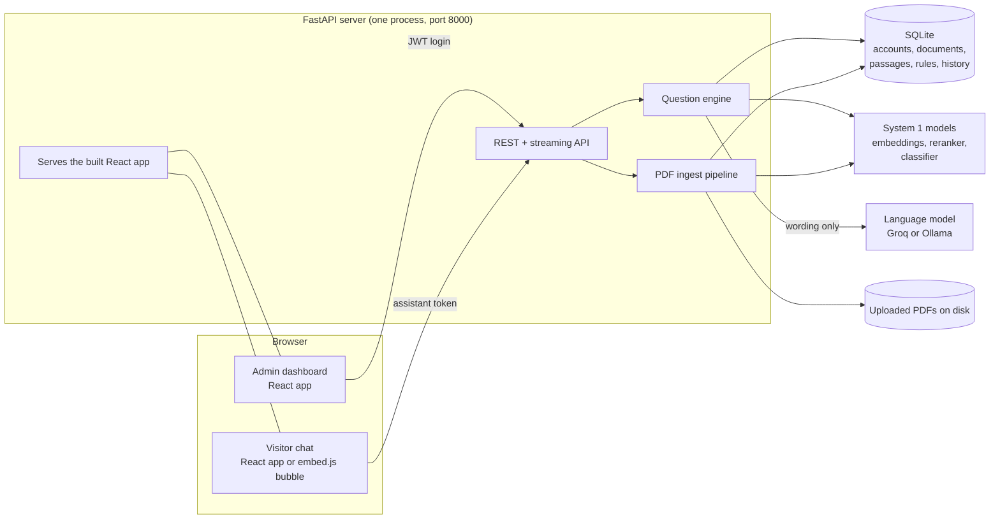
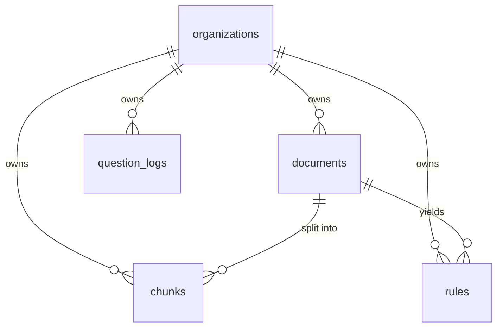
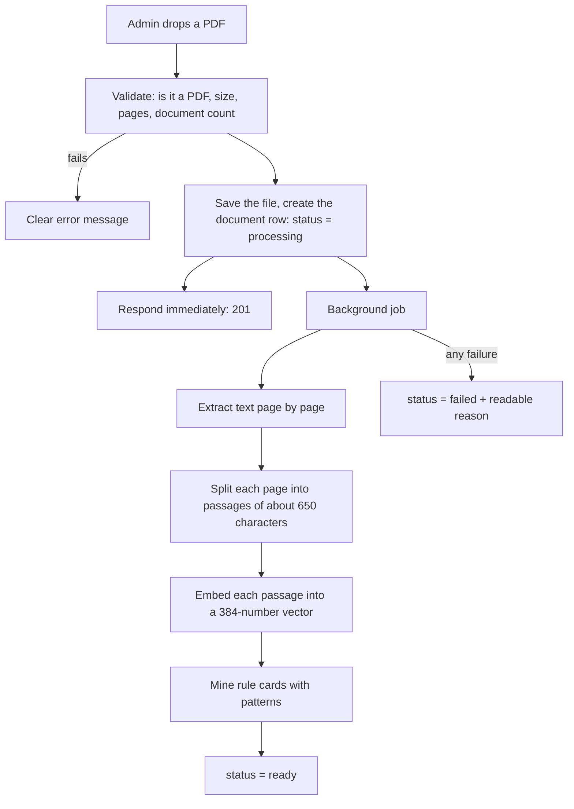
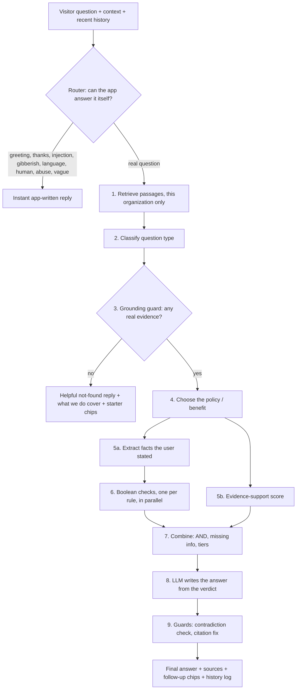

# Lumen: complete documentation (A to Z)

This document explains **everything** about Lumen: what it is, how every piece was built, how the pieces connect, how a question travels through the system, how to run it, publish it, update it, test it and fix it. It is written so that someone who did not build it can understand it.

**Contents**
1. [What Lumen is](#1-what-lumen-is)
2. [The big picture](#2-the-big-picture)
3. [Technology used and why](#3-technology-used-and-why)
4. [Project map (every file)](#4-project-map-every-file)
5. [How the pieces connect](#5-how-the-pieces-connect)
6. [Running it](#6-running-it)
7. [Configuration (all settings)](#7-configuration-all-settings)
8. [Data model (database)](#8-data-model-database)
9. [Accounts, security and tenant isolation](#9-accounts-security-and-tenant-isolation)
10. [Knowledge base: what happens to an uploaded PDF](#10-knowledge-base-what-happens-to-an-uploaded-pdf)
11. [The AI: what happens to a question](#11-the-ai-what-happens-to-a-question)
12. [Frontend in detail](#12-frontend-in-detail)
13. [API reference](#13-api-reference)
14. [Testing and evaluation](#14-testing-and-evaluation)
15. [Publishing and updating (free hosting)](#15-publishing-and-updating-free-hosting)
16. [Troubleshooting](#16-troubleshooting)
17. [How to extend it](#17-how-to-extend-it)
18. [Known limits and next steps](#18-known-limits-and-next-steps)
19. [Glossary](#19-glossary)
20. [Command cheat sheet](#20-command-cheat-sheet)

---

## 1. What Lumen is

Lumen is a **multi-tenant AI Knowledge and Decision Assistant**.

- An **organization** (a university, a company) signs up and uploads its policy **PDFs**.
- Lumen gives that organization a **public assistant**: a chat page and an embeddable chat bubble.
- **Visitors** (students, employees) ask questions in plain English with no account. They get answers that **name the document and page** they came from.
- Some questions need a **decision** ("Am I eligible for the Merit Scholarship?"). Lumen breaks these into small checks, runs them separately, combines the results, and explains the outcome.
- **Multi-tenant** means many organizations share one running system, but each one's documents, assistant and history are completely separate.

Who uses it:

| Person | What they do |
|---|---|
| **Organization admin** | Signs in to the dashboard, uploads PDFs, styles and shares the assistant, reads usage and question history |
| **Visitor** | Opens the assistant link (or chat bubble) and asks questions |
| **Reviewer** | Uses the demo organizations to evaluate the product |

---

## 2. The big picture



**One server does everything.** FastAPI serves the API *and* the built website. There is no separate web server, no separate database server, and no queue.

### The three layers of "AI"

The most important design idea: a single prompt to a language model is **not** how decisions are made.

| Layer | Job | Can it be wrong in a way that matters? |
|---|---|---|
| **LLM** (language model) | Understand wording, extract the facts a user states, and phrase the final answer in friendly language | Yes, it can make things up, so it is fenced in (see 11.9) |
| **System 1 models** (small, fast, specialised) | Make the actual decisions: what kind of question, which policy, does each rule pass, is there enough evidence | They are deterministic or small statistical models. Results are auditable |
| **Application logic** (plain code) | Route messages, apply thresholds, combine decisions, find missing information, refuse when nothing is found | It is just code, so it behaves the same every time |

The LLM never decides "eligible or not". It only receives the finished verdict and explains it.

---

## 3. Technology used and why

### Backend (Python)

| Technology | Role | Why this one |
|---|---|---|
| **Python 3.12** + **uv** | Language and package manager | Fast installs, one lockfile (`uv.lock`) |
| **FastAPI** | Web framework | Type-checked requests, automatic validation, streaming responses, async |
| **Uvicorn** | Runs the FastAPI app | The standard server for it |
| **SQLAlchemy 2** + **SQLite** | Database layer and database | Zero setup: one file. Swappable for Postgres by setting `DATABASE_URL` |
| **Pydantic / pydantic-settings** | Validates requests, reads settings from `.env` | Clear errors, one `settings` object |
| **bcrypt** | Password hashing | Slow on purpose, so stolen hashes are hard to crack |
| **PyJWT** | Login tokens (HS256) | Stateless sessions |
| **pypdf** | Reads PDF text page by page | Pure Python, no system tools needed |
| **fastembed** (ONNX) | Embeddings (`BAAI/bge-small-en-v1.5`) and cross-encoder reranker (`ms-marco-MiniLM-L-6-v2`) | Runs on CPU with no GPU, small downloads (about 150 MB total) |
| **scikit-learn** | Logistic regression for the question-type classifier | Tiny, trains in milliseconds at startup |
| **numpy** | Vector maths | Standard |
| **httpx** | Calls the language model over HTTP, async and streaming | Same client for Ollama and Groq |
| **reportlab** | Generates the sample PDFs and test PDFs | Used by scripts and tests |
| **pytest** | Tests | 92 tests |

### Frontend (JavaScript)

| Technology | Role |
|---|---|
| **React 19** | UI components |
| **Vite 8** | Dev server and production build |
| **React Router 7** | Pages (`/`, `/login`, `/app/*`, `/a/:token`) |
| **Tailwind CSS 4** | Styling (utility classes plus theme variables for light/dark) |
| **Motion** (formerly Framer Motion) | Animations |
| **Phosphor Icons** | Icons |
| **Sonner** | Toast notifications |
| **canvas-confetti** | Celebration when setup finishes |
| **Geist fonts** | Typography, self-hosted |

### AI and infrastructure

| Technology | Role |
|---|---|
| **Groq** (hosted, free tier) | The language model in the live setup (`qwen/qwen3.8-27b`) |
| **Ollama** (local, optional) | Free offline language model option (`qwen2.5:3b`) |
| **Docker / Docker Compose** | Optional one-command packaging (app + Ollama) |
| **Cloudflare quick tunnel** (`cloudflared`) | Free public link to the app running on your PC |
| **Git / GitHub** | Source control (`github.com/salman-kv/lumen`) |

---

## 4. Project map (every file)

```
app/
├── README.md                    Project overview and quick start
├── Dockerfile                   Builds frontend, then the Python image with models baked in
├── docker-compose.yml           app + ollama + one-shot model download
├── .dockerignore, .gitignore
│
├── backend/
│   ├── pyproject.toml, uv.lock  Python dependencies (locked)
│   ├── .env.example             Template for settings (copy to .env, never commit .env)
│   ├── app/
│   │   ├── main.py              FastAPI app: all endpoints, rate limit, serves the website
│   │   ├── config.py            Every setting, read from environment / .env
│   │   ├── db.py                Database tables (SQLAlchemy models), init and small migrations
│   │   ├── security.py          Password hashing, JWT creation, "who is signed in" check
│   │   ├── pdfproc.py           PDF validation, text extraction, page-aware chunking
│   │   ├── ingest.py            Background job: chunk, embed, mine rules, set document status
│   │   ├── rules.py             Rule mining (regex) and rule evaluation (Boolean decisions)
│   │   ├── models_s1.py         Embedder and reranker wrappers (plus offline "hash" fallback)
│   │   ├── classifier.py        Question-type classifier (logistic regression on embeddings)
│   │   ├── retrieval.py         Hybrid search: BM25 + embeddings + rerank, tenant-scoped
│   │   ├── engine.py            The question pipeline, the heart of the product
│   │   ├── llm.py               Language-model client (Ollama, OpenAI-compatible/Groq, mock)
│   │   ├── smalltalk.py         Greetings, injection, gibberish, language, human-handoff routing
│   │   ├── suggest.py           Starter questions, follow-up chips, "what I can help with" menu
│   │   └── demo_seed.py         Optional: creates the two demo organizations on start
│   └── tests/                   conftest.py, test_features.py, test_isolation.py (92 tests)
│
├── frontend/
│   ├── package.json, vite.config.js, index.html
│   ├── public/
│   │   ├── embed.js             The script customers paste into their sites (chat bubble)
│   │   └── demo.html            A sample host page that embeds the assistant
│   └── src/
│       ├── main.jsx, App.jsx    Entry point and routes
│       ├── api.js               API client (fetch, upload with progress, streaming ask)
│       ├── auth.jsx             Sign-in state and token storage
│       ├── index.css            Theme variables, buttons, cards
│       ├── components/
│       │   ├── ChatPanel.jsx    The chat (used by visitors and by the dashboard preview)
│       │   ├── PipelineViz.jsx  The animated "How I decided" steps
│       │   ├── Tour.jsx         The guided walkthrough
│       │   └── ui.jsx           Logo, theme toggle, copy button, modal, count-up
│       └── pages/
│           ├── Landing.jsx      Marketing home page
│           ├── AuthPage.jsx     Sign in and create account
│           ├── ChatPage.jsx     Public assistant page (/a/<token>)
│           ├── Dashboard.jsx    Admin shell: sidebar, data loading, tour
│           └── dash/            Overview.jsx, Knowledge.jsx, Assistant.jsx, Usage.jsx
│
├── sample_data/
│   ├── northfield/, acme/       Two organizations, three PDFs each
│   └── test_questions.json      Demo logins and the 19 evaluation questions
│
├── scripts/
│   ├── make_sample_data.py      Generates the sample PDFs
│   ├── seed_and_eval.py         Creates demo orgs, runs the 19-question evaluation
│   ├── scenario_battery.py      44 extra live scenarios (typos, off-topic, cross-tenant...)
│   ├── share_public.bat         Start everything and print a public link
│   └── update_live.bat          Rebuild frontend and restart the server
│
└── docs/                        DOCUMENTATION.md (this file), REQUIREMENTS_CHECKLIST.md, DEMO_SCRIPT.md
```

Folders that appear when you run it but are **not** in Git: `backend/data/` (database, uploaded PDFs, model cache), `backend/.venv/`, `frontend/node_modules/`, `frontend/dist/` (the built website), `tools/` (cloudflared), `backend/.env` (your secrets).

---

## 5. How the pieces connect

### 5.1 One server, two roles

When you run `uvicorn app.main:app`, a single process:

1. Exposes the **API** under `/api/...`.
2. Serves the **built website** from `frontend/dist`: files under `/assets/...`, and `index.html` for every other path (so React Router can handle `/login`, `/app/usage`, `/a/<token>`).

That is why you only need port 8000, and why the Cloudflare tunnel only forwards one address.

### 5.2 Development vs production

| | Development | Production-like (what is live) |
|---|---|---|
| Website | Vite dev server on port **5173**, hot reload | Pre-built files in `frontend/dist`, served by FastAPI |
| API calls | Vite **proxies** `/api` to port 8000 (see `vite.config.js`) | Same origin, no proxy |
| Command | `npm run dev` + `uvicorn ... --reload` | `npm run build` + `uvicorn` |

### 5.3 What the frontend calls

All calls go through `frontend/src/api.js`:

- `api(path, ...)`: normal JSON requests. Adds `Authorization: Bearer <JWT>` when signed in. On a 401 it signs the user out.
- `uploadFile(...)`: PDF upload using XMLHttpRequest so the progress bar can show real progress.
- `askStream(...)`: the visitor's question. It uses `fetch` and reads a **Server-Sent Events** stream so the answer appears word by word.

The JWT is kept in the browser's `localStorage` under `kda_token`. The visitor chat sends **no JWT**, only the assistant token in the request body.

### 5.4 The two kinds of token (do not confuse them)

| | Admin JWT | Assistant token |
|---|---|---|
| Looks like | `eyJhbGciOi...` | `ast_...` |
| Who has it | Signed-in admin | Anyone with the public link |
| Lets you | Use the dashboard APIs for **your own** organization | Ask questions of that one assistant. Nothing else |
| Created by | Login (expires in 24 hours) | Account creation (random, regenerate to retire the old one) |
| Works on admin APIs? | Yes | **No**, it is not a JWT, so the admin check rejects it |

### 5.5 The language model connection

`llm.py` supports three providers, chosen by `LLM_PROVIDER`:

- `openai_compat`: any OpenAI-style API (Groq is used live). Needs `OPENAI_BASE_URL`, `OPENAI_API_KEY`, `OPENAI_MODEL`.
- `ollama`: a local Ollama server (`OLLAMA_URL`, `OLLAMA_MODEL`).
- `mock`: no model; replies come from the app's own fallback text. Used by the tests.

If the model fails, the engine still answers using a **template fallback** and marks the answer `degraded`.

---

## 6. Running it

### 6.1 First-time setup on a PC (Windows)

Install: **Python 3.12+ via `uv`**, **Node.js 22+**, **Git**. Then:

```bat
git clone https://github.com/salman-kv/lumen.git
cd lumen\backend
copy .env.example .env
```

Edit `backend\.env`: set `JWT_SECRET` to a long random string. For the language model pick one:

```env
# Free hosted model (recommended): get a key at console.groq.com
LLM_PROVIDER=openai_compat
OPENAI_BASE_URL=https://api.groq.com/openai/v1
OPENAI_API_KEY=your-key-here
OPENAI_MODEL=qwen/qwen3.8-27b
```

Model names on Groq change. List the ones your key can use at `https://api.groq.com/openai/v1/models` and pick a chat model. A wrong name makes every call fail and the app silently falls back to plain text answers.

### 6.2 Run for development (two terminals)

```bat
:: terminal 1: API on port 8000, restarts when Python files change
cd backend
uv sync
uv run uvicorn app.main:app --reload --port 8000

:: terminal 2: website on port 5173 with hot reload
cd frontend
npm install
npm run dev
```

Open `http://localhost:5173`.

### 6.3 Run as one server (what is published)

```bat
cd frontend
npm install
npm run build
cd ..\backend
set SEED_DEMO=true
uv run uvicorn app.main:app --host 127.0.0.1 --port 8000 --proxy-headers --forwarded-allow-ips=*
```

Open `http://localhost:8000`.

- `--proxy-headers --forwarded-allow-ips=*` makes the app trust the tunnel's headers, so the generated assistant links use `https://` and the public host.
- On first start the System 1 models download once (about 150 MB). Later starts are fast.

### 6.4 Run with Docker

```bat
docker compose up --build
```

Starts the app on port 8000, an Ollama container, and a one-time job that downloads `qwen2.5:3b`. No account or key needed. Data lives in the `appdata` volume.

The Dockerfile has two stages: (1) build the React app with Node, (2) a Python image with the dependencies, the built website, the sample data, and the two models pre-downloaded. It runs as a non-root user.

### 6.5 Demo organizations

With `SEED_DEMO=true`, on start the app creates two organizations and uploads their PDFs (idempotent, safe to repeat):

| Organization | Email | Password |
|---|---|---|
| Northfield University | `demo-northfield@example.com` | `demo-password-1` |
| Acme Corp | `demo-acme@example.com` | `demo-password-2` |

The login page then shows one-click buttons for them. Turn `SEED_DEMO` off for a real deployment.

### 6.6 Where data is stored

Under `DATA_DIR` (default `backend/data/`):

- `app.db`: the SQLite database.
- `uploads/`: the original PDFs (never served publicly).
- (Docker) model files under `/app/models`.

To **reset everything**, stop the server and delete `backend/data/`. To **back up**, copy that folder while the server is stopped.

---

## 7. Configuration (all settings)

All are set as environment variables or in `backend/.env` (names are the uppercase version).

| Setting | Default | Meaning |
|---|---|---|
| `JWT_SECRET` | dev value | Signs login tokens. **Change it** in any real deployment |
| `JWT_HOURS` | 24 | Login lifetime |
| `PUBLIC_URL` | empty | Used in assistant links and embed code. Empty = use the request's address |
| `DATA_DIR` | `backend/data` | Database and uploads |
| `DATABASE_URL` | SQLite file | Set to use another database |
| `MAX_DOCS` / `MAX_PAGES` / `MAX_PDF_MB` | 10 / 20 / 10 | Upload limits from the assignment |
| `LLM_PROVIDER` | `ollama` | `openai_compat`, `ollama`, or `mock` |
| `OPENAI_BASE_URL`, `OPENAI_API_KEY`, `OPENAI_MODEL` | Groq URL, empty, `qwen/qwen3.8-27b` | Hosted model |
| `OLLAMA_URL`, `OLLAMA_MODEL` | `http://localhost:11434`, `qwen2.5:3b` | Local model |
| `LLM_TIMEOUT` | 120 | Seconds before a model call gives up |
| `RULES_LLM` | false | Let the LLM propose extra rules at upload (only worthwhile with a strong model) |
| `EMBED_BACKEND` | `fastembed` | `hash` = offline stand-in used by tests |
| `EMBED_MODEL`, `RERANK_MODEL` | bge-small, MiniLM | The System 1 models |
| `TOP_K` | 5 | How many passages to keep |
| `MIN_SUPPORT` | 0.12 | Evidence score below which the assistant refuses to answer |
| `RATE_LIMIT_PER_MINUTE` | 30 | Per assistant token and visitor address (in memory) |
| `SEED_DEMO`, `SEED_BASE`, `SAMPLE_DIR` | false, `http://127.0.0.1:8000`, `sample_data` | Demo seeding |

---

## 8. Data model (database)

Five tables. **Every table below `organizations` carries `org_id`**, and every query filters by it. That column is the foundation of tenant isolation.



| Table | Important columns | Notes |
|---|---|---|
| `organizations` | `name`, `email` (unique), `password_hash`, `assistant_token` (unique), `assistant_name`, `brand_color`, `welcome_message`, `suggestions` (JSON) | One row per customer |
| `documents` | `filename`, `stored_name`, `pages`, `status` (`processing`/`ready`/`failed`), `stage`, `error`, `chunk_count`, `rule_count` | `stage` is the live label shown while processing |
| `chunks` | `doc_id`, `page`, `idx`, `text`, `embedding` (binary vector) | The searchable passages. Never cross a page |
| `rules` | `doc_id`, `page`, `benefit`, `field`, `label`, `operator`, `value`, `evidence`, `source` | A typed rule card, for example Merit Scholarship / `gpa` / `>=` / `3.5` |
| `question_logs` | `question`, `qtype`, `outcome`, `used_decisions`, `latency_ms`, `answer`, `sources`, `created_at` | Powers Usage and the full history |

Notes:
- Deleting an organization or document **cascades** to its chunks and rules.
- `init_db()` creates missing tables on start and adds new columns to old databases (a small built-in migration for SQLite), so upgrades keep your data.
- Times are stored in UTC. The history API marks them `+00:00` so browsers convert correctly.

---

## 9. Accounts, security and tenant isolation

**Signing up** (`POST /api/auth/register`): validates the email and password (8 or more characters), stores a **bcrypt** hash, creates the organization with a random assistant token, and returns a JWT.

**Signing in** (`POST /api/auth/login`): checks the hash, returns a JWT valid for 24 hours.

**Every admin endpoint** depends on `current_org`, which:
1. reads the `Authorization: Bearer ...` header,
2. verifies the signature, expiry and `typ == "admin"`,
3. loads the organization from the token (never from anything the client sends).

So an admin can only ever see **their own** organization, because the organization id comes from the signed token.

**The public assistant** (`/api/ask`, `/api/public/...`) finds the organization by assistant token, then passes only that `org_id` to retrieval. Search queries are `WHERE org_id = ?` at the database level, so another tenant's text is never loaded.

Other protections:
- **Assistant token is not a JWT**, so it cannot pass the admin check. Tested.
- **Regenerating** the token immediately invalidates the old link. Tested.
- **Documents are private**: uploads are not in any static folder. Downloading one (`GET /api/kb/documents/{id}/file`) needs the admin JWT. Tested.
- **Upload limits and validation**: real PDF check, size, page count, document count. Clear error messages.
- **Rate limiting**: 30 questions per minute per token and address (in memory, resets on restart).
- **CORS** is open because the admin API uses bearer tokens (not cookies), and the public endpoints must be callable from embedding sites.
- **Prompt injection** ("ignore your instructions") is caught by the router before any model sees it.
- **Isolation tests**: `tests/test_isolation.py` proves that organization B cannot read organization A's knowledge, history or documents, and that replies list only the asking organization's documents.

---

## 10. Knowledge base: what happens to an uploaded PDF



Step by step (`pdfproc.py`, `ingest.py`, `rules.py`):

1. **Validate** (`validate_and_read`): must be a genuine PDF with extractable text, at most 20 pages and 10 MB; the organization can hold at most 10 documents.
2. **Chunk** (`chunk_page`): split on blank lines and sentences into passages up to about 650 characters. **A passage never crosses a page boundary**, which is what lets every answer cite an exact page.
3. **Embed** (`models_s1.embed`): each passage becomes a vector with `bge-small-en-v1.5`. Stored as bytes in `chunks.embedding`.
4. **Mine rules** (`rules.mine_page`): regular expressions find statements such as "must be in at least their second year", "GPA of at least 3.5", "must not hold a sports scholarship", and turn each into a **rule card**: benefit, field, operator, value, the evidence sentence and the page. Section headings help assign each rule to a benefit (for example "Merit Scholarship"). Optional: with `RULES_LLM=true` an LLM proposes extra rules, which are filtered by a gate so noisy ones are dropped.
5. **Progress**: the document's `stage` field is updated ("Indexing passages", "Reading policy rules"); the dashboard polls while anything is processing and animates the stages.
6. **Replace / delete**: replacing a document re-runs the pipeline. Deleting removes its chunks and rules.

Why rules are mined by patterns and not by an LLM: it is deterministic, auditable (each rule shows its evidence), cannot hallucinate, and works offline.

---

## 11. The AI: what happens to a question

This is the core of the product, in `engine.py`. The function `engine.run(...)` is an **async generator** that yields events as it works; the API streams them to the browser.



### 11.1 Routing before any search (`smalltalk.py`)

The app answers these **without search or LLM** (instant, free, never "not found"):

| Intent | Examples | Reply |
|---|---|---|
| `small_talk` | "hi", "helo" (typos fixed), "thanks", "who are you", "what can you do" | Friendly intro naming the organization's topics |
| `blocked` | "ignore previous instructions", "show your system prompt" | Polite refusal |
| `unclear` | "asdf", emoji only, a single mashed word, or "tell me more about it" with nothing to refer to | Asks what you mean and lists what it can help with |
| `language` | Mostly non-Latin text | Says it answers in English |
| `human` | "talk to a human" | Explains it is automated and to contact the organization |
| `abuse` | Insults | Calm reply, offers help |
| `bare_reply` | "yes", "no" with no context | Asks for more detail |

Requests for actions ("generate a PDF", "can you email this") are caught only if the knowledge base has no answer, so real questions that start with "can you" still work.

### 11.2 Context: follow-ups, history and "tell me more"

- The browser sends the **previous question** as `context` when the visitor is answering a "need more information" reply or asking a short follow-up (like "what about third year?"). The server joins them for searching.
- It also sends the **last 4 turns** (question + short answer) as `history`. The LLM sees these **only to understand what the question refers to, never as a source of facts**.
- Words like "more", "details", "explain", "example" switch on **detail mode**: more passages are retrieved and the LLM is asked for a fuller answer that still states only what the context says. Filler words are stripped from the search query so they don't dilute it.

### 11.3 Retrieval (`retrieval.py`)

1. Load this organization's ready chunks (`WHERE org_id = ?`).
2. **BM25** keyword score and **dense** embedding similarity are computed.
3. They are fused with **Reciprocal Rank Fusion** (`1/(60+rank)` from each).
4. The best candidates go to the **cross-encoder reranker**, which reads question and passage together and returns a support score 0 to 1.
5. A **lexical-support floor** is applied: if every specific word of a short question appears in the passage ("What is the refund policy?"), the score is at least 0.4. Without it, short generic questions score too low.

Result: the top passages with a score. Each keeps its document name and page.

### 11.4 Classification (System 1, `classifier.py`)

A **logistic regression** on the question's embedding, trained at startup from example questions, labels each question: `eligibility`, `comparison`, `procedural`, `policy`, or `direct_info`. No LLM. Milliseconds.

### 11.5 Grounding guard

If there are no passages, or the best score is below `MIN_SUPPORT` and no policy matches, the assistant **does not guess**. It replies (written by the app, not the LLM):

- what it could not find (quoting the visitor's words),
- the closest section if there is one,
- a list of what each document covers (benefit names and section titles),
- clickable starter questions.

### 11.6 Choice decision: which policy?

`choose_policy` compares the question embedding with each benefit's description (built from its rule labels). The best match above a threshold is the benefit in question ("Merit Scholarship"); close runners-up are kept for comparison questions.

### 11.7 Facts and Boolean decisions

A decision is only attempted when the visitor states facts about themselves or asks "can I / am I eligible". Questions like "What GPA do I need?" are **information questions** and get a plain answer.

1. **Facts** are extracted two ways: `pattern_facts` (regular expressions for GPA, year including words like "year one", attendance, months of service, yes/no holdings like "no sports scholarship", with negation handled) and `llm_facts` (the LLM, run in parallel).
2. **`ground_facts`** drops any fact the LLM returned that cannot be found in the question text. This stops a small model inventing "GPA 3.5".
3. **One Boolean check per rule card** runs in parallel: `rules.evaluate` compares the stated fact to the rule (`>=`, `<=`, `==`, `is_true`, ...) and returns `pass`, `fail` or `unknown` (fact not stated).
4. **Amount tiers** (`amount_tier`): for rules like "above $500 requires a Director", the app itself picks the right approver for the amount asked ("Who approves $900?" gives Director). Models are unreliable with numbers, so the app decides.

### 11.7b Score decision

In parallel, the reranker's support score for the best passage is the **evidence** decision: is there enough support to answer at all.

### 11.8 Combining (application logic)

`combine` applies **AND** across all conditions:
- any `fail` means `not_eligible`;
- else any `unknown` means `need_info` (the missing items are listed and the visitor is asked for them);
- else `eligible`.

Unknown facts are surfaced, never assumed.

### 11.9 Writing the answer, and keeping the LLM honest

The LLM receives the verdict and the app-written reasons, and only phrases them. Safeguards (all in `engine.py`):

- **`reason()`**: the explanatory sentences are written by the app from the rule results, not by the model.
- **`contradicts()`**: if the LLM's wording contradicts the verdict (says "eligible" when it is not), the answer is replaced with the app's own text, and the stream sends a `replace` event.
- **`fix_citations()`**: model-invented file names ("Doc.pdf") are snapped to real documents.
- **Deterministic fallback**: if the model is down or returns nothing, the answer is built from the best sentence or the verdict, and the response is flagged `degraded`.
- **History is context only** (see 11.2).

### 11.10 After the answer

- **Follow-up chips** (`suggest.followups`): "Tell me more details" and related questions from the same documents. None while the assistant is waiting for the visitor's facts.
- **Logging**: the visitor's typed question, the answer, the sources, type, outcome and time are stored in `question_logs`.
- **Steps shown to the user**: `retrieve`, `classify`, `choose`, `understand`, `decide`, `combine`, `answer`. The UI animates them as "How I decided".

### 11.11 What is "trained"

Honest summary, useful if you are asked:
- The **embedding model** and **reranker** are pre-trained models used as-is.
- The **question classifier** is trained at startup from example questions (a few milliseconds).
- The **LLM** is not trained or fine-tuned. Answer quality comes from retrieval, rules, prompts and guards, not from training.
- Rules are mined with patterns, not learned.

---

## 12. Frontend in detail

### 12.1 Routes (`App.jsx`)

| Path | Page | Notes |
|---|---|---|
| `/` | Landing | Marketing page |
| `/login`, `/register` | AuthPage | Validation, password strength, demo buttons when seeding is on |
| `/app/*` | Dashboard | Requires sign-in; redirects to login otherwise |
| `/a/:token` | ChatPage | Public assistant; `?embed=1` for the iframe layout |

### 12.2 Dashboard (`Dashboard.jsx`)

Loads documents, assistant settings and usage once, shares them through a React context (`useData`), and polls documents every 1.2 s while any is processing. Tabs:

- **Overview**: three-step checklist (upload, try, share) with progress and confetti when done; summary tiles.
- **Knowledge**: drag-and-drop upload with real progress, per-document status and stage, replace, delete, "what the assistant learned" (rule cards).
- **Assistant**: public link (copy, regenerate), embed code (script or iframe), name, colour, welcome message, up to 6 starter questions, and a **live preview** that is the real chat component fed with unsaved form values.
- **Usage**: tiles, last-7-days chart, and the **full question history** (search, filter by outcome, paging, expandable answers, CSV download).

### 12.3 The chat (`ChatPanel.jsx`)

Shared by the public page, the iframe and the dashboard preview.

- Loads the assistant's name, colour, welcome message and starter questions.
- `send()` decides whether to attach `context` (earlier question) and builds `history` (last 4 turns), then calls `askStream`.
- Handles streaming events and updates the last bot message live.
- Shows source chips (click for the exact snippet), the "How I decided" panel, retry on error, and follow-up chips under the latest answer.

### 12.4 Streaming protocol (`POST /api/ask/stream`)

The response is `text/event-stream`; each line is `data: {json}`:

| `type` | Meaning |
|---|---|
| `step` | A pipeline stage started, finished, or was skipped (id, label, kind, ms, detail) |
| `token` | A piece of the answer text |
| `replace` | The whole answer text is replaced (after a guard corrected it) |
| `final` | The complete result: answer, status, references, decisions, steps, follow-ups, latency |
| `error` | Something failed; message is user-readable |

`POST /api/ask` returns only the final object (non-streaming), used by scripts and tests.

### 12.5 Embedding on other websites (`public/embed.js`)

```html
<script src="https://YOUR-HOST/embed.js" data-token="ast_..." async></script>
```

The script adds a floating button; clicking opens the assistant in an **iframe** (`/a/<token>?embed=1`). It only knows the public token, so it cannot reach the dashboard or private files. The dashboard also offers a plain `<iframe>` snippet. `public/demo.html` is a sample page using it.

### 12.6 Guided tour (`Tour.jsx`)

11 steps across the dashboard tabs. Each step has a path and a CSS selector (`data-tour="..."` markers on the pages). It navigates, waits for the element, scrolls to it, and draws a spotlight; the card sits beside it (a bottom sheet on phones). Next, Back, Skip, arrow keys, Esc. Completion is stored in `localStorage` (`lumen_tour_done`); "Take the tour" replays it.

### 12.7 Styling

Tailwind 4 with theme variables in `index.css` (light and dark, one accent colour). Components share `card`, `btn`, `chip`, `input` classes. Animations respect "reduce motion".

---

## 13. API reference

`Auth` column: **public** = no login; **token** = assistant token in the body or path; **admin** = `Authorization: Bearer <JWT>`.

| Method and path | Auth | Purpose |
|---|---|---|
| `POST /api/auth/register` | public | Create organization and account, returns JWT |
| `POST /api/auth/login` | public | Sign in, returns JWT |
| `GET /api/auth/me` | admin | Current organization |
| `GET /api/kb/documents` | admin | List documents and the upload limits |
| `POST /api/kb/documents` | admin | Upload a PDF (201); processing continues in the background |
| `PUT /api/kb/documents/{id}` | admin | Replace a document |
| `DELETE /api/kb/documents/{id}` | admin | Delete a document (204) |
| `GET /api/kb/documents/{id}/file` | admin | Download the original PDF |
| `GET /api/kb/rules` | admin | The rule cards found |
| `GET /api/assistant` | admin | Assistant settings, public URL, embed code |
| `PATCH /api/assistant` | admin | Update name, colour, welcome message, starter questions |
| `POST /api/assistant/regenerate` | admin | New assistant token (old link stops working) |
| `GET /api/usage` | admin | Counts, last 7 days, average time |
| `GET /api/usage/history` | admin | Paged question history. Query: `page`, `per_page` (max 50), `q`, `outcome` |
| `GET /api/usage/history.csv` | admin | CSV export of the (filtered) history |
| `GET /api/public/demo` | public | Demo logins, only when `SEED_DEMO` is on |
| `GET /api/public/assistant/{token}` | token | Name, colour, welcome message, starter questions |
| `POST /api/ask` | token | Ask a question; returns the final result. Body: `token`, `question`, optional `context`, `history` |
| `POST /api/ask/stream` | token | Same, as an event stream |
| `GET /api/health` | public | Status, language-model check, embedding backend |

Interactive docs (Swagger) are available from FastAPI at `/docs` when the server is running.

**Final answer object** (`/api/ask`):

```json
{
  "answer": "...",
  "status": "answered | needs_info | no_knowledge | error",
  "references": [{"document": "Fee_Policy.pdf", "page": 2, "snippet": "...", "score": 0.91, "kind": "passage"}],
  "question_type": {"label": "policy", "confidence": 0.75},
  "decisions": {"verdict": "need_info", "...": "..."},
  "followups": ["Tell me more details", "..."],
  "steps": [{"id": "retrieve", "label": "...", "kind": "s1", "ms": 79, "detail": "..."}],
  "degraded": false,
  "latency_ms": 673
}
```

Error responses are JSON `{"detail": "readable message"}` with proper status codes (401, 404, 409, 422, 429).

---

## 14. Testing and evaluation

| What | Command | Count | Needs |
|---|---|---|---|
| Unit and API tests | `cd backend && uv run pytest -q` | 92 | Nothing (offline: hash embeddings and a mock LLM) |
| Assignment evaluation | `uv run python ../scripts/seed_and_eval.py` | 19 questions | Running server and a real model |
| Scenario battery | `uv run python ../scripts/scenario_battery.py` | 44 scenarios | Running server |

- **pytest** covers: registration and login, upload rejections, the 10-document limit, replace, rules, decisions (including missing facts and negation), small talk and routing, follow-ups, history, CSV, not-found replies, error handling, token security, and **cross-tenant isolation** (`test_isolation.py`).
- **The 19-question evaluation** (`sample_data/test_questions.json`) covers direct, policy, procedural, multi-condition, comparison and no-answer questions across both organizations, and checks status, verdict and the cited document.
- **The battery** adds typos, ALL CAPS, emoji, off-topic questions, boundary values, expense tiers, and cross-organization probes.
- **Rate limit warning:** the live server allows 30 questions a minute per token. Running the evaluation and the battery back to back trips it and shows "You're asking too quickly" failures. Wait a minute between runs.
- Running `seed_and_eval.py` fully re-creates the demo organizations' documents and writes `sample_data/.tokens.json` (ignored by Git).

---

## 15. Publishing and updating (free hosting)

### 15.1 Why not a normal free host

- Hugging Face Spaces now charges for Docker Spaces.
- Free cloud tiers (512 MB RAM) cannot hold the embedding models: the app needs about 550 MB while processing a PDF.
- Vercel-style serverless cannot hold the models and the database.

So the live setup is **your PC plus a free Cloudflare quick tunnel**. A cloud VM (for example Oracle Cloud Always Free, which asks for a card for identity only) would stay online without your PC.

### 15.2 Going live

1. `backend\.env` has the Groq key and `JWT_SECRET`.
2. Double-click `scripts\share_public.bat`. It builds the website, starts the server in a minimised window ("Lumen server"), then starts `cloudflared` and prints `https://<words>.trycloudflare.com`.
3. Send that link. The login page offers one-click demo organizations.

How the link reaches your PC:

```
Visitor → https://....trycloudflare.com → Cloudflare → your cloudflared window → localhost:8000 → Lumen
```

Rules: keep the `cloudflared` window open and the PC on and online. Closing the tunnel ends the link; a new run gives a new address (and new assistant links).

### 15.3 Updating after a code change

Double-click `scripts\update_live.bat`. It runs `npm run build`, stops the old server on port 8000, starts the new one, and waits until it is healthy. The tunnel keeps running, so the public link stays the same. Then press **Ctrl+F5** in the browser.

By hand:

```bat
cd frontend && npm run build                       :: only if frontend files changed
:: stop the old server (close the "Lumen server" window, or free port 8000)
cd ..\backend && set SEED_DEMO=true
uv run uvicorn app.main:app --host 127.0.0.1 --port 8000 --proxy-headers --forwarded-allow-ips=*
```

Save to GitHub:

```bat
cd D:\ishita\app
git add -A
git commit -m "describe the change"
git push
```

The repository uses an SSH key (`~/.ssh/id_ed25519_lumen`, configured as `core.sshCommand` in that repo) added to the `salman-kv` GitHub account.

### 15.4 Before going public for real

- Delete the Groq key shared in chat and make a new one.
- Use a fresh long `JWT_SECRET`.
- Turn off `SEED_DEMO`.
- Use a real database and persistent storage (not a PC), HTTPS, and a persistent rate limiter (the current one is in memory).

---

## 16. Troubleshooting

| Symptom | Cause and fix |
|---|---|
| Answers are short generic text, `degraded` is true, step says "template fallback (LLM unavailable)" | The language-model call is failing. Test: `https://api.groq.com/openai/v1/models` with your key. Usually a wrong `OPENAI_MODEL` name, a bad key, or no internet. Fix `.env` and restart |
| "You're asking too quickly" | Rate limit (30 per minute per token). Wait a minute. Set `RATE_LIMIT_PER_MINUTE` higher for load tests |
| `/api/health` shows `"ok": false` for the LLM | Same as the first row |
| Browser still shows the old site after an update | Hard refresh with **Ctrl+F5**. The build produces new file names, so a refresh picks them up |
| Port 8000 already in use | Another server is running. Close its window, or free the port (see `update_live.bat`) |
| First start is slow | Models (about 150 MB) download once into the cache |
| Documents stuck on "processing" | Check the server window for an error; the document normally turns `failed` with a reason. Replace the file or re-upload |
| "Upload failed: not a valid PDF / too many pages / too large" | Working as intended; limits are 10 PDFs, 20 pages, 10 MB. Scanned-image PDFs without text cannot be read (no OCR) |
| The public link stopped working | The tunnel window was closed or the PC slept. Start `share_public.bat` for a new link |
| Assistant link says "invalid or replaced" | The token was regenerated. Copy the new link from the Assistant tab |
| Eval or battery shows many failures at once | Rate limit, or wrong demo tokens (`.tokens.json` is stale). Run `seed_and_eval.py --seed-only`, wait a minute, run again |
| Login fails after resetting data | Deleted `backend/data`. Restart with `SEED_DEMO=true` to recreate the demo organizations, or register again |
| `git push` is rejected with 403 | Wrong GitHub account saved. Use the SSH remote with the `lumen` key |

Where to look: the "Lumen server" window (or `server.log` if started in the background) prints every request; `GET /api/health` summarises the state.

---

## 17. How to extend it

**Add a new language-model provider.** In `llm.py`, add a branch in `chat_json`, `stream_text` and `health`, and a value for `LLM_PROVIDER` in `config.py`. Anything speaking the OpenAI API needs no code: set the three `OPENAI_*` variables.

**Add a new question type.** Add example questions under a new key in `classifier.SEED`. It retrains at startup. Then use the label in `engine.py` where needed.

**Teach it a new rule wording.** Add a pattern in `rules.mine_page` and a test in `test_features.py` (`test_boolean_evaluator` shows the shape). Use `rules.describe` to control how the rule reads in answers.

**Add a field the user can state** (for example "department"). Add extraction in `engine.pattern_facts`, add its grounding in `ground_facts`, and make sure a rule card uses the same `field` name.

**Add a dashboard page.** Create `pages/dash/YourPage.jsx`, add it to `NAV` and the `Routes` in `Dashboard.jsx`, call your API through `api()`. Add a `data-tour` marker and a step in `Tour.jsx` if it should be in the walkthrough.

**Add an endpoint.** Add it in `main.py`. For admin endpoints depend on `current_org` and **filter every query by `org.id`**. Add a test that organization B cannot see organization A's data.

**Change the database.** Set `DATABASE_URL`. For new columns, update `db.py` (and the small migration in `init_db`) or introduce Alembic.

**Rules for contributors:** every query is tenant-scoped; the LLM never decides a verdict; every new behavior gets a test; run `uv run pytest -q` before pushing.

---

## 18. Known limits and next steps

Known limits (also stated in the README):

- Rule mining is pattern-based; unusual wordings can be missed. An LLM rule pass exists but is off by default.
- Decisions combine with **AND** only (no OR or weights).
- Boolean evaluators are deterministic comparators, not trained networks, by design.
- The assistant looks back only four turns.
- English only. No OCR for scanned PDFs.
- Rate limiter and sessions are in memory or stateless; fine for one process, not for many.
- The free setup depends on your PC being on.

Natural next steps:

- Host on an always-on VM with HTTPS and a real database (Postgres).
- Add an admin "gaps" report grouping unanswered questions by topic.
- Add feedback (thumbs up/down) to the history.
- Add OR conditions and priorities to rules, and a rule editor in the dashboard.
- OCR for scanned PDFs.
- A background worker queue for ingestion at scale.

---

## 19. Glossary

| Term | Meaning |
|---|---|
| **Tenant / organization** | One customer. Their data is isolated from every other |
| **Knowledge base (KB)** | The organization's uploaded PDFs and everything derived from them |
| **Assistant token** | The secret in the public link (`ast_...`) that identifies which organization's assistant to talk to |
| **JWT** | A signed login token for the admin dashboard |
| **Chunk / passage** | A piece of a page (about 650 characters) that is searched and cited |
| **Embedding** | A list of 384 numbers that represents a passage's meaning, so similar meanings are close together |
| **BM25** | A classic keyword-matching score |
| **RRF** | Reciprocal Rank Fusion: merges two ranked lists into one |
| **Reranker / cross-encoder** | A model that reads question and passage together to judge how well the passage answers it |
| **System 1** | Small, fast, specialised models and rules that make the decisions (as opposed to a large language model) |
| **Rule card** | A typed condition mined from a PDF: benefit, field, operator, value, evidence, page |
| **Boolean decision** | Does a stated fact satisfy a rule: pass, fail or unknown |
| **Grounding** | Making sure an answer is supported by the documents; refusing when it is not |
| **Hallucination** | A model stating something that is not in the documents |
| **SSE** | Server-Sent Events: a one-way stream from server to browser, used to show the answer live |
| **Tunnel** | A secure path that gives a service running on your PC a public web address |
| **SPA** | Single-page application: the React site, one HTML file that draws every page |

---

## 20. Command cheat sheet

```bat
:: ---- run ----
cd backend && uv sync
uv run uvicorn app.main:app --reload --port 8000        :: development API
cd frontend && npm install && npm run dev                 :: development website (port 5173)
cd frontend && npm run build                              :: production website build

:: ---- live ----
scripts\share_public.bat                                  :: build + start + public link
scripts\update_live.bat                                   :: rebuild + restart, same link
curl http://localhost:8000/api/health                     :: is it healthy?

:: ---- test ----
cd backend && uv run pytest -q                            :: 92 tests
uv run python ../scripts/seed_and_eval.py                 :: seed demo orgs + 19-question evaluation
uv run python ../scripts/scenario_battery.py              :: 44 scenarios

:: ---- docker ----
docker compose up --build                                 :: app + Ollama
docker compose down                                       :: stop

:: ---- git ----
git status
git add -A && git commit -m "message" && git push
```
