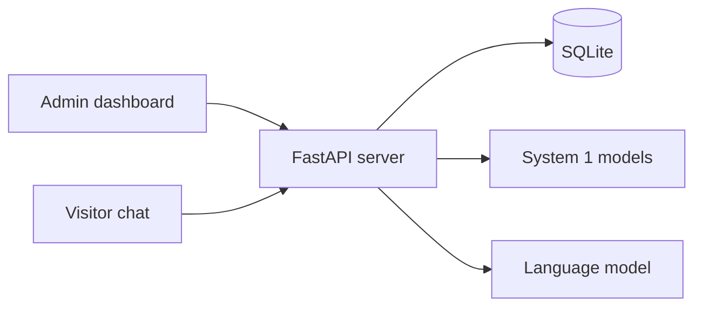
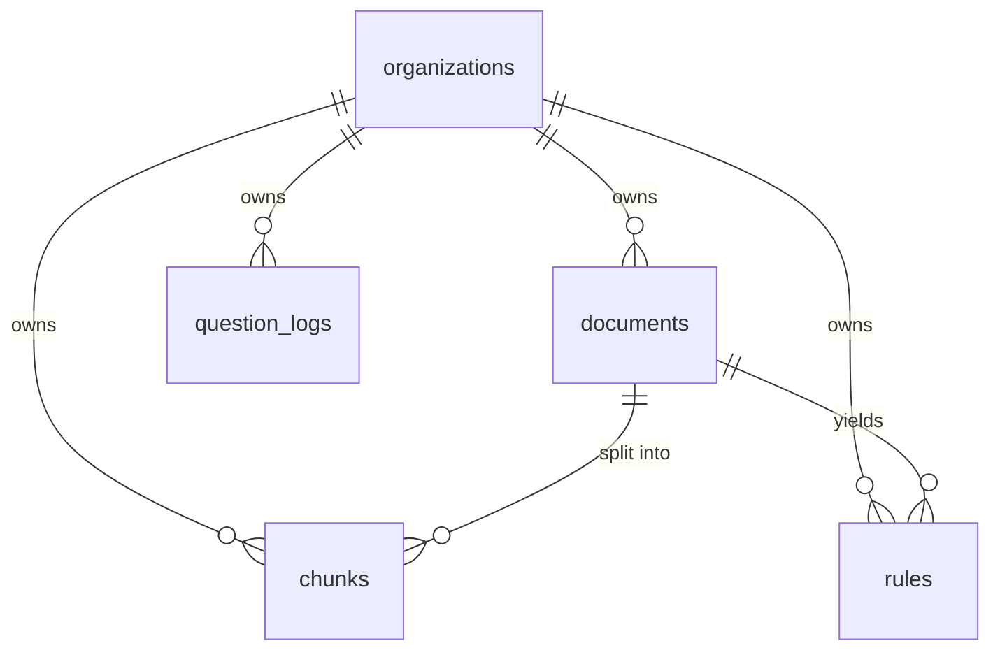
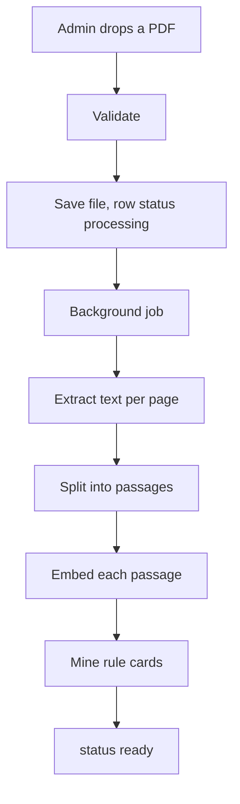
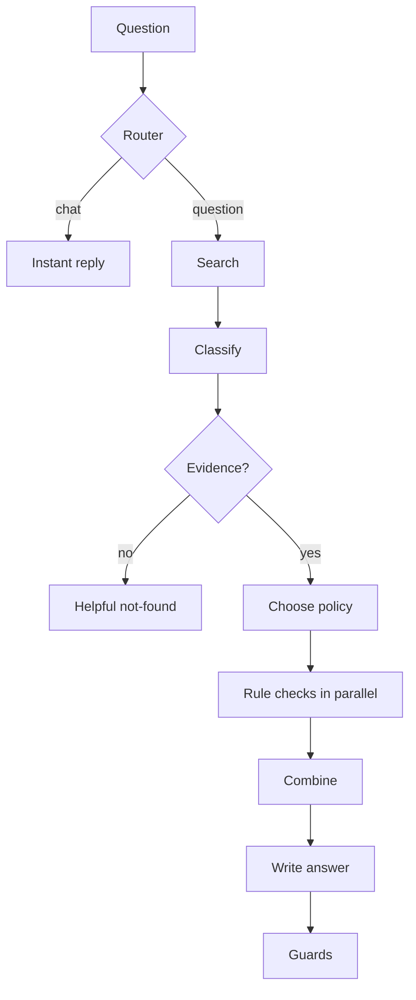

# Lumen: implementation guide (the code, the logic, the setup)

This guide shows **how Lumen is actually built**. For every feature you get the idea, the real code, and the reasoning behind it, plus the backend setup, the AI setup, how the parts connect, and how it is hosted.

All code blocks are **extracted automatically from the source files** when this document is built, so they always match the real code. Where a function is long, the block shows the important part and says so.

**How to read it:** Part 1 to 3 give the big picture and the foundations. Parts 4 to 9 follow the life of a PDF and a question through the code. Part 10 is the AI setup. Parts 11 to 14 cover the frontend, tests and hosting. Part 15 traces three complete journeys function by function.

---

## 1. System overview

Lumen is **one Python process** (FastAPI) plus a **React website** that the same process serves. The data lives in **SQLite**. Two small machine-learning models run **inside** the process (embeddings and a reranker). A **language model** is reached over HTTP (Groq online, or Ollama on the same PC).



**The three layers of intelligence**

| Layer | What it does | Where it lives |
|---|---|---|
| Language model | Understands wording, extracts stated facts, writes the final sentence | `llm.py` (called from `engine.py`) |
| System 1 (small models and rules) | Search, question type, which policy, does each rule pass, evidence score | `retrieval.py`, `models_s1.py`, `classifier.py`, `rules.py`, parts of `engine.py` |
| Application logic | Routing, thresholds, refusing, combining decisions, missing information, safety guards | `smalltalk.py`, `engine.py`, `suggest.py` |

**Design rule:** the language model never decides. It receives a finished verdict and explains it.

**The five tables:** `organizations`, `documents`, `chunks`, `rules`, `question_logs`. Every table except the first has an `org_id`.

**Two kinds of caller**

| Caller | Proves who they are with | Can reach |
|---|---|---|
| Admin (dashboard) | A signed login token (JWT) in the `Authorization` header | Only their own organization's admin endpoints |
| Visitor (chat page or widget) | A secret assistant token in the request body | Only the public question endpoints of one organization |

---

## 2. Startup and how the app is served

When the server starts, FastAPI runs the `lifespan` function once. It prepares the database and starts three background jobs: warm up the language model (Ollama only), load the machine-learning models so the first question is not slow, and create the demo organizations if demo seeding is on.

```python
@asynccontextmanager
async def lifespan(_):
    init_db()
    warm = [asyncio.create_task(llm.warmup()), asyncio.create_task(asyncio.to_thread(models_s1.warmup)),
            asyncio.create_task(demo_seed.seed_demo())]
    yield
    for t in warm:
        t.cancel()


@app.exception_handler(Exception)
async def unhandled(_, exc):
    return JSONResponse({"detail": "Something went wrong on our side. Please try again."}, status_code=500)
```

- **CORS is open** (`allow_origins=["*"]`). This is deliberate: the public endpoints must be callable from customers' own websites (the embedded widget). The admin endpoints use a bearer token in a header (not a cookie), so another site cannot make a browser send it by itself.
- **`unhandled`** is the safety net. Any unexpected error returns a friendly message with status 500 and never a stack trace.

**Serving the website.** After the API routes, the file ends by mounting the built React app. Any path that is not an API path returns `index.html`, so React Router can handle `/login`, `/app/usage` and `/a/<token>` in the browser.

```python
DIST = BASE_DIR.parent / "frontend" / "dist"
if DIST.exists():
    if (DIST / "assets").exists():
        app.mount("/assets", StaticFiles(directory=DIST / "assets"), name="assets")

    @app.get("/{path:path}", include_in_schema=False)
    def spa(path: str):
        if path.startswith("api/"):
            raise HTTPException(404, "Not found")
        f = (DIST / path).resolve()
        if path and f.is_file() and DIST.resolve() in f.parents:
            return FileResponse(f)
        return FileResponse(DIST / "index.html")
```

---

## 3. Configuration

Every setting lives in one class. Values come from environment variables or from `backend/.env`; the names are the upper-case versions of the fields.

```python
class Settings(BaseSettings):
    model_config = SettingsConfigDict(env_file=BASE_DIR / ".env", extra="ignore")

    app_name: str = "Knowledge & Decision Assistant"
    public_url: str = ""
    data_dir: Path = BASE_DIR / "data"
    database_url: str = ""
    jwt_secret: str = "dev-only-secret-change-me-in-production-0123456789"
    jwt_hours: int = 24

    # Hosted demo: create the two sample organizations on start (see demo_seed.py)
    seed_demo: bool = False
    seed_base: str = "http://127.0.0.1:8000"
    sample_dir: Path = BASE_DIR.parent / "sample_data"

    # Hard limits from the assignment
    max_docs: int = 10
    max_pages: int = 20
    max_pdf_mb: int = 10

    # LLM: ollama (free, local) | openai_compat (Groq/OpenRouter/Gemini-compat free tiers) | mock
    llm_provider: str = "ollama"
    ollama_url: str = "http://localhost:11434"
    ollama_model: str = "qwen2.5:3b"
    openai_base_url: str = "https://api.groq.com/openai/v1"
    openai_api_key: str = ""
    openai_model: str = "qwen/qwen3.8-27b"
    # tried in order when the main model is rate-limited (free tiers allow few tokens a minute per model) or unavailable
    openai_fallback_models: str = "openai/gpt-oss-20b,openai/gpt-oss-120b"
    llm_timeout: float = 120.0
    rules_llm: bool = False  # opt-in: enable with a strong model (e.g. Groq 70B); small local models over-generate
    rules_llm_max_pages: int = 6

    # System 1 models: fastembed (bge-small + MiniLM cross-encoder) | hash (offline test fallback)
    embed_backend: str = "fastembed"
    embed_model: str = "BAAI/bge-small-en-v1.5"
    rerank_model: str = "Xenova/ms-marco-MiniLM-L-6-v2"

    # Retrieval / grounding thresholds
    top_k: int = 5
    min_support: float = 0.12
    rate_limit_per_minute: int = 30

    @property
    def db_url(self) -> str:
        return self.database_url or f"sqlite:///{(self.data_dir / 'app.db').as_posix()}"

    @property
    def upload_dir(self) -> Path:
        return self.data_dir / "uploads"
```

A real `.env` for the live setup (the template shipped in the repository):

```text
# Copy to .env and adjust. Never commit the real .env.

# --- Security ---
JWT_SECRET=replace-with-a-long-random-string-at-least-32-chars
# Public origin used in the assistant URL / embed code. Leave empty to use the request's host.
PUBLIC_URL=

# --- LLM provider: ollama (free, local, default) | openai_compat (Groq/OpenRouter free tiers) | mock (no model) ---
LLM_PROVIDER=ollama
OLLAMA_URL=http://localhost:11434
OLLAMA_MODEL=qwen2.5:3b

# Optional: a free hosted model for faster, higher-quality answers (e.g. a free Groq key)
# LLM_PROVIDER=openai_compat
# OPENAI_BASE_URL=https://api.groq.com/openai/v1
# OPENAI_API_KEY=
# OPENAI_MODEL=qwen/qwen3.8-27b

# Let the LLM propose extra rule cards at upload time (gated, opt-in; best with a strong model)
RULES_LLM=false

# --- System 1 models (downloaded once on first use, about 150 MB) ---
EMBED_BACKEND=fastembed
# EMBED_BACKEND=hash   # offline fallback used by the test-suite
```

**Why this matters:** the same code runs with a local model, a hosted model, or a mock model just by changing `LLM_PROVIDER`. Nothing is hard-coded.

---

## 4. The database

Five tables. **Every table below `organizations` carries `org_id`.** That column is the whole tenant-isolation design: any query that touches tenant data filters by it.



**Connecting to the database.** SQLite is a single file. Foreign keys are off by default in SQLite, so a connection event switches them on; that makes `ON DELETE CASCADE` work (deleting a document deletes its passages and rules).

```python
connect_args = {"check_same_thread": False} if settings.db_url.startswith("sqlite") else {}
engine = create_engine(settings.db_url, connect_args=connect_args)


@event.listens_for(engine, "connect")
def _fk_on(dbapi_conn, _):
    if settings.db_url.startswith("sqlite"):
        dbapi_conn.execute("PRAGMA foreign_keys=ON")


SessionLocal = sessionmaker(bind=engine, autoflush=False, expire_on_commit=False)
```

**The tables.**

```python
def new_token() -> str:
    return "ast_" + secrets.token_urlsafe(24)


class Organization(Base):
    __tablename__ = "organizations"
    id: Mapped[int] = mapped_column(primary_key=True)
    name: Mapped[str] = mapped_column(String(120))
    email: Mapped[str] = mapped_column(String(200), unique=True, index=True)
    password_hash: Mapped[str] = mapped_column(String(200))
    assistant_token: Mapped[str] = mapped_column(String(80), unique=True, index=True, default=new_token)
    assistant_name: Mapped[str] = mapped_column(String(80), default="Assistant")
    brand_color: Mapped[str] = mapped_column(String(16), default="#6366f1")
    welcome_message: Mapped[str] = mapped_column(String(300), default="Hi! Ask me anything about our policies.")
    suggestions: Mapped[list] = mapped_column(JSON, default=list)
    created_at: Mapped[datetime] = mapped_column(DateTime(timezone=True), default=now)
    documents = relationship("Document", cascade="all, delete-orphan", back_populates="org")


class Document(Base):
    __tablename__ = "documents"
    id: Mapped[int] = mapped_column(primary_key=True)
    org_id: Mapped[int] = mapped_column(ForeignKey("organizations.id", ondelete="CASCADE"), index=True)
    filename: Mapped[str] = mapped_column(String(255))
    stored_name: Mapped[str] = mapped_column(String(80))
    pages: Mapped[int] = mapped_column(Integer, default=0)
    size_bytes: Mapped[int] = mapped_column(Integer, default=0)
    status: Mapped[str] = mapped_column(String(20), default="processing")  # processing|ready|failed
    stage: Mapped[str] = mapped_column(String(40), default="Extracting text")
    error: Mapped[str | None] = mapped_column(Text, nullable=True)
    chunk_count: Mapped[int] = mapped_column(Integer, default=0)
    rule_count: Mapped[int] = mapped_column(Integer, default=0)
    created_at: Mapped[datetime] = mapped_column(DateTime(timezone=True), default=now)
    org = relationship("Organization", back_populates="documents")


class Chunk(Base):
    __tablename__ = "chunks"
    id: Mapped[int] = mapped_column(primary_key=True)
    org_id: Mapped[int] = mapped_column(ForeignKey("organizations.id", ondelete="CASCADE"), index=True)
    doc_id: Mapped[int] = mapped_column(ForeignKey("documents.id", ondelete="CASCADE"), index=True)
    page: Mapped[int] = mapped_column(Integer)
    idx: Mapped[int] = mapped_column(Integer)
    text: Mapped[str] = mapped_column(Text)
    embedding: Mapped[bytes] = mapped_column(LargeBinary)


class Rule(Base):
    """Typed rule card extracted from policy text, evaluated deterministically at question time."""
    __tablename__ = "rules"
    id: Mapped[int] = mapped_column(primary_key=True)
    org_id: Mapped[int] = mapped_column(ForeignKey("organizations.id", ondelete="CASCADE"), index=True)
    doc_id: Mapped[int] = mapped_column(ForeignKey("documents.id", ondelete="CASCADE"), index=True)
    page: Mapped[int] = mapped_column(Integer)
    benefit: Mapped[str] = mapped_column(String(160))
    field: Mapped[str] = mapped_column(String(80))
    label: Mapped[str] = mapped_column(String(160))
    operator: Mapped[str] = mapped_column(String(16))
    value: Mapped[str] = mapped_column(String(80))
    evidence: Mapped[str] = mapped_column(Text, default="")
    source: Mapped[str] = mapped_column(String(16), default="pattern")  # pattern|llm


class QuestionLog(Base):
    __tablename__ = "question_logs"
    id: Mapped[int] = mapped_column(primary_key=True)
    org_id: Mapped[int] = mapped_column(ForeignKey("organizations.id", ondelete="CASCADE"), index=True)
    question: Mapped[str] = mapped_column(Text)
    qtype: Mapped[str] = mapped_column(String(40), default="")
    outcome: Mapped[str] = mapped_column(String(20))  # answered|needs_info|no_knowledge|error
    used_decisions: Mapped[bool] = mapped_column(Boolean, default=False)
    latency_ms: Mapped[float] = mapped_column(Float, default=0)
    answer: Mapped[str] = mapped_column(Text, default="")
    sources: Mapped[str] = mapped_column(String(400), default="")  # e.g. "Fee_Policy.pdf p.2, Leave_Policy.pdf p.1"
    created_at: Mapped[datetime] = mapped_column(DateTime(timezone=True), default=now)
```

- `Organization` is the tenant **and** its admin account (email and password hash are here). That is why there is one login per organization today.
- `Chunk.embedding` holds 384 numbers as raw bytes (`float32`, 1,536 bytes per passage).
- `Rule` is a typed rule card, for example benefit "Merit Scholarship", field `gpa`, operator `>=`, value `3.5`, with the evidence sentence and page.
- `QuestionLog` stores what the visitor typed, the answer, the sources, the type, the outcome and the time. It powers Usage and the full history.

**Creating and upgrading tables.** `init_db` creates missing tables and adds new columns to an older SQLite file, so upgrades never lose data. `get_db` gives each request its own session and always closes it.

```python
def init_db():
    Base.metadata.create_all(engine)
    # existing databases (created before answers were kept) get the new columns
    with engine.begin() as c:
        have = {r[1] for r in c.exec_driver_sql("PRAGMA table_info(question_logs)")} if engine.dialect.name == "sqlite" else None
        for col, ddl in (("answer", "TEXT DEFAULT ''"), ("sources", "VARCHAR(400) DEFAULT ''")):
            if have is not None and col not in have:
                c.exec_driver_sql(f"ALTER TABLE question_logs ADD COLUMN {col} {ddl}")


def get_db():
    db = SessionLocal()
    try:
        yield db
    finally:
        db.close()
```

**How the tenant filter looks in practice.** Listing documents:

```python
@app.get("/api/kb/documents")
def list_documents(org: Organization = Depends(current_org), db: Session = Depends(get_db)):
    docs = db.query(Document).filter(Document.org_id == org.id).order_by(Document.created_at.desc()).all()
    return {"documents": [doc_out(d) for d in docs], "limits": limits()}
```

Note that `org` comes from `Depends(current_org)`, which is built from the verified login token (see Part 5), never from anything the browser sends.

---

## 5. Authentication and security

### Passwords and login tokens

```python
def hash_password(pw: str) -> str:
    return bcrypt.hashpw(pw.encode()[:72], bcrypt.gensalt()).decode()


def verify_password(pw: str, hashed: str) -> bool:
    try:
        return bcrypt.checkpw(pw.encode()[:72], hashed.encode())
    except ValueError:
        return False


def make_jwt(org_id: int) -> str:
    exp = datetime.now(timezone.utc) + timedelta(hours=settings.jwt_hours)
    return jwt.encode({"sub": str(org_id), "typ": "admin", "exp": exp}, settings.jwt_secret, algorithm="HS256")


def current_org(authorization: str | None = Header(default=None), db: Session = Depends(get_db)) -> Organization:
    """Admin auth. Assistant tokens are NOT JWTs, so they can never pass this dependency."""
    if not authorization or not authorization.lower().startswith("bearer "):
        raise HTTPException(401, "Please sign in to continue.")
    try:
        payload = jwt.decode(authorization[7:], settings.jwt_secret, algorithms=["HS256"])
        if payload.get("typ") != "admin":
            raise ValueError
        org = db.get(Organization, int(payload["sub"]))
    except Exception:
        raise HTTPException(401, "Your session has expired. Please sign in again.")
    if not org:
        raise HTTPException(401, "Account not found.")
    return org
```

- **bcrypt** hashes the password with a random salt and is deliberately slow. (bcrypt only reads the first 72 bytes, hence the slice.)
- **`make_jwt`** signs a small JSON object with the server secret (`HS256`): the organization id (`sub`), a type (`typ: admin`) and an expiry of 24 hours.
- **`current_org`** is a FastAPI *dependency*. Any endpoint that lists it as `Depends(current_org)` is protected. It checks the header, verifies the signature and expiry, requires `typ == "admin"`, and loads the organization. The assistant token is not a JWT, so it can never pass this check.

### Sign up and sign in

```python
@app.post("/api/auth/register")
def register(body: RegisterIn, db: Session = Depends(get_db)):
    email = body.email.strip().lower()
    if not re.match(r"^[^@\s]+@[^@\s]+\.[^@\s]+$", email):
        raise HTTPException(422, "Please enter a valid email address.")
    if db.query(Organization).filter(Organization.email == email).first():
        raise HTTPException(409, "An account with this email already exists. Try signing in.")
    name = body.org_name.strip()
    org = Organization(name=name, email=email, password_hash=hash_password(body.password),
                       assistant_name=f"{name} Assistant")
    db.add(org)
    db.commit()
    return {"token": make_jwt(org.id), "org": org_out(org)}


@app.post("/api/auth/login")
def login(body: LoginIn, db: Session = Depends(get_db)):
    org = db.query(Organization).filter(Organization.email == body.email.strip().lower()).first()
    if not org or not verify_password(body.password, org.password_hash):
        raise HTTPException(401, "Incorrect email or password.")
    return {"token": make_jwt(org.id), "org": org_out(org)}
```

### The public assistant token

The secret in the public link is created with Python's `secrets` module (cryptographically strong):

```python
def new_token() -> str:
    return "ast_" + secrets.token_urlsafe(24)    # 24 random bytes = 192 bits
```

Finding the organization from that token, used by every visitor endpoint:

```python
def _org_by_token(db: Session, token: str) -> Organization:
    org = db.query(Organization).filter(Organization.assistant_token == token.strip()).first() if token else None
    if not org:
        raise HTTPException(401, "This assistant link is invalid or has been replaced. "
                                 "Please ask the organization for a new link.")
    return org
```

Regenerating the link simply writes a new token, so the old one stops matching:

```python
@app.post("/api/assistant/regenerate")
def regenerate(request: Request, org: Organization = Depends(current_org), db: Session = Depends(get_db)):
    org.assistant_token = new_token()
    db.merge(org)
    db.commit()
    return assistant_out(org, request)
```

### Rate limiting

A simple sliding window kept in memory: at most 30 questions a minute per assistant token and visitor address. (In a multi-server setup this would move to Redis.)

```python
def rate_limit(key: str):
    q, nowt = _hits[key], time.time()
    while q and q[0] < nowt - 60:
        q.popleft()
    if len(q) >= settings.rate_limit_per_minute:
        raise HTTPException(429, "You're asking too quickly. Please wait a moment and try again.")
    q.append(nowt)
```

---

## 6. The API layer

The endpoints are all in `main.py`.

| Method and path | Who | What |
|---|---|---|
| `POST /api/auth/register`, `/login`, `GET /me` | public / admin | Account and session |
| `GET/POST /api/kb/documents`, `PUT/DELETE .../{id}`, `GET .../{id}/file`, `GET /api/kb/rules` | admin | The knowledge base |
| `GET/PATCH /api/assistant`, `POST /api/assistant/regenerate` | admin | Settings, link, embed code |
| `GET /api/usage`, `/usage/history`, `/usage/history.csv` | admin | Numbers and the full history |
| `GET /api/public/assistant/{token}` | token | Name, colour, welcome, starter questions |
| `POST /api/ask`, `POST /api/ask/stream` | token | Ask a question (JSON, or a live stream) |
| `GET /api/health`, `GET /api/public/demo` | public | Status; demo logins when seeding is on |

### Uploading, replacing and deleting documents

Uploads are checked **immediately** (so errors are instant and clear), then processed **in the background**.

```python
async def _accept_upload(org: Organization, file: UploadFile, db: Session, replacing: Document | None):
    count = db.query(Document).filter(Document.org_id == org.id).count() - (1 if replacing else 0)
    if count >= settings.max_docs:
        raise HTTPException(409, f"Your knowledge base is full ({settings.max_docs} documents). "
                                 "Delete a document before uploading another.")
    data = await file.read(settings.max_pdf_mb * 1024 * 1024 + 1)
    name = (file.filename or "document.pdf").replace("\\", "/").split("/")[-1][:200]
    try:
        pages = validate_and_read(data, name)  # synchronous validation: instant, meaningful errors
    except PdfError as e:
        code = 413 if "MB" in str(e) else 422
        raise HTTPException(code, str(e))
    stored = uuid.uuid4().hex + ".pdf"
    (settings.upload_dir / stored).write_bytes(data)
    doc = Document(org_id=org.id, filename=name, stored_name=stored, pages=len(pages), size_bytes=len(data),
                   status="processing", stage="Extracting text")
    db.add(doc)
    if replacing:
        (settings.upload_dir / replacing.stored_name).unlink(missing_ok=True)
        db.delete(replacing)
    db.commit()
    return doc


@app.post("/api/kb/documents", status_code=201)
async def upload_document(background: BackgroundTasks, file: UploadFile = File(...),
                          org: Organization = Depends(current_org), db: Session = Depends(get_db)):
    doc = await _accept_upload(org, file, db, None)
    background.add_task(process_document, doc.id)
    return doc_out(doc)


@app.put("/api/kb/documents/{doc_id}")
async def replace_document(doc_id: int, background: BackgroundTasks, file: UploadFile = File(...),
                           org: Organization = Depends(current_org), db: Session = Depends(get_db)):
    old = db.query(Document).filter(Document.id == doc_id, Document.org_id == org.id).first()
    if not old:
        raise HTTPException(404, "Document not found.")
    doc = await _accept_upload(org, file, db, old)
    background.add_task(process_document, doc.id)
    return doc_out(doc)


@app.delete("/api/kb/documents/{doc_id}", status_code=204)
def delete_document(doc_id: int, org: Organization = Depends(current_org), db: Session = Depends(get_db)):
    doc = db.query(Document).filter(Document.id == doc_id, Document.org_id == org.id).first()
    if not doc:
        raise HTTPException(404, "Document not found.")
    db.query(Chunk).filter(Chunk.doc_id == doc.id).delete()
    db.query(Rule).filter(Rule.doc_id == doc.id).delete()
    (settings.upload_dir / doc.stored_name).unlink(missing_ok=True)
    db.delete(doc)
    db.commit()
```

- The file is saved under a **random name** (`uuid`), not the user's file name, and is never served publicly.
- Every lookup uses both `Document.id` and `Document.org_id`, so one organization cannot touch another's file by guessing an id.
- `background.add_task(process_document, doc.id)` runs the heavy work after the response is sent; the dashboard polls the status.

### Assistant settings and the public page

```python
def assistant_out(o: Organization, request: Request) -> dict:
    origin = base_url(request)
    url = f"{origin}/a/{o.assistant_token}"
    return {"token": o.assistant_token, "url": url, "assistant_name": o.assistant_name,
            "brand_color": o.brand_color, "welcome_message": o.welcome_message, "suggestions": o.suggestions or [],
            "embed_iframe": f'<iframe src="{url}?embed=1" title="{o.assistant_name}" width="400" height="640" '
                            f'style="border:0;border-radius:16px;box-shadow:0 8px 40px rgba(0,0,0,.18)" '
                            f'allow="clipboard-write"></iframe>',
            "embed_script": f'<script src="{origin}/embed.js" data-token="{o.assistant_token}" async></script>'}


@app.patch("/api/assistant")
def update_assistant(body: AssistantIn, request: Request, org: Organization = Depends(current_org),
                     db: Session = Depends(get_db)):
    if body.assistant_name is not None:
        org.assistant_name = body.assistant_name.strip()
    if body.brand_color is not None:
        org.brand_color = body.brand_color
    if body.welcome_message is not None:
        org.welcome_message = body.welcome_message.strip()
    if body.suggestions is not None:
        org.suggestions = [s.strip()[:140] for s in body.suggestions if s.strip()][:suggest.MAX_SUGGESTIONS]
    db.merge(org)
    db.commit()
    return assistant_out(org, request)


@app.get("/api/public/assistant/{token}")
def public_assistant(token: str, db: Session = Depends(get_db)):
    org = _org_by_token(db, token)
    return {"name": org.assistant_name, "org": org.name, "color": org.brand_color, "welcome": org.welcome_message,
            "suggestions": suggest.all_suggestions(org.id, list(org.suggestions or []))}
```

### Usage and the full history

```python
def _history_query(db: Session, org: Organization, q: str, outcome: str):
    rows = db.query(QuestionLog).filter(QuestionLog.org_id == org.id)
    if outcome == "answered":
        rows = rows.filter(QuestionLog.outcome == "answered")
    elif outcome in ("needs_info", "no_knowledge", "error"):
        rows = rows.filter(QuestionLog.outcome == outcome)
    if q.strip():
        like = "%" + q.strip().replace("\\", "\\\\").replace("%", "\\%").replace("_", "\\_") + "%"
        rows = rows.filter(QuestionLog.question.ilike(like, escape="\\") | QuestionLog.answer.ilike(like, escape="\\"))
    return rows


@app.get("/api/usage/history")
def usage_history(page: int = 1, per_page: int = 15, q: str = "", outcome: str = "all",
                  org: Organization = Depends(current_org), db: Session = Depends(get_db)):
    """Every question visitors have asked (newest first), searchable and filterable, with the answer given."""
    per_page = min(max(per_page, 1), 50)
    rows = _history_query(db, org, q[:200], outcome)
    total = rows.count()
    pages = max(1, -(-total // per_page))
    page = min(max(page, 1), pages)
    items = rows.order_by(QuestionLog.id.desc()).offset((page - 1) * per_page).limit(per_page).all()
    return {"total": total, "page": page, "pages": pages, "per_page": per_page,
            "items": [{"id": r.id, "question": r.question, "answer": r.answer or "", "sources": r.sources or "",
                       "outcome": r.outcome, "type": r.qtype, "decisions": r.used_decisions,
                       "latency_ms": round(r.latency_ms or 0), "at": _utc_iso(r.created_at)} for r in items]}
```

- The search escapes `%` and `_` so a visitor-typed or admin-typed `%` is searched literally.
- Times are stored in UTC; the API marks them as UTC so the browser shows the viewer's local time.

### Asking a question

The request model, the preparation step, and the two endpoints (plain JSON and streaming):

```python
class Turn(BaseModel):
    q: str = Field(max_length=1000)
    a: str = Field(max_length=2000)


class AskIn(BaseModel):
    token: str
    question: str
    context: str = ""  # earlier question, when the user is answering a "more information needed" reply
    history: list[Turn] = Field(default_factory=list, max_length=6)  # recent turns, so follow-ups make sense


def _prepare(body: AskIn) -> tuple[str, bool, bool]:
    """(question for the engine, detail?, simple?). "what?" / "I don't understand" / "really?" after an answer means
    "explain your last answer again, more simply", so the earlier question is asked again in simple words."""
    q = _clean_question(body.question)
    if body.history and smalltalk.CLARIFY.match(smalltalk._norm(q)):
        return body.history[-1].q, True, True
    return _with_context(body), bool(DETAIL.search(body.question)), False


def _with_context(body: AskIn) -> str:
    q = _clean_question(body.question)
    prev = (body.context or "").strip()[:1000]
    if not prev:
        return q
    # "tell me more details" adds only filler words to the search, which would dilute the earlier question
    rest = re.sub(r"\s+", " ", FILLER.sub(" ", q)).strip(" ,.?!")
    return f"{prev} {rest}" if rest else prev


@app.post("/api/ask")
async def ask(body: AskIn, request: Request, db: Session = Depends(get_db)):
    org = _org_by_token(db, body.token)
    question, detail, simple = _prepare(body)
    org_id = org.id
    db.close()
    rate_limit(f"{body.token}:{request.client.host if request.client else ''}")
    final = None
    async for ev in engine.run(org_id, question, _history(body), detail, body.question.strip(), simple):
        if ev["type"] == "final":
            final = ev["data"]
    return final


@app.post("/api/ask/stream")
async def ask_stream(body: AskIn, request: Request, db: Session = Depends(get_db)):
    org = _org_by_token(db, body.token)
    question, detail, simple = _prepare(body)
    org_id = org.id
    db.close()
    rate_limit(f"{body.token}:{request.client.host if request.client else ''}")

    async def gen():
        try:
            async for ev in engine.run(org_id, question, _history(body), detail, body.question.strip(), simple):
                yield f"data: {json.dumps(ev, default=str)}\n\n"
        except Exception:
            yield f"data: {json.dumps({'type': 'error', 'message': 'Something went wrong while answering. Please try again.'})}\n\n"

    return StreamingResponse(gen(), media_type="text/event-stream",
                             headers={"Cache-Control": "no-cache", "X-Accel-Buffering": "no"})
```

- `context` is the previous question (sent when the visitor is answering a "need more information" reply or asking a short follow-up); `_with_context` joins it to the new text for searching, after stripping filler words such as "tell me more".
- `history` is the last few question and answer pairs. It is passed to the language model only to understand references.
- `_prepare` turns "what?" or "I don't understand" into "explain the previous question again, more simply".
- `ask_stream` returns **Server-Sent Events**: each yielded engine event becomes one `data: {...}` line.

---

## 7. PDF ingestion: from a file to searchable knowledge



### Step 1: validate and read pages

```python
def validate_and_read(data: bytes, filename: str) -> list[PageText]:
    if not filename.lower().endswith(".pdf"):
        raise PdfError(f'"{filename}" is not a PDF. Only .pdf files are supported.')
    if len(data) == 0:
        raise PdfError(f'"{filename}" is empty.')
    if len(data) > settings.max_pdf_mb * 1024 * 1024:
        mb = len(data) / 1024 / 1024
        raise PdfError(f'"{filename}" is {mb:.1f} MB. The maximum size is {settings.max_pdf_mb} MB per PDF.')
    if not data.lstrip()[:5] == b"%PDF-":
        raise PdfError(f'"{filename}" does not look like a valid PDF file.')
    try:
        reader = PdfReader(io.BytesIO(data))
        if reader.is_encrypted:
            raise PdfError(f'"{filename}" is password protected. Please upload an unlocked copy.')
        n = len(reader.pages)
    except PdfError:
        raise
    except (PyPdfError, Exception):
        raise PdfError(f'"{filename}" could not be read. The file may be corrupted.')
    if n == 0:
        raise PdfError(f'"{filename}" has no pages.')
    if n > settings.max_pages:
        raise PdfError(f'"{filename}" has {n} pages. The maximum is {settings.max_pages} pages per PDF.')
    pages = []
    for i, p in enumerate(reader.pages, start=1):
        try:
            text = p.extract_text() or ""
        except Exception:
            text = ""
        pages.append(PageText(i, clean(text)))
    if not any(p.text.strip() for p in pages):
        raise PdfError(f'"{filename}" contains no extractable text (it may be a scanned image).')
    return pages


def clean(text: str) -> str:
    text = text.replace("\x00", "").replace("\r", "")
    text = re.sub(r"[ \t]+", " ", text)
    text = re.sub(r"\n{3,}", "\n\n", text)
    return text.strip()
```

Each check has its own plain-language message (not a PDF, empty, too big, encrypted, corrupted, no pages, too many pages, no extractable text). The result is the text of each page, with its page number.

### Step 2: split pages into passages

```python
def chunk_page(text: str, max_chars: int = 650) -> list[str]:
    """Split a page on blank lines / sentences into chunks that never cross a page boundary."""
    blocks = [b.strip() for b in re.split(r"\n\s*\n", text) if b.strip()]
    if len(blocks) <= 1:
        blocks = [b.strip() for b in text.split("\n") if b.strip()]
    chunks, cur = [], ""
    for b in blocks:
        if len(cur) + len(b) + 1 <= max_chars:
            cur = f"{cur}\n{b}".strip()
            continue
        if cur:
            chunks.append(cur)
        if len(b) > max_chars:
            sentences = re.split(r"(?<=[.!?])\s+", b)
            cur = ""
            for s in sentences:
                if len(cur) + len(s) + 1 <= max_chars:
                    cur = f"{cur} {s}".strip()
                else:
                    if cur:
                        chunks.append(cur)
                    cur = s
        else:
            cur = b
    if cur:
        chunks.append(cur)
    return chunks
```

A passage is at most about 650 characters, built from blank-line blocks and sentences, and **never crosses a page boundary**. That single rule is what lets every answer cite an exact page.

### Step 3: the background job

```python
def process_document(doc_id: int) -> None:
    db = SessionLocal()
    doc = db.get(Document, doc_id)
    if not doc:
        db.close()
        return
    try:
        data = (settings.upload_dir / doc.stored_name).read_bytes()
        pages = validate_and_read(data, doc.filename)

        doc.stage = "Indexing passages"
        db.commit()
        rows = []
        for p in pages:
            for i, text in enumerate(chunk_page(p.text)):
                rows.append((p.page, i, text))
        vecs = models_s1.embed([r[2] for r in rows])
        for (page, idx, text), v in zip(rows, vecs):
            db.add(Chunk(org_id=doc.org_id, doc_id=doc.id, page=page, idx=idx, text=text, embedding=to_blob(v)))
        doc.chunk_count = len(rows)
        db.commit()

        doc.stage = "Reading policy rules"
        db.commit()
        cards = []
        for p in pages:
            cards += rules.mine_page(p.text, p.page)
        if settings.rules_llm and settings.llm_provider != "mock":
            cue_pages = [p for p in pages if rules.RULE_CUES.search(p.text)][: settings.rules_llm_max_pages]
            proposed = []
            for p in cue_pages:
                try:
                    proposed += asyncio.run(rules.llm_rules(p.text, p.page))
                except Exception:  # LLM trouble must never fail the upload
                    log.exception("llm rule extraction failed")
            cards += rules.gate_llm_rules(cards, proposed)
        cards = rules.dedupe(cards)
        for c in cards:
            db.add(Rule(org_id=doc.org_id, doc_id=doc.id, page=c.page, benefit=c.benefit, field=c.field,
                        label=c.label, operator=c.operator, value=c.value, evidence=c.evidence, source=c.source))
        doc.rule_count = len(cards)
        doc.pages = len(pages)
        doc.status, doc.stage, doc.error = "ready", "Ready", None
        db.commit()
    except PdfError as e:
        db.rollback()
        _fail(db, doc_id, str(e))
    except Exception as e:  # document-processing failure -> meaningful message, never a crash
        log.exception("document processing failed")
        db.rollback()
        _fail(db, doc_id, "We couldn't process this document. Please try again or upload a different file.")
    finally:
        db.close()


def _fail(db, doc_id, message):
    doc = db.get(Document, doc_id)
    if doc:
        db.query(Chunk).filter(Chunk.doc_id == doc_id).delete()
        db.query(Rule).filter(Rule.doc_id == doc_id).delete()
        doc.status, doc.stage, doc.error = "failed", "Failed", message
        db.commit()
```

- Passages are embedded in one batch, then saved with their vectors.
- Rule cards are mined with patterns (and optionally proposed by the LLM, then filtered by a gate).
- Any failure marks the document `failed` with a readable reason; nothing crashes. Stage names ("Indexing passages", "Reading policy rules") are written to the row so the dashboard can animate progress.

### Step 4: mining rule cards

A rule card is a typed condition found in a sentence such as "must be in at least their second year", "GPA of at least 3.5", or "must not hold a sports scholarship".

```python
@dataclass
class RuleCard:
    benefit: str
    field: str
    label: str
    operator: str
    value: str
    page: int
    evidence: str
    source: str = "pattern"


def mine_page(text: str, page: int) -> list[RuleCard]:
    cards: list[RuleCard] = []
    current = ""
    # Sentences/bullets with the heading they sit under
    units: list[tuple[str, str]] = []
    buf: list[str] = []

    def flush():
        if buf:
            for s in re.split(r"(?<=[.!?])\s+|\n(?=[\-•*\d])", " ".join(buf).replace("\n", " ")):
                if s.strip():
                    units.append((current, s.strip()))
            buf.clear()

    lines = text.split("\n")
    if page == 1 and lines:
        lines = lines[1:]  # first line of a document is its title, not a policy heading
    for line in lines:
        if _is_heading(line):
            flush()
            if norm(line) not in GENERIC_HEADINGS:
                current = line.strip()
        else:
            if re.match(r"^\s*[\-•*]|^\s*\d+[.)]\s", line):
                flush()
            buf.append(line.strip())
    flush()

    for heading, sent in units:
        benefit = _benefit_for(sent, heading) or "General policy"
        low = sent.lower()

        def add(field, label, op, value):
            cards.append(RuleCard(benefit, field, label, op, value, page, sent))

        for m in re.finditer(r"\bgpa\b[^.;\n\d]{0,40}?(\d(?:\.\d{1,2})?)|(\d\.\d{1,2})\s*(?:or [a-z]+\s*)?gpa", low):
            val = m.group(1) or m.group(2)
            w = _window(low, m.start(), m.end(), 40)
            op = ">="
            if re.search(r"below|under|less than", w):
                op = "<"
            elif re.search(DOWN, w):
                op = "<="
            add("gpa", "Cumulative GPA", op, _num(val))
        for m in re.finditer(r"\b(first|second|third|fourth|fifth|1st|2nd|3rd|4th|5th)[- ]year\b", low):
            w = _window(low, m.start(), m.end(), 40)
            op = ">=" if re.search(UP, w) else "=="
            add("year", "Year of study", op, str(ORD[m.group(1)]))
        for m in re.finditer(r"(\d+)\s*(months?|years?)\s+(?:of\s+)?(?:continuous\s+|full-time\s+)?"
                             r"(?:service|employment|tenure)", low):
            months = int(m.group(1)) * (12 if m.group(2).startswith("year") else 1)
            w = _window(low, m.start(), m.end(), 30)
            add("tenure_months", "Months of service", "<" if "less than" in w else ">=", str(months))
        for m in re.finditer(r"attendance[^.\d]{0,30}(\d{2,3})\s*%|(\d{2,3})\s*%\s*attendance", low):
            add("attendance_percent", "Attendance (%)", ">=", m.group(1) or m.group(2))
        for m in re.finditer(r"(?:at least|minimum of)\s+(\d+)\s+credits?", low):
            add("credits", "Credits completed", ">=", m.group(1))
        for m in re.finditer(r"(?:at least|minimum of)\s+(\d+)\s+(?:working |business |calendar )?days?"
                             r"(?:'|’)?\s*(?:of\s+)?(?:advance\s+)?(?:notice|in advance|before)", low):
            add("notice_days", "Days of advance notice", ">=", m.group(1))
        for m in re.finditer(r"(?:up to|maximum of|no more than|at most)\s+(\d+)\s+days?\s+(?:per|a|each)\s+week", low):
            add("days_per_week", "Remote days per week", "<=", m.group(1))
        for m in re.finditer(r"(?:not|never|cannot|may not|must not|no)\s+(?:currently\s+|already\s+)?"
                             r"(?:hold|holding|receiv(?:e|ing)|have|having|be on)\s+(?:an?\s+|any\s+|another\s+|other\s+)?"
                             r"([a-z][a-z ]{2,40}?(?:scholarship|grant|aid|leave|loan|allowance|award|bursary|probation|warning))", low):
            thing = re.sub(r"\b(any|other|another|an|a)\b", "", m.group(1)).strip()
            add("holds_" + slug(thing), f"Holds a {thing.title()}", "is_false", "false")
        for m in re.finditer(r"(?:must|need to|required to|should)\s+(?:have|obtain|submit|provide|hold|complete|get)\s+"
                             r"(?:an?\s+|the\s+|written\s+|prior\s+|signed\s+|formal\s+|valid\s+)*"
                             r"([a-z][a-z ]{2,40}?(?:approval|consent|certificate|clearance|letter|form|report|recommendation|agreement))", low):
            thing = m.group(1).strip()
            add("has_" + slug(thing), f"Has {thing}", "is_true", "true")
        for m in re.finditer(r"requires?\s+(?:an?\s+|the\s+|written\s+|prior\s+|signed\s+|formal\s+)*"
                             r"([a-z][a-z ]{2,30}?(?:approval|consent|certificate|clearance|recommendation))", low):
            thing = m.group(1).strip()
            add("has_" + slug(thing), f"Has {thing}", "is_true", "true")
    return dedupe(cards)
```

The logic: split the page into sentences, remember the **heading** each sentence sits under (that heading names the benefit, for example "Merit Scholarship"), then match patterns for numbers with comparison words (at least, minimum, no more than), ordinals (second year), and yes/no holdings. Each match becomes a card with the evidence sentence and page.

A card, as stored (example):

```text
benefit = "Merit Scholarship"   field = "gpa"   label = "Cumulative GPA"
operator = ">="                 value = "3.5"   page = 1
evidence = "...must have a cumulative GPA of 3.5 or higher."
```

### Step 5: evaluating a card (the Boolean decision)

Pure code, no AI, no randomness:

```python
def evaluate(rule, facts: dict) -> tuple[str, object]:
    """Pure-code Boolean decision. Returns (pass|fail|unknown, actual_value)."""
    if rule.field not in facts or facts[rule.field] is None:
        return "unknown", None
    actual = facts[rule.field]
    op = rule.operator
    try:
        if op == "is_true":
            return ("pass" if bool(actual) else "fail"), actual
        if op == "is_false":
            return ("pass" if not bool(actual) else "fail"), actual
        a, b = float(actual), float(rule.value)
        ok = {">=": a >= b, ">": a > b, "<=": a <= b, "<": a < b, "==": a == b, "!=": a != b}[op]
        return ("pass" if ok else "fail"), actual
    except (ValueError, TypeError, KeyError):
        return "unknown", actual


def describe(rule) -> str:
    sym = {">=": "at least", ">": "more than", "<=": "at most", "<": "less than", "==": "exactly", "!=": "not"}
    if rule.operator == "is_true":
        return f"{rule.label}: required"
    if rule.operator == "is_false":
        return f"{rule.label}: must not apply"
    return f"{rule.label}: {sym[rule.operator]} {rule.value}"
```

The result is `pass`, `fail` or `unknown` (the visitor never stated that fact). `unknown` is never treated as a pass: the assistant asks for it.

---

## 8. Search: finding the right passages

### Everyday words to policy words

People say "money back if I quit"; policies say "refund" and "withdraw". Before searching, the query gets policy words appended. Only the search query is widened; the answer is still written only from passages that were found.

```python
SYNONYMS: list[tuple[str, str]] = [
    (r"money back|get (my|the) money|pay(ing)? me back|repay|give back", "refund"),
    (r"\b(quit|quitting|drop ?out|dropping out|stop studying|unenrol\w*|unenroll\w*|cancel\w* (my )?(enrol\w*|registration|"
     r"course|subscription)|leave the (course|program|programme|university|college|school))\b", "withdraw withdrawal"),
    (r"\b(how much|price|prices|cost|costs|pay|paying|payment|afford|expensive|cheap)\b", "fee fees tuition"),
    (r"\b(last date|due date|cut ?off|closing date|by when|until when)\b", "deadline"),
    (r"\b(paperwork|what (do|should) i (submit|bring|send|upload)|submit anything|need to (submit|provide|bring)|"
     r"documents? (needed|required))\b", "documents required application submit"),
    (r"\b(time off|days off|day off|holiday|holidays|vacation|pto|take a break)\b", "leave annual leave"),
    (r"\b(work(ing)? from home|wfh|work remotely|hybrid)\b", "remote work"),
    (r"\b(taxi|uber|cab|receipt|receipts|reimburse\w*|travel cost|hotel|meal|meals)\b", "expense claim"),
    (r"\b(approve[sd]?|sign ?off|permission|who (do i|should i) ask)\b", "approval approve"),
    (r"\b(grant|bursary|financial aid|funding)\b", "scholarship"),
    (r"\b(can'?t afford|cannot afford|hardship|struggling to pay|no money)\b", "fee waiver hardship"),
    (r"\b(apply|applying|sign up|register|join)\b", "application apply admission"),
    (r"\b(phone|call|email|reach|talk to someone|address)\b", "contact office email phone"),
    (r"\b(sick|ill|unwell|doctor)\b", "sick leave"),
    (r"\b(baby|maternity|paternity|newborn|pregnan\w*)\b", "parental leave"),
    (r"\b(laptop|desk|chair|equipment|internet|wifi)\b", "home office allowance equipment"),
    (r"\b(grades?|marks|average|score)\b", "gpa grade average"),
    (r"\b(foreign|overseas|abroad|visa)\b", "international students visa english"),
```
```python
def expand(question: str) -> str:
    """The question plus the policy words for any everyday phrasing in it. Unchanged when nothing matches."""
    extra: list[str] = []
    for rx, words in _COMPILED:
        if rx.search(question):
            extra += [w for w in words.split() if w not in extra and w not in question.lower().split()]
    return f"{question} {' '.join(extra)}" if extra else question
```

### The models

`models_s1.py` wraps two ONNX models that run on the CPU through the `fastembed` library, downloaded once and cached: the embedder `BAAI/bge-small-en-v1.5` (384 numbers per text) and the cross-encoder reranker `ms-marco-MiniLM-L-6-v2`. A deterministic "hash" stand-in is used by the offline tests.

```python
def tokens(text: str) -> list[str]:
    return [_stem(t) for t in TOKEN.findall(text.lower()) if t not in STOP]


def embed(texts: list[str]) -> np.ndarray:
    if not texts:
        return np.zeros((0, 384), dtype=np.float32)
    if settings.embed_backend == "hash":
        return np.stack([_hash_vec(t) for t in texts])
    arr = np.array(list(_get_embedder().embed(texts)), dtype=np.float32)
    norms = np.linalg.norm(arr, axis=1, keepdims=True)
    return arr / np.where(norms == 0, 1, norms)


def rerank(query: str, passages: list[str]) -> list[float]:
    """Return a 0..1 'how well does this passage support answering the query' score per passage."""
    if not passages:
        return []
    if settings.embed_backend == "hash":
        q = set(tokens(query))
        out = []
        for p in passages:
            pt = set(tokens(p))
            m = len(q & pt)
            cov = m / max(1, len(q))
            out.append(0.0 if (m < 2 or cov < 0.5) else min(1.0, cov * 1.5))
        return out
    logits = list(_get_reranker().rerank(query, passages))
    return [sigmoid(float(x)) for x in logits]


def warmup():
    embed(["warm up"])
    rerank("warm up", ["warm up"])
```

### Hybrid retrieval

```python
def retrieve(db: Session, org_id: int, question: str, top_k: int | None = None) -> list[Hit]:
    top_k = top_k or settings.top_k
    rows = (db.query(Chunk, Document.filename)
            .join(Document, Document.id == Chunk.doc_id)
            .filter(Chunk.org_id == org_id, Document.org_id == org_id, Document.status == "ready")
            .all())
    if not rows:
        return []
    chunks = [r[0] for r in rows]
    names = {c.id: r[1] for c, r in zip(chunks, rows)}
    toks = [models_s1.tokens(c.text) for c in chunks]
    bm = _bm25(models_s1.tokens(question), toks)
    qv = models_s1.embed([question])[0]
    mat = np.stack([from_blob(c.embedding) for c in chunks])
    dense = mat @ qv

    def ranks(scores):
        order = np.argsort(-np.array(scores))
        r = np.empty(len(scores), dtype=int)
        r[order] = np.arange(len(scores))
        return r

    rb, rd = ranks(bm), ranks(dense)
    rrf = [1 / (60 + rb[i]) + 1 / (60 + rd[i]) for i in range(len(chunks))]
    cand = np.argsort(-np.array(rrf))[: max(top_k * 3, 10)]
    supports = models_s1.rerank(question, [chunks[i].text for i in cand])
    hits = [Hit(chunks[i].id, chunks[i].doc_id, names[chunks[i].id], chunks[i].page, chunks[i].text,
                max(s, lexical_support(question, chunks[i].text)))
            for i, s in zip(cand, supports)]
    hits.sort(key=lambda h: -h.score)
    return hits[:top_k]


def lexical_support(question: str, text: str) -> float:
    """Short generic questions ("What is the refund policy?") score low with a cross-encoder trained on long
    queries, even when the passage is exactly right. If every *specific* word of the question appears in the
    passage, that is real evidence, so give it a moderate support score instead of refusing."""
    q = {t for t in models_s1.tokens(question) if t not in GENERIC}
    if not q:
        return 0.0
    cov = len(q & set(models_s1.tokens(text))) / len(q)
    return 0.4 if cov >= 1.0 else cov * 0.15
```

How `retrieve` works, step by step:

1. Load **only this organization's ready passages** (`WHERE org_id = ?`). Nothing else is ever read.
2. **BM25** scores keyword matches; the **embedding dot product** scores meaning (the vectors are normalised, so a dot product is cosine similarity).
3. **Reciprocal Rank Fusion** merges the two rankings: each passage gets `1/(60+rank)` from each list.
4. The best candidates go to the **reranker**, which reads question and passage together and scores 0 to 1.
5. `lexical_support` adds a floor: if every specific word of a short question appears in a passage, its score is at least 0.4, so short generic questions such as "What is the refund policy?" are not refused.

---

## 9. The question engine

The function `engine.run` is an **async generator**: it yields events as it works (a step started or finished, a piece of text, a replacement, the final result). The API forwards each event to the browser, which is how the "How I decided" panel animates.



### 9.1 The router (before any search)

Greetings, thanks, "who are you", injection attempts, gibberish, other languages, "talk to a human", vague or frustrated messages and so on are answered by plain code. It is instant, free, and a casual message never hits the "not found" guard.

```python
def route(text: str, assistant: str, org: str, suggestions: list[str], docs: list[str],
          menu=None) -> tuple[str, str, bool] | None:
    """Return (intent, answer, counts_as_answered) for messages the app can handle itself, else None.
    `menu` is a callable returning the "what each document covers" list."""
    raw = text.strip()
    t = _norm(raw)

    def what_i_cover() -> str:
        m = menu() if menu else ""
        return m or "\n".join("• " + n for n in _topics(docs).split(", ") if n)

    if INJECTION.search(t):
        return ("blocked", f"I can't change how I work or share my instructions. I'm {assistant}, and I only answer "
                           f"questions from {org}'s documents. Pick a suggestion below or ask me about a policy.", False)
    letters = _alpha(raw)
    if not letters:
        return ("unclear", "I didn't catch that. Could you type your question in words? You can also pick a suggestion below.",
                False)
    if sum(1 for c in letters if ord(c) > 0x24F) > len(letters) / 2:
        return ("language", "I can only answer in English at the moment. Please ask your question in English, "
                            "or pick a suggestion below.", False)
    words = t.split()
    small = reply(text, assistant, org, suggestions, docs)
    if small:
        return ("small_talk", small, True)
    if len(words) <= 2 and not re.search(r"[aeiouy]", t) or re.fullmatch(r"(.)\1{3,}", t.replace(" ", "")):
        return ("unclear", "I didn't understand that. Could you rephrase your question? You can also pick a suggestion below.",
                False)
    if len(words) == 1 and len(t) >= 5 and not re.search(r"[aeiouy]", t[1:]):
        return ("unclear", "I didn't understand that. Could you rephrase your question? You can also pick a suggestion below.",
                False)
    if HUMAN.search(t):
        return ("human", f"I'm an automated assistant, so I can't transfer you, but a person at {org} can help. "
                         f"Please contact {org} directly. I'll note that you asked for human help.", False)
    if ABUSE.search(t) and len(words) <= 8:
        return ("abuse", "I'm sorry this has been frustrating. I'll do my best to help: ask me about "
                         f"{_topics(docs) or 'our policies'} and I'll point you to the exact page.", True)
    if HELP_OFFER.match(t):
        return ("help", "Of course, I'm happy to help! What would you like to know? Here's what I can help with:\n"
                        + what_i_cover(), True)
    if is_overview(t):
        return ("overview", f"Here's what I can help with at {org}:\n{what_i_cover()}\n\nAsk me about any of these in your "
                            "own words, or pick a suggestion below.", True)
    if NEWCOMER.search(t):
        return ("overview", f"Welcome to {org}! A good place to start is one of these topics:\n{what_i_cover()}\n\n"
                            "Tell me about your situation, for example your year or role, and I can check what applies to you.",
                True)
    if ANYTHING_ELSE.match(t):
        return ("overview", "That's everything I found about that. I can also help with:\n" + what_i_cover(), True)
    if len(words) <= 9 and FRUSTRATED.search(t):
        return ("frustrated", "I'm sorry that wasn't what you needed. Could you tell me a bit more, or try asking it a "
                              "different way? Here's what I can help with:\n" + what_i_cover(), False)
    if CLARIFY.match(t) or (VAGUE.match(t) and menu):
        return ("unclear", "Could you tell me what you'd like to know more about? I'm not sure yet what you're referring "
                           "to. Here's what I can help with:\n" + what_i_cover(), False)
    if YESNO.match(t):
        return ("bare_reply", "Could you tell me a little more about what you'd like to know? You can also pick a "
                              "suggestion below.", True)
    return None


def is_overview(t: str) -> bool:
    """"what all the features we have", "list everything", "give me a summary": nothing specific is asked, so show the menu
    instead of searching. A message that names anything specific (a product, a policy) is never an overview request."""
    words = t.split()
    return bool(OVERVIEW_PHRASE.match(t)) or (
        1 <= len(words) <= 10 and any(w in OVERVIEW_TRIGGER for w in words) and all(w in OVERVIEW_WORDS for w in words))
```

The stage in `run` that calls it:

```python
    # 0. Small talk ("hi", "thanks", "what can you do") is answered by the app: instant, no search, no LLM
    routed = await asyncio.to_thread(_route, org_id, question)
    if routed:
        intent, chat, as_answered = routed
        t = time.perf_counter()
        yield done("classify", "Classify question", "s1", t, f"{intent.replace('_', ' ')} (rule)")
        for sid, label, kind in (("retrieve", "Search documents", "s1"), ("choose", "Choose policy", "s1"),
                                 ("understand", "Extract facts", "llm"), ("decide", "Run decisions", "s1"),
                                 ("combine", "Combine results", "app"), ("answer", "Write answer", "llm")):
            yield _ev(id=sid, label=label, kind=kind, status="skipped", ms=0, detail="not needed")
        yield {"type": "token", "text": chat}
        # a thank-you, goodbye or "ok" needs no suggestions; everything else gets clickable next steps
        quiet = intent == "human" or (intent == "small_talk" and smalltalk.is_closing(typed))
        more = [] if quiet else await asyncio.to_thread(_followups, org_id, typed, "no_knowledge", [], False)
        yield {"type": "final", "data": _final(chat, "answered", [], intent, 1.0, None, steps, t0, False, more)}
        _log(org_id, typed, intent, "answered" if as_answered else "no_knowledge", False, t0, chat)
        return
```

### 9.2 Search and classification

```python
    # 1. Retrieval (tenant-scoped) -------------------------------------------------
    yield running("retrieve", "Search knowledge base", "s1")
    t = time.perf_counter()
    wants_list, topic_only = bool(LISTQ.search(typed)), is_topic_only(typed)
    ctx = await asyncio.to_thread(load_context, org_id, question,
                                  settings.top_k + 3 if (detail or simple or wants_list or topic_only) else None)
    hits = ctx.hits
    best = hits[0].score if hits else 0.0
    yield done("retrieve", "Search knowledge base", "s1", t,
               f"{len(hits)} passages, best match {best:.0%}" if hits else "no documents indexed")
```

The **question-type classifier** is a logistic regression trained at startup on about 40 example questions embedded with the same embedder. It is tiny and takes milliseconds.

```python
def _train():
    X, y = [], []
    for label, qs in SEED.items():
        X.append(models_s1.embed(qs))
        y += [label] * len(qs)
    clf = LogisticRegression(C=8.0, max_iter=1000)
    clf.fit(np.vstack(X), y)
    return clf


def classify(question: str) -> tuple[str, float]:
    global _model
    with _lock:
        if _model is None:
            _model = _train()
    v = models_s1.embed([question])
    probs = _model.predict_proba(v)[0]
    i = int(np.argmax(probs))
    return str(_model.classes_[i]), float(probs[i])
```

### 9.3 The grounding guard

If there are no passages, or the best score is under `MIN_SUPPORT` (0.12) and no policy matches, the assistant does **not** guess. It writes a helpful reply itself.

```python
    # 2. Classification (System 1) -----------------------------------------------
    yield running("classify", "Classify question", "s1")
    t = time.perf_counter()
    qtype, conf = await asyncio.to_thread(classifier.classify, question)
    yield done("classify", "Classify question", "s1", t, f"{qtype.replace('_', ' ')} ({conf:.0%})")

    # Grounding guard: nothing relevant -> do not invent an answer
    has_rules = bool(ctx.rules)
    choice = await asyncio.to_thread(choose_policy, question, ctx.rules) if has_rules else \
        {"benefit": None, "score": 0.0, "alternatives": []}
    if not hits or (best < settings.min_support and not choice["benefit"]):
        if ctx.ready_count == 0:
            msg = "This assistant doesn't have any documents yet, so I can't answer questions."
        else:  # never a bare "couldn't find": say what was asked and what the documents do cover
            menu = await asyncio.to_thread(suggest.menu_text, org_id)
            msg = (smalltalk.out_of_scope_message(typed, ctx.assistant_name, ctx.org_name, menu)
                   or suggest.not_found_message(menu, typed, hits, best, ctx.org_name))
        for sid, label, kind in (("choose", "Choose policy", "s1"), ("understand", "Extract facts", "llm"),
                                 ("decide", "Run decisions", "s1"), ("combine", "Combine results", "app"),
                                 ("answer", "Write answer", "llm")):
            yield _ev(id=sid, label=label, kind=kind, status="skipped", ms=0, detail="skipped")
        yield {"type": "token", "text": msg}
        more = await asyncio.to_thread(_followups, org_id, question, "no_knowledge", [], detail)
        yield {"type": "final", "data": _final(msg, "no_knowledge", [], qtype, conf, None, steps, t0, False, more)}
        _log(org_id, typed, qtype, "no_knowledge", False, t0, msg)
        return
```

The reply names what was asked, offers the closest section if any, and lists what each document covers (built from rule benefit names and section titles):

```python
def not_found_message(menu: str, typed: str, hits: list, best: float, org_name: str) -> str:
    """Never just "couldn't find": name what was asked, offer the closest section if there is one, and list what the
    knowledge base covers so the visitor can steer."""
    asked = typed.strip().rstrip("?.! ")
    asked = asked if len(asked) <= 70 else asked[:67].rstrip() + "…"
    parts = [f"I couldn't find anything about “{asked}” in {org_name}'s documents, so I won't guess."]
    if hits and best >= 0.04:
        h = hits[0]
        parts.append(f"The closest I have is {h.document}, p.{h.page}, but it doesn't seem to answer this.")
    if menu:
        parts.append("Here's what I can help with:\n" + menu)
    parts.append("Try one of the suggestions below, or ask again using the wording from the policy. "
                 f"For anything else, please contact {org_name} directly.")
    return "\n\n".join(parts)


def menu_text(org_id: int, max_docs: int = 6) -> str:
    rows = doc_topics(org_id)
    lines = [f"• {t}: {', '.join(tp)}" if tp else f"• {t}" for t, tp, _ in rows[:max_docs]]
    if len(rows) > max_docs:
        lines.append(f"• …and {len(rows) - max_docs} more documents")
    return "\n".join(lines)
```

### 9.4 Do we need a decision?

A decision is only attempted when the visitor states facts about themselves, or asks "can I / am I eligible". "What GPA do I need?" is an information question and gets a plain answer.

```python
    # 3. Decide whether structured decisions are needed (application logic) -------
    benefit = choice["benefit"]
    benefit_rules = [r for r in ctx.rules if r.benefit == benefit] if benefit else []
    fields = {r.field: r.label for r in benefit_rules}
    quick = pattern_facts(question, fields) if fields else {}
    modal = bool(MODAL.search(question.lower()))
    # a decision is only meaningful if the user states facts about themselves or asks "can I / am I eligible"
    eligibility_like = (qtype == "eligibility" and (modal or bool(quick))) or (modal and bool(quick))
    # "What GPA do I need for X?" or "How many days do I get?" ask for information, not for a verdict on the user
    if INFO_START.match(question.strip().lower()) and not ELIGIBILITY_WORDS.search(question.lower()):
        eligibility_like = False
    use_decisions = bool(benefit_rules) and eligibility_like

    decisions: dict | None = None
    results: list[dict] = []
    verdict, missing = None, []
    llm_ok = True
```

**Choosing the policy** (a *Choice* decision): compare the question with each benefit's description by word overlap and embedding similarity.

```python
def choose_policy(question: str, rs: list[RuleView]) -> dict:
    """Choice decision: which policy/benefit does this question concern?"""
    groups: dict[str, list[RuleView]] = {}
    for r in rs:
        if r.benefit != "General policy":
            groups.setdefault(r.benefit, []).append(r)
    if not groups:
        return {"benefit": None, "score": 0.0, "alternatives": []}
    q = set(models_s1.tokens(question))
    names = list(groups)
    desc = [f"{n}. " + " ".join(sorted({r.label for r in groups[n]})) for n in names]
    sims = models_s1.embed(desc) @ models_s1.embed([question])[0]
    scored = []
    for n, s in zip(names, sims):
        nt = set(models_s1.tokens(n))
        overlap = len(q & nt) / max(1, len(nt))
        cos = float(max(0.0, (s - 0.4) / 0.4)) if settings.embed_backend != "hash" else 0.0
        scored.append((n, round(0.65 * overlap + 0.35 * cos, 3), overlap))
    scored.sort(key=lambda x: -x[1])
    best = scored[0]
    ok = best[1] >= 0.35 and (best[2] > 0 or settings.embed_backend == "hash" or best[1] >= 0.5)
    return {"benefit": best[0] if ok else None, "score": best[1],
            "alternatives": [{"benefit": n, "score": s} for n, s, _ in scored[:3]]}
```

### 9.5 Facts: patterns first, the language model second

The assignment wants the language model to understand the question, so it runs in parallel with the evidence-score model, but its output is **fenced in**:

- `pattern_facts` (regular expressions) finds GPA, year (including "year one"), attendance, months of service and yes/no holdings, with negation handled.
- `llm_facts` asks the model to extract the same fields as JSON.
- `ground_facts` throws away any model-made number that does not literally appear in the question.
- On a conflict the pattern wins: `facts.setdefault(k, v)` only fills gaps.

```python
def pattern_facts(question: str, fields: dict[str, str]) -> dict:
    """Deterministic fact extractor for common quantities; also validates/falls back when the LLM is down."""
    low = question.lower()
    facts: dict = {}
    if "gpa" in fields:
        m = re.search(r"gpa\s*(?:of|is|was|:|=)?\s*(\d(?:\.\d{1,2})?)|(\d(?:\.\d{1,2})?)\s*(?:/\s*4(?:\.0)?\s*)?gpa", low)
        if m:
            facts["gpa"] = float(m.group(1) or m.group(2))
    if "year" in fields:
        m = re.search(r"\b(first|second|third|fourth|fifth|1st|2nd|3rd|4th|5th|freshman|sophomore|junior|senior)"
                      r"(?:[- ]year)?\b", low)
        m2 = re.search(r"\byear\s*(\d)\b|\b(\d)(?:st|nd|rd|th)?[- ]year\b", low)
        if m and (("year" in low[m.start():m.end() + 6]) or m.group(1) in ("freshman", "sophomore", "junior", "senior")):
            facts["year"] = ORD[m.group(1)]
        elif m2:
            facts["year"] = int(m2.group(1) or m2.group(2))
        else:  # "year one", "year two", "in year three"
            m3 = re.search(r"\byear\s+(one|two|three|four|five)\b", low)
            if m3:
                facts["year"] = NUMBER_WORDS[m3.group(1)]
    if "tenure_months" in fields:
        m = re.search(r"(\d+)\s*(months?|years?)(?!\s*(?:of study|old))", low)
        if m:
            facts["tenure_months"] = int(m.group(1)) * (12 if m.group(2).startswith("year") else 1)
    if "attendance_percent" in fields:
        m = re.search(r"(\d{2,3})\s*%", low)
        if m:
            facts["attendance_percent"] = int(m.group(1))
    if "amount" in fields:
        m = re.search(r"[$₹€£]\s?(\d[\d,]*)|(\d[\d,]*)\s*(?:dollars|usd)", low)
    # ... (the function continues)


def ground_facts(question: str, facts: dict) -> dict:
    """Small models invent facts. Keep an LLM-extracted fact only if it is verifiable in the question text:
    numbers must literally appear (as digits or number words); yes/no facts are decided by deterministic
    keyword checks only, so LLM booleans are dropped."""
    low = question.lower()
    seen = {float(x) for x in re.findall(r"\d+(?:\.\d+)?", low)}
    seen |= {float(v) for w, v in NUMBER_WORDS.items() if re.search(rf"\b{w}\b", low)}
    out = {}
    for k, v in facts.items():
        if isinstance(v, bool):
            continue
        if float(v) in seen or (k == "tenure_months" and float(v) / 12 in seen):
            out[k] = v
    return out
```

### 9.6 The decisions, the combination, and the parallelism

```python
    if use_decisions:
        yield running("choose", "Choose policy", "s1")
        t = time.perf_counter()
        yield done("choose", "Choose policy", "s1", t, f"{benefit} ({choice['score']:.0%} match)")

        # 4. LLM understands the question  ||  S1 scores the evidence (parallel)
        yield running("understand", "Extract facts", "llm")
        t = time.perf_counter()
        # The assignment wants the LLM to understand the question, so it always runs here (in parallel with the
        # evidence-score model). Its output is grounded against the question text, and patterns win on conflict.
        llm_task = asyncio.create_task(llm_facts(question, fields)) if settings.llm_provider != "mock" else None
        score_task = asyncio.create_task(decide_score(question, [h.text for h in hits]))
        facts = dict(quick)
        detail_note = "patterns"
        if llm_task:
            try:
                for k, v in (await llm_task).items():
                    facts.setdefault(k, v)  # deterministic patterns win; LLM fills the gaps
                detail_note = "LLM + patterns"
            except llm.LLMError:
                llm_ok = False
                detail_note = "LLM unavailable, used patterns"
        shown = ", ".join(f"{fields.get(k, k)}={v}" for k, v in facts.items()) or "no facts stated"
        yield done("understand", "Extract facts", "llm", t, f"{shown} [{detail_note}]",
                   "done" if llm_ok else "error")
        score = await score_task

        # 5. Parallel Boolean decisions
        yield running("decide", "Run decisions", "s1")
        t = time.perf_counter()
        try:
            results = list(await asyncio.gather(*[decide_boolean(r, facts) for r in benefit_rules]))
        except Exception:
            yield done("decide", "Run decisions", "s1", t, "decision model failed", "error")
            msg = "Sorry, I had trouble evaluating the policy conditions. Please try again."
            yield {"type": "token", "text": msg}
            yield {"type": "final", "data": _final(msg, "error", [], qtype, conf, None, steps, t0, False)}
            _log(org_id, typed, qtype, "error", True, t0, msg)
            return
        passed = sum(r["result"] == "pass" for r in results)
        yield done("decide", "Run decisions", "s1", t,
                   f"{len(results)} checks in parallel: {passed} met")

        yield running("combine", "Combine results", "app")
        t = time.perf_counter()
        verdict, missing = combine(results)
        yield done("combine", "Combine results", "app", t, verdict.replace("_", " "))
        decisions = {"path": "decision", "benefit": benefit, "choice": choice, "facts": facts, "booleans": results,
                     "score": score, "verdict": verdict, "missing": missing}
```

```python
async def decide_boolean(rule: RuleView, facts: dict) -> dict:
    t = time.perf_counter()
    result, actual = rules.evaluate(rule, facts)
    return {"field": rule.field, "label": rule.label, "rule": rules.describe(rule), "operator": rule.operator,
            "value": rule.value, "actual": actual, "result": result, "document": rule.document, "page": rule.page,
            "evidence": rule.evidence, "ms": round((time.perf_counter() - t) * 1000, 2)}


async def decide_score(question: str, passages: list[str]) -> dict:
    t = time.perf_counter()
    scores = await asyncio.to_thread(models_s1.rerank, question, passages)
    return {"support": round(float(max(scores, default=0.0)), 3), "ms": round((time.perf_counter() - t) * 1000)}


def combine(results: list[dict]) -> tuple[str, list[str]]:
    """Application logic: AND over all conditions. Unknown facts are surfaced, never assumed."""
    if any(r["result"] == "fail" for r in results):
        return "not_eligible", []
    missing = [r["label"] for r in results if r["result"] == "unknown"]
    if missing:
        return "need_info", missing
    return "eligible", []
```

- `asyncio.create_task` starts the language-model call and the evidence scoring **at the same time**; `asyncio.gather` runs every rule check **at the same time**.
- `combine` is the whole decision logic: any `fail` gives `not_eligible`; otherwise any `unknown` gives `need_info`; otherwise `eligible`.

**Amount tiers** are a second Choice decision made by code, because models are unreliable with numbers ("Who approves a $900 expense?" must give Director, not Finance Committee):

```python
def amount_tier(question: str, hits: list[Hit]) -> dict | None:
    amount = question_amount(question)
    if amount is None:
        return None
    tiers = []
    for h in hits[:4]:
        for sent in re.split(r"(?<=[.!?])\s+", re.sub(r"\s+", " ", h.text)):  # PDF line wraps must not cut a name
            for m in _TIER.finditer(sent):
                kind = m.group(1).lower()
                tiers.append((kind in ("up to", "upto", "below", "under", "less than", "at most"),
                              float(m.group(2).replace(",", "")), m.group(3).strip(), h, sent.strip()))
    if not tiers:
        return None
    over = [t for t in tiers if not t[0] and amount > t[1]]
    if over:
        pick = max(over, key=lambda t: t[1])
    else:
        under = [t for t in tiers if t[0] and amount <= t[1]]
        if not under:
            return None
        pick = min(under, key=lambda t: t[1])
    _, _, who, hit, sent = pick
    return {"amount": amount, "approver": who, "document": hit.document, "page": hit.page, "evidence": sent}
```

### 9.7 Writing the answer and keeping the model honest

The prompts differ by situation:

```python
ANSWER_SYSTEM = (
    "You are {assistant}, the assistant of {org}. Answer ONLY from the provided context. "
    "Be concise (under 90 words), warm and clear, plain text, no markdown, no lists. "
    "Mention source documents like (Doc.pdf, p.4). If the context does not contain the answer, say you could not find it."
)

DETAIL_SYSTEM = (
    "You are {assistant}, the assistant of {org}. Answer ONLY from the provided context. The user wants more detail: "
    "restate the rule fully and clearly (up to 120 words), listing every condition, amount, deadline, exception and "
    "step that the context states, whichever apply. Every sentence must be supported by the context: do not add "
    "general advice, assumptions or remarks. If the context is short, the answer is short; never pad. Plain text; steps "
    "may go on separate lines numbered 1., 2. End with the source, like (Doc.pdf, p.4)."
)

SIMPLE_SYSTEM = (
    "You are {assistant}, the assistant of {org}. The user did not fully understand your earlier answer (shown under "
    "'Earlier in this conversation'). Explain the same thing again in simpler, friendlier words, as you would to someone new "
    "to the topic: short sentences, everyday words, up to 90 words. Use ONLY the provided context. Keep every number, date "
    "and condition exact and add nothing new. If the user asked 'really?' or 'why?', confirm what the document says and give "
    "the reason it states. End with the source, like (Doc.pdf, p.4)."
)

LIST_SYSTEM = (
    "You are {assistant}, the assistant of {org}. Answer ONLY from the provided context. The user wants a list: reply with "
    "at most one short intro sentence, then one item per line, each starting with '- ', up to 8 items. Every item must come "
    "from the context (names, amounts, dates). End with the source on its own line, like (Doc.pdf, p.4). If the context has "
    "no such items, say so."
)

TOPIC_SYSTEM = (
    "You are {assistant}, the assistant of {org}. The user typed only a topic. Give a short, friendly overview of what the "
    "documents say about it (up to 90 words): the main facts first (amounts, dates, conditions). Plain text. Use ONLY the "
    "provided context. Cite like (Doc.pdf, p.4)."
)

LISTQ = re.compile(r"\b(list|steps|all the|all of the|what are (all )?the|which (ones|are)|types of|kinds of|options|"
                   r"purposes?|features?|examples of)\b", re.I)


def is_topic_only(text: str) -> bool:
    """One or two words, like "refund" or "late fee": the visitor named a topic, so give an overview of it."""
    return 1 <= len(re.findall(r"[a-z0-9']+", text.lower())) <= 2


HISTORY_NOTE = (" Earlier messages are shown only so you understand what the question refers to; never use them as a "
                "source of facts.")

DECISION_SYSTEM = (
    "You are {assistant}, the assistant of {org}. A policy check has already been run and its result is final. "
    "Write a short, friendly reply (under 80 words, plain text, no lists): begin with the result, then explain it "
    "using ONLY the listed reasons, in natural sentences. Do not add other conditions. If information is missing, "
    "ask for it politely and do not say whether the user is eligible. Cite the document once like (Doc.pdf, p.1)."
)
```

The stage that builds the prompt, streams the answer, and applies the guards:

```python
    # 6. LLM writes the answer -----------------------------------------------------
    yield running("answer", "Write answer", "llm")
    t = time.perf_counter()
    refs = build_references(hits, results, best)
    fallback = fallback_answer(question, hits, verdict, results, missing, benefit)
    decision_text = ""
    if verdict:
        lines = "\n".join(f"- {reason(r)} ({r['document']}, p.{r['page']})" for r in results)
        decision_text = f"Policy check result: {VERDICT_TEXT[verdict]} for the {benefit}.\nReasons:\n{lines}"
        if missing:
            decision_text += "\nAsk the user for: " + ", ".join(missing)
    elif decisions.get("compare_rules"):
        decision_text = "KNOWN CONDITIONS:\n" + "\n".join(decisions["compare_rules"])
    tier = None if verdict else amount_tier(question, hits)
    if tier:  # Choice decision made by the app: which approval level applies to this amount
        amt = f"{tier['amount']:,.0f}" if tier["amount"] == int(tier["amount"]) else f"{tier['amount']:,.2f}"
        sentence = (f"For an amount of {amt}, the required approver is {tier['approver']} "
                    f"({tier['document']}, p.{tier['page']}).")
        decisions["tier"] = {"amount": tier["amount"], "approver": tier["approver"]}
        decision_text = f"Policy check result (computed by the app, do not change it): {sentence}"
        fallback = sentence
        refs.insert(0, {"document": tier["document"], "page": tier["page"], "snippet": tier["evidence"][:300],
                        "score": None, "kind": "rule"})
        refs = [refs[0]] + [r for r in refs[1:] if (r["document"], r["page"]) != (tier["document"], tier["page"])]
    hist = _history_block(history)
    # how the answer should read: a decision, an explanation again, more detail, a list, a topic overview, or short
    mode = None if (verdict or tier) else ("simple" if simple else "detail" if detail else "list" if wants_list
                                           else "topic" if topic_only else None)
    base = {None: DECISION_SYSTEM if verdict else ANSWER_SYSTEM, "simple": SIMPLE_SYSTEM, "detail": DETAIL_SYSTEM,
            "list": LIST_SYSTEM, "topic": TOPIC_SYSTEM}[mode]
    user_prompt = (f"{hist}Question: {question}\n\n{decision_text}\n\n"
                   f"Context:\n{_context_block(hits, 4 if mode in (None, 'simple') else 7)}\n\nAnswer:")
    system = base.format(assistant=ctx.assistant_name, org=ctx.org_name) + (HISTORY_NOTE if hist else "")
    answer, degraded = "", False
    try:
        async for tok in llm.stream_text(system, user_prompt, fallback):
            answer += tok
            yield {"type": "token", "text": tok}
    except llm.LLMError:
        degraded = True
    if not answer.strip():
        degraded = degraded or settings.llm_provider != "mock"
        answer = fallback
        yield {"type": "token", "text": answer}
    corrected = False
    if not degraded and (contradicts(answer, verdict) or (tier and tier["approver"].lower() not in answer.lower())):
        corrected, answer = True, fallback
        yield {"type": "replace", "text": answer}
    doc_names = list(dict.fromkeys([r["document"] for r in refs] + [h.document for h in hits]))
    fixed = fix_citations(answer, doc_names)
    if fixed != answer:
        answer = fixed
        yield {"type": "replace", "text": answer}
    yield done("answer", "Write answer", "llm", t,
               "template fallback (LLM unavailable)" if degraded else
               (f"{settings.llm_provider}, corrected to match the decision" if corrected else f"{settings.llm_provider}"),
               "error" if degraded else "done")
    status = "needs_info" if verdict == "need_info" else "answered"
    more = await asyncio.to_thread(_followups, org_id, question, status, refs, detail)
    yield {"type": "final", "data": _final(answer.strip(), status, refs, qtype, conf, decisions, steps, t0,
                                           degraded or not llm_ok, more)}
    _log(org_id, typed, qtype, status, use_decisions, t0, answer.strip(), refs)
```

The guards:

```python
def reason(r: dict) -> str:
    """Accurate plain-English sentence for one decided condition (written by code, not by the LLM)."""
    label, said, op, val = r["label"], r["actual"], r["operator"], r["value"]
    low = label[0].lower() + label[1:]
    thing = re.sub(r"^(Holds an?|Has) ", "", label)
    art = "a " if label.startswith("Holds a ") else ""
    if r["result"] == "unknown":
        if op == "is_false":
            return f"I don't yet know whether you hold {art}{thing}."
        if op == "is_true":
            return f"I don't yet know whether you have {thing}."
        return f"I don't yet know your {low}."
    if op == "is_false":
        return f"You don't hold {art}{thing}." if r["result"] == "pass" else f"You hold {art}{thing}, which isn't allowed."
    if op == "is_true":
        return f"You have {thing}." if r["result"] == "pass" else f"You don't have {thing}."
    sym = {">=": "at least", ">": "more than", "<=": "at most", "<": "less than", "==": "exactly", "!=": "not"}[op]
    ok = "meets" if r["result"] == "pass" else "does not meet"
    return f"Your {low} ({said}) {ok} the requirement of {sym} {val}."


def contradicts(answer: str, verdict: str | None) -> bool:
    """Guard against small-model slips: the app's decision is the source of truth."""
    if not verdict:
        return False
    a = answer.lower()
    if verdict == "eligible":
        return bool(_NEGATE.search(a))
    if verdict == "not_eligible":
        return bool(_AFFIRM.search(a)) and not _NEGATE.search(a)
    return bool(_AFFIRM.search(a))  # need_info: any claim of eligibility is premature


def fix_citations(answer: str, documents: list[str]) -> str:
    """Small models shorten or re-space file names ("Doc.pdf", "Remote Work Policy.pdf"). Snap any cited .pdf name
    to the real document name, so every citation points at a file that exists."""
    if not documents:
        return answer
    for d in documents:  # "Remote Work Policy.pdf" / "remote_work_policy.pdf" -> the real name
        stem = re.escape(d[:-4]).replace("_", "[ _]")
        answer = re.sub(stem + r"\.pdf", d, answer, flags=re.I)
    known = {d.lower() for d in documents}

    def snap(m: re.Match) -> str:
        name = m.group(0)
        if name.lower() in known:
            return next(d for d in documents if d.lower() == name.lower())
        words = set(re.findall(r"[a-z0-9]+", name.lower())) - {"pdf", "doc", "document"}
        # the document sharing the most words with the cited name; otherwise the answer's primary source
        best = max(documents, key=lambda d: len(words & set(re.findall(r"[a-z0-9]+", d.lower()))))
        return best if words & set(re.findall(r"[a-z0-9]+", best.lower())) else documents[0]
    return re.sub(r"[\w\-]+\.pdf", snap, answer, flags=re.I)
```

- **`reason`**: the explanation sentences for each rule are written by the app, not the model.
- **`contradicts`**: if the model's wording says "eligible" when the verdict is "not eligible" (or the reverse), the answer is replaced by the app's own text and a `replace` event is sent.
- **`fix_citations`**: a file name the model invents is snapped to a real document.
- **Fallback**: if the model is unavailable the answer is built from the verdict or the best sentence, and the response is flagged `degraded`.

### 9.8 The final result and the log

```python
def _final(answer, status, refs, qtype, conf, decisions, steps, t0, degraded, followups=None):
    return {"followups": followups or [], "answer": answer, "status": status, "references": refs,
            "question_type": {"label": qtype, "confidence": round(conf, 3)}, "decisions": decisions,
            "steps": steps, "degraded": degraded, "latency_ms": round((time.perf_counter() - t0) * 1000)}


def _log(org_id, question, qtype, outcome, used, t0, answer="", refs=None):
    sources = ", ".join(dict.fromkeys(f"{r['document']} p.{r['page']}" for r in (refs or [])))[:400]
    db = SessionLocal()
    try:
        db.add(QuestionLog(org_id=org_id, question=question[:1000], qtype=qtype, outcome=outcome,
                           used_decisions=used, latency_ms=round((time.perf_counter() - t0) * 1000),
                           answer=answer[:3000], sources=sources))
        db.commit()
    finally:
        db.close()


def build_references(hits: list[Hit], results: list[dict], best: float) -> list[dict]:
    refs, seen = [], set()
    for r in results:
        key = (r["document"], r["page"])
        if key not in seen:
            seen.add(key)
            refs.append({"document": r["document"], "page": r["page"], "snippet": r["evidence"][:300],
                         "score": None, "kind": "rule"})
    for h in hits:
        key = (h.document, h.page)
        if key in seen or len(refs) >= 4 or h.score < max(settings.min_support, best * 0.35):
            continue
        seen.add(key)
        refs.append({"document": h.document, "page": h.page, "snippet": h.text[:300],
                     "score": round(h.score, 3), "kind": "passage"})
    return refs
```

The final object sent to the browser contains the answer, status (`answered`, `needs_info`, `no_knowledge`, `error`), references with snippets, the question type, the decisions with every rule check, the steps with timings, follow-up buttons, and whether it was degraded.

### 9.9 Follow-up buttons and starter questions

```python
def followups(org_id: int, question: str, status: str, refs: list[dict], custom: list[str], detail: bool) -> list[str]:
    """Chips shown under an answer: ask for more detail, or jump to a related question."""
    if status == "needs_info":
        return []
    if status == "no_knowledge":
        return all_suggestions(org_id, custom)[:3]
    docs = {r["document"] for r in refs}
    pairs = auto_questions(org_id)
    # next steps that fit this answer: other sections of the document it came from, then related questions
    asked = set(models_s1.tokens(question))
    sections = [f"Tell me about {tp}" for _, tps, fn in doc_topics(org_id) if fn in docs for tp in tps
                if tp.lower() not in TOPIC_SKIP and not (set(models_s1.tokens(tp)) & asked)]
    related = sections[:2] + [q for q, d in pairs if d in docs and not _same(q, question)]
    rest = [q for q, d in pairs if d not in docs and not _same(q, question)]
    out = [] if detail else [MORE]
    for q in related + rest:
        if len(out) >= 3:
            break
        out.append(q)
    return out


def auto_questions(org_id: int) -> list[tuple[str, str]]:
    """(question, document) pairs derived from the rule cards and document titles."""
    db = SessionLocal()
    try:
        docs = {d.id: d.filename for d in db.query(Document).filter(Document.org_id == org_id, Document.status == "ready")}
        seen, out = set(), []
        for r in db.query(Rule).filter(Rule.org_id == org_id).order_by(Rule.id):
            if r.benefit.lower() in NOISE or r.benefit in seen or r.doc_id not in docs:
                continue
            seen.add(r.benefit)
            out.append((f"Am I eligible for the {r.benefit}?", docs[r.doc_id]))
            out.append((f"What are the requirements for the {r.benefit}?", docs[r.doc_id]))
        for name in docs.values():
            out.append((f"What does the {_title(name)} cover?", name))
        return out
    finally:
        db.close()


def all_suggestions(org_id: int, custom: list[str]) -> list[str]:
    """The organization's own starter questions first, then generated ones, without duplicates (max 6)."""
    out = [c for c in custom if c.strip()]
    for q, _ in auto_questions(org_id):
        if len(out) >= MAX_SUGGESTIONS:
            break
        if not any(_same(q, o) for o in out):
            out.append(q)
    return out[:MAX_SUGGESTIONS]
```

Buttons come from the answer's own document: "Tell me about <another section>", then related questions. Starter questions are the owner's own plus ones generated from rule benefits and document titles (maximum six).

---

## 10. The AI setup: language model, Groq, Ollama

### What the language model does here

1. Reads the visitor's wording and extracts stated facts (as JSON).
2. Writes the final answer from a finished verdict and the retrieved passages.

It never searches, never decides, never sees other organizations' text.

### The client (`llm.py`)

```python
def _openai_models() -> list[str]:
    """The main model first, then the fallbacks (each model has its own rate-limit bucket on free tiers)."""
    extra = [m.strip() for m in settings.openai_fallback_models.split(",") if m.strip()]
    return [settings.openai_model] + [m for m in extra if m != settings.openai_model]


def _openai_payload(model: str, system: str, user: str, *, stream: bool = False, json_mode: bool = False) -> dict:
    body = {"model": model, "temperature": 0 if json_mode else 0.2,
            "messages": [{"role": "system", "content": system}, {"role": "user", "content": user}]}
    if stream:
        body.update(stream=True, max_tokens=400)
    if json_mode:
        body["response_format"] = {"type": "json_object"}
    if "gpt-oss" in model:  # reasoning models: keep the thinking short; its tokens count toward the limit
        body["reasoning_effort"] = "low"
        if stream:
            body["max_tokens"] = 800
    return body


async def chat_json(system: str, user: str) -> dict:
    p = settings.llm_provider
    if p == "mock":
        raise LLMError("mock provider has no language model")
    try:
        async with httpx.AsyncClient(timeout=settings.llm_timeout) as c:
            if p == "ollama":
                r = await c.post(f"{settings.ollama_url}/api/chat", json={
                    "model": settings.ollama_model, "stream": False, "format": "json",
                    "keep_alive": "30m", "options": {"temperature": 0, "num_ctx": 4096},
                    "messages": [{"role": "system", "content": system}, {"role": "user", "content": user}]})
                r.raise_for_status()
                return _extract_json(r.json()["message"]["content"])
            last: Exception | None = None
            for model in _openai_models():
                try:
                    r = await c.post(f"{settings.openai_base_url}/chat/completions",
                                     headers={"Authorization": f"Bearer {settings.openai_api_key}"},
                                     json=_openai_payload(model, system, user, json_mode=True))
                    r.raise_for_status()
                    return _extract_json(_clean(r.json()["choices"][0]["message"]["content"]))
                except httpx.HTTPStatusError as e:
                    if e.response.status_code not in RETRY_STATUS:
                        raise
                    log.warning("model %s answered %s, trying the next one", model, e.response.status_code)
                    last = e
                except (httpx.TimeoutException, httpx.ConnectError) as e:
                    last = e
            raise last or LLMError("no language model configured")
    except LLMError:
        raise
    except (httpx.HTTPError, KeyError, ValueError) as e:
        raise LLMError(f"The language model is unavailable ({type(e).__name__}).") from e
```

```python
async def stream_text(system: str, user: str, fallback: str = "") -> AsyncIterator[str]:
    p = settings.llm_provider
    if p == "mock":
        for w in re.findall(r"\S+\s*", fallback):
            yield w
        return
    try:
        async with httpx.AsyncClient(timeout=settings.llm_timeout) as c:
            if p == "ollama":
                async with c.stream("POST", f"{settings.ollama_url}/api/chat", json={
                        "model": settings.ollama_model, "stream": True, "keep_alive": "30m",
                        "options": {"temperature": 0.2, "num_ctx": 4096, "num_predict": 320},
                        "messages": [{"role": "system", "content": system},
                                     {"role": "user", "content": user}]}) as r:
                    r.raise_for_status()
                    async for line in r.aiter_lines():
                        if not line:
                            continue
                        d = json.loads(line)
                        if d.get("message", {}).get("content"):
                            yield d["message"]["content"]
                        if d.get("done"):
                            break
            else:
                last: Exception | None = None
                for model in _openai_models():
                    started = False
                    try:
                        async with c.stream("POST", f"{settings.openai_base_url}/chat/completions",
                                            headers={"Authorization": f"Bearer {settings.openai_api_key}"},
                                            json=_openai_payload(model, system, user, stream=True)) as r:
                            r.raise_for_status()
                            async for line in r.aiter_lines():
                                if not line.startswith("data:") or line.strip().endswith("[DONE]"):
                                    continue
                                delta = json.loads(line[5:])["choices"][0]["delta"].get("content")
                                if delta:
                                    started = True
                                    yield _clean(delta)
                        return
                    except httpx.HTTPStatusError as e:
                        if started or e.response.status_code not in RETRY_STATUS:
                            raise
                        log.warning("model %s answered %s, trying the next one", model, e.response.status_code)
                        last = e
                    except (httpx.TimeoutException, httpx.ConnectError) as e:
                        if started:
                            raise
                        last = e
                if last:
                    raise last
    except (httpx.HTTPError, KeyError, ValueError) as e:
        raise LLMError(f"The language model is unavailable ({type(e).__name__}).") from e
```

- **Providers** are chosen by `LLM_PROVIDER`: `openai_compat` (Groq or any OpenAI-style service), `ollama` (local), or `mock` (tests).
- **Failover:** free tiers limit tokens per minute per model. On 429, 404 or a server error, the same request is retried on each model in `OPENAI_FALLBACK_MODELS`. A genuine error such as a wrong API key is not hidden.
- **Streaming** reads the response line by line and yields text as it arrives.

### Setting up Groq (hosted, free tier)

1. Create an account at https://console.groq.com and make an API key.
2. In `backend/.env`:

```text
LLM_PROVIDER=openai_compat
OPENAI_BASE_URL=https://api.groq.com/openai/v1
OPENAI_API_KEY=<your key>
OPENAI_MODEL=qwen/qwen3.8-27b
```

3. Check which models your key can use: open `https://api.groq.com/openai/v1/models` with the key. A wrong model name makes every call fail and answers fall back to plain text.
4. Restart the server and open `/api/health`: it should say `"ok": true`.

Limits to know: about 1,000 requests a day and about 8,000 tokens a minute per model on the free tier. Your documents' text sent as context is processed by the provider.

### Setting up Ollama (local, free, private)

1. Install Ollama from https://ollama.com.
2. Download a model: `ollama pull qwen2.5:3b` (about 2 GB).
3. In `backend/.env`:

```text
LLM_PROVIDER=ollama
OLLAMA_URL=http://localhost:11434
OLLAMA_MODEL=qwen2.5:3b
```

4. Ollama runs a local web server on port 11434. The app sends chat requests to it and keeps the model loaded for 30 minutes (`keep_alive`) so replies stay quick.

| | Groq | Ollama |
|---|---|---|
| Where it runs | Provider's servers | Your own computer |
| Cost | Free tier, then pay per use | Free |
| Speed | About 1 second | About 5 to 15 seconds on a CPU |
| Quality | Larger models | Small models, more guard rails needed |
| Needs | Internet and an API key | Disk space and RAM |
| Privacy | Passages go to the provider | Everything stays on the machine |

### Where the small models come from

The embedder and reranker download once on first use into a cache folder (in Docker they are baked into the image) and run on the CPU. No GPU and no key are needed.

---

## 11. The frontend

React single-page app built with Vite. Pages: landing, sign in and sign up, the dashboard with four tabs, and the public chat.

### Routes and protection

```javascript
import { lazy, Suspense } from 'react'
import { Navigate, Route, Routes, useLocation } from 'react-router-dom'
import { Toaster } from 'sonner'
import { AuthProvider, useAuth } from './auth'
import Landing from './pages/Landing'
import AuthPage from './pages/AuthPage'
import ChatPage from './pages/ChatPage'

const Dashboard = lazy(() => import('./pages/Dashboard'))

function Protected({ children }) {
  const { org, ready } = useAuth()
  const loc = useLocation()
  if (!ready) return <div className="grid min-h-[100dvh] place-items-center"><div className="skeleton h-10 w-40" /></div>
  return org ? children : <Navigate to="/login" state={{ from: loc.pathname }} replace />
}

export default function App() {
  return (
    <AuthProvider>
      <Toaster position="top-center" richColors closeButton theme="system" toastOptions={{ style: { borderRadius: 12 } }} />
      <Routes>
        <Route path="/" element={<Landing />} />
        <Route path="/login" element={<AuthPage mode="login" />} />
        <Route path="/register" element={<AuthPage mode="register" />} />
        <Route path="/a/:token" element={<ChatPage />} />
        <Route path="/app/*" element={
          <Protected>
            <Suspense fallback={<div className="grid min-h-[100dvh] place-items-center"><div className="skeleton h-10 w-40" /></div>}>
              <Dashboard />
            </Suspense>
          </Protected>
        } />
        <Route path="*" element={<Navigate to="/" replace />} />
      </Routes>
    </AuthProvider>
  )
}
```

`Protected` sends visitors without a session to `/login`. The dashboard is loaded lazily so the public chat stays light.

### Session state

```javascript
import { createContext, useContext, useEffect, useState, useCallback } from 'react'
import { api, getToken, setToken } from './api'

const Ctx = createContext(null)
export const useAuth = () => useContext(Ctx)

export function AuthProvider({ children }) {
  const [org, setOrg] = useState(null)
  const [ready, setReady] = useState(!getToken())

  useEffect(() => {
    if (!getToken()) return
    api('/auth/me').then(setOrg).catch(() => setToken(null)).finally(() => setReady(true))
  }, [])
  useEffect(() => {
    const h = () => setOrg(null)
    window.addEventListener('kda:logout', h)
    return () => window.removeEventListener('kda:logout', h)
  }, [])

  const authenticate = useCallback(async (path, body) => {
    const r = await api(path, { method: 'POST', json: body, auth: false })
    setToken(r.token); setOrg(r.org)
    return r.org
  }, [])
  const logout = useCallback(() => { setToken(null); setOrg(null) }, [])

  return <Ctx.Provider value={{ org, ready, login: (b) => authenticate('/auth/login', b), register: (b) => authenticate('/auth/register', b), logout }}>{children}</Ctx.Provider>
}
```

On load, if a token exists, the app calls `/auth/me`. A 401 from any call clears the session (the API client fires a `kda:logout` event).

### The API client

```javascript
export async function api(path, { method = 'GET', json, form, auth = true } = {}) {
  const headers = {}
  const t = getToken()
  if (auth && t) headers.Authorization = `Bearer ${t}`
  let body
  if (json !== undefined) { headers['Content-Type'] = 'application/json'; body = JSON.stringify(json) }
  if (form) body = form
  let res
  try { res = await fetch(`/api${path}`, { method, headers, body }) }
  catch { throw new ApiError('Cannot reach the server. Check your connection and try again.', 0) }
  if (res.status === 204) return null
  const data = await res.json().catch(() => null)
  if (!res.ok) {
    if (res.status === 401 && auth && t) { setToken(null); window.dispatchEvent(new Event('kda:logout')) }
    throw new ApiError(messageFrom(data, res.status), res.status)
  }
  return data
}
```

The login token is added automatically as a bearer header. Streaming a question:

```javascript
export async function askStream(token, question, onEvent, signal, context = '', history = []) {
  let res
  try {
    res = await fetch('/api/ask/stream', {
      method: 'POST', headers: { 'Content-Type': 'application/json' }, signal,
      body: JSON.stringify({ token, question, context, history }),
    })
  } catch (e) {
    if (e.name === 'AbortError') return
    throw new ApiError('Cannot reach the assistant right now. Please try again.', 0)
  }
  if (!res.ok) {
    const data = await res.json().catch(() => null)
    throw new ApiError(messageFrom(data, res.status), res.status)
  }
  const reader = res.body.getReader()
  const dec = new TextDecoder()
  let buf = ''
  for (;;) {
    const { value, done } = await reader.read()
    if (done) break
    buf += dec.decode(value, { stream: true })
    let i
    while ((i = buf.indexOf('\n\n')) >= 0) {
      const chunk = buf.slice(0, i); buf = buf.slice(i + 2)
      if (chunk.startsWith('data:')) { try { onEvent(JSON.parse(chunk.slice(5))) } catch { /* ignore */ } }
    }
  }
}
```

### The chat

```javascript
async function send(q) {
  const question = (q ?? input).trim()
  if (!question || busy) return
  // Answering a "more information needed" reply: send the earlier question along so the new facts combine with it.
  const prevBot = msgs[msgs.length - 1]
  // Short follow-ups ("what about the sports one?", "and for third year?", "tell me more") also carry the earlier question.
  const FOLLOW_UP = /^(and|also|what about|how about|what if|then|so|but|why|how so|what else|more|tell me more|explain|and if|for)\b|\b(it|that|this|they|those|them|its|the same|there|details?|elaborate|example|expand|clarify|step by step)\b/i
  const prevQuestion = msgs[msgs.length - 2]?.text || ''
  const prevWasReal = prevBot?.final && !['small_talk', 'blocked', 'unclear', 'language', 'human', 'abuse', 'bare_reply'].includes(prevBot.final.question_type?.label) && prevBot.final.status !== 'no_knowledge'
  const followUp = prevWasReal && question.split(/\s+/).length <= 9 && FOLLOW_UP.test(question)
  const context = prevBot?.final?.status === 'needs_info' || followUp ? prevQuestion : ''
  // Recent turns (question + short answer) so "why?" or "give an example" are understood in context.
  const history = []
  for (let i = 0; i + 1 < msgs.length; i += 2) {
    const a = msgs[i + 1]?.final?.answer
    if (msgs[i].role === 'user' && a) history.push({ q: msgs[i].text, a: a.slice(0, 600) })
  }
  lastQ.current = question
  setInput(''); setBusy(true)
  setMsgs((ms) => [...ms, { role: 'user', text: question }, { role: 'bot', text: '', steps: [], pending: true }])
  abortRef.current = new AbortController()
  try {
    await askStream(token, question, (ev) => {
      if (ev.type === 'step') patchLast((m) => {
        const rest = m.steps.filter((s) => s.id !== ev.id)
        const order = ['retrieve', 'classify', 'choose', 'understand', 'decide', 'combine', 'answer']
        return { ...m, steps: [...rest, ev].sort((a, b) => order.indexOf(a.id) - order.indexOf(b.id)) }
      })
      else if (ev.type === 'token') patchLast((m) => ({ ...m, text: m.text + ev.text }))
      else if (ev.type === 'replace') patchLast((m) => ({ ...m, text: ev.text }))
      else if (ev.type === 'final') patchLast((m) => ({ ...m, pending: false, final: ev.data, text: m.text || ev.data.answer }))
      else if (ev.type === 'error') patchLast((m) => ({ ...m, pending: false, error: true, text: ev.message }))
    }, abortRef.current.signal, context, history.slice(-4))
    patchLast((m) => (m.pending ? { ...m, pending: false, error: true, text: m.text || 'The answer was interrupted. Please try again.' } : m))
  } catch (e) {
    patchLast((m) => ({ ...m, pending: false, error: true, text: e.message }))
  } finally { setBusy(false) }
}
```

`send` decides whether to attach `context`, builds `history`, starts the stream, and updates the last message live as `step`, `token`, `replace` and `final` events arrive. The same component powers the public page, the iframe, and the live preview in the dashboard.

### The dashboard

The dashboard loads documents, assistant settings and usage once, shares them through a React context, and polls while any document is still processing:

```javascript
  const loadDocs = useCallback(() => api('/kb/documents').then((r) => { setDocs(r.documents); setLimits(r.limits) }).catch((e) => toast.error(e.message)), [])
  const loadAssistant = useCallback(() => api('/assistant').then(setAssistant).catch((e) => toast.error(e.message)), [])
  const loadUsage = useCallback(() => api('/usage').then(setUsage).catch(() => {}), [])

  useEffect(() => { loadDocs(); loadAssistant(); loadUsage() }, [loadDocs, loadAssistant, loadUsage])
  // First visit: offer the guided tour once (skippable; replay it from "Take the tour").
  const loaded = docs !== null && !!assistant
  useEffect(() => {
    if (!loaded) return
    let seen = false
    try { seen = localStorage.getItem(TOUR_KEY) === '1' } catch { /* ignore */ }
    if (seen) return
    const t = setTimeout(() => setTourOpen(true), 900)
    return () => clearTimeout(t)
  }, [loaded])
  // Poll while any document is still being processed so stages animate live.
  const processing = docs?.some((d) => d.status === 'processing')
  useEffect(() => {
    if (!processing) return
    const t = setInterval(loadDocs, 1200)
    return () => clearInterval(t)
  }, [processing, loadDocs])
```

### The embeddable widget

`public/embed.js` is plain JavaScript with no dependencies. A customer pastes one script tag with their token; it adds a floating button that opens the assistant in an iframe (`/a/<token>?embed=1`).

```javascript
  var btn = document.createElement('button');
  btn.className = 'lumen-btn';
  btn.type = 'button';
  btn.setAttribute('aria-label', 'Open assistant');
  btn.setAttribute('aria-expanded', 'false');
  btn.style.background = color;
  var ICON_CHAT = '<svg viewBox="0 0 256 256" fill="#fff" aria-hidden="true"><path d="M216 48H40a16 16 0 0 0-16 16v160a15.84 15.84 0 0 0 9.25 14.5A16.05 16.05 0 0 0 40 240a15.89 15.89 0 0 0 10.25-3.78l.09-.07L83 208h133a16 16 0 0 0 16-16V64a16 16 0 0 0-16-16Zm0 144H83a8 8 0 0 0-5.1 1.83L40 224V64h176Z"/></svg>';
  var ICON_X = '<svg viewBox="0 0 256 256" fill="#fff" aria-hidden="true"><path d="M205.66 194.34a8 8 0 0 1-11.32 11.32L128 139.31l-66.34 66.35a8 8 0 0 1-11.32-11.32L116.69 128 50.34 61.66a8 8 0 0 1 11.32-11.32L128 116.69l66.34-66.35a8 8 0 0 1 11.32 11.32L139.31 128Z"/></svg>';
  btn.innerHTML = ICON_CHAT;

  var panel = document.createElement('div');
  panel.className = 'lumen-panel';
  panel.setAttribute('role', 'dialog');
  panel.setAttribute('aria-label', 'Assistant');
  var close = document.createElement('button');
  close.className = 'lumen-close';
  close.type = 'button';
  close.setAttribute('aria-label', 'Close assistant');
  close.textContent = '×';
  panel.appendChild(close);

  function toggle(force) {
    open = typeof force === 'boolean' ? force : !open;
    if (open && !iframe) {
      iframe = document.createElement('iframe');
      iframe.src = origin + '/a/' + encodeURIComponent(token) + '?embed=1';
      iframe.title = 'Assistant chat';
      iframe.allow = 'clipboard-write';
      panel.appendChild(iframe);
    }
    panel.classList.toggle('lumen-open', open);
    btn.setAttribute('aria-expanded', String(open));
    btn.setAttribute('aria-label', open ? 'Close assistant' : 'Open assistant');
    btn.innerHTML = open ? ICON_X : ICON_CHAT;
  }
  btn.addEventListener('click', function () { toggle(); });
  close.addEventListener('click', function () { toggle(false); });
  document.addEventListener('keydown', function (e) { if (e.key === 'Escape' && open) toggle(false); });

  // Match the organization's brand color (public, non-sensitive config).
  fetch(origin + '/api/public/assistant/' + encodeURIComponent(token))
    .then(function (r) { return r.ok ? r.json() : null; })
    .then(function (cfg) { if (cfg && cfg.color) btn.style.background = cfg.color; })
    .catch(function () {});

  function mount() { document.body.appendChild(panel); document.body.appendChild(btn); }
  if (document.body) mount(); else document.addEventListener('DOMContentLoaded', mount);
})();
```

### The guided tour

`Tour.jsx` has 11 steps. Each step names a page and a CSS selector (`data-tour="..."` markers placed in the pages). It navigates, waits for the element, scrolls to it, and draws a spotlight; the card is placed beside it, or as a bottom sheet on phones. Completion is remembered in `localStorage`.

```javascript
function place(rect, card, vw, vh) {
  const fit = (v, size, max) => Math.min(Math.max(v, MARGIN), Math.max(max - size - MARGIN, MARGIN))
  if (!rect) return { top: fit((vh - card.h) / 2, card.h, vh), left: fit((vw - card.w) / 2, card.w, vw) }
  const below = vh - (rect.bottom + PAD) - MARGIN
  const above = rect.top - PAD - MARGIN
  const right = vw - (rect.right + PAD) - MARGIN
  const left = rect.left - PAD - MARGIN
  const midX = rect.left + rect.width / 2 - card.w / 2
  const midY = rect.top + rect.height / 2 - card.h / 2
  let top, x
  if (below >= card.h + GAP) { top = rect.bottom + PAD + GAP; x = midX }
  else if (above >= card.h + GAP) { top = rect.top - PAD - GAP - card.h; x = midX }
  else if (right >= card.w + GAP) { x = rect.right + PAD + GAP; top = midY }
  else if (left >= card.w + GAP) { x = rect.left - PAD - GAP - card.w; top = midY }
  else { top = vh - card.h - MARGIN; x = (vw - card.w) / 2 } // target fills the screen: sit over its lower edge
  return { top: fit(top, card.h, vh), left: fit(x, card.w, vw) }
}
```

---

## 12. Tests and quality checks

| Check | Command | Size |
|---|---|---|
| Unit and API tests (offline, fake embeddings, mock model) | `cd backend && uv run pytest -q` | 119 tests |
| Assignment evaluation (real models, running server) | `uv run python ../scripts/seed_and_eval.py` | 19 questions |
| Scenario battery (typos, off-topic, cross-tenant) | `uv run python ../scripts/scenario_battery.py` | 44 scenarios |

The test setup forces an offline, deterministic environment **before** the app is imported, and gives each test file two ready organizations:

```python
import os
import tempfile
from pathlib import Path

# Configure BEFORE the app is imported: offline, deterministic, isolated data dir.
_tmp = tempfile.mkdtemp(prefix="kda-test-")
os.environ["DATA_DIR"] = _tmp
os.environ["EMBED_BACKEND"] = "hash"
os.environ["LLM_PROVIDER"] = "mock"
os.environ["RATE_LIMIT_PER_MINUTE"] = "10000"

import pytest  # noqa: E402
from fastapi.testclient import TestClient  # noqa: E402

from app.main import app  # noqa: E402

SAMPLES = Path(__file__).resolve().parents[2] / "sample_data"


@pytest.fixture(scope="session")
def client():
    with TestClient(app) as c:
        yield c


def register(client, name, email):
    r = client.post("/api/auth/register", json={"org_name": name, "email": email, "password": "supersecret1"})
    assert r.status_code == 200, r.text
    token = r.json()["token"]
    h = {"Authorization": f"Bearer {token}"}
    a = client.get("/api/assistant", headers=h).json()
    return h, a["token"]


def upload(client, headers, path: Path):
    with open(path, "rb") as f:
        return client.post("/api/kb/documents", headers=headers, files={"file": (path.name, f, "application/pdf")})


@pytest.fixture(scope="session")
def org_a(client):
    h, tok = register(client, "Northfield University", "a@example.com")
    for p in (SAMPLES / "northfield").glob("*.pdf"):
        assert upload(client, h, p).status_code == 201
    return h, tok


@pytest.fixture(scope="session")
def org_b(client):
    h, tok = register(client, "Acme Corp", "b@example.com")
    for p in (SAMPLES / "acme").glob("*.pdf"):
        assert upload(client, h, p).status_code == 201
    return h, tok
```

The isolation proof (organization B cannot read A's knowledge, and retrieval is scoped at the query level):

```python
def test_org_b_cannot_get_org_a_knowledge(client, org_a, org_b):
    (_, ta), (_, tb) = org_a, org_b
    r = ask(client, tb, Q_SCHOLAR).json()  # Org A's content, asked on Org B's assistant
    assert r["status"] == "no_knowledge"
    assert r["references"] == []
    # the reply may repeat the visitor's own words, but must list only this organization's documents
    assert not any(x in r["answer"] for x in ("Scholarship Rules", "Fee Policy", "Admissions FAQ", "Northfield", "3.5"))
    assert "Leave Policy" in r["answer"] and "Expense Policy" in r["answer"]
    r = ask(client, ta, Q_LEAVE).json()  # and vice versa
    assert r["status"] == "no_knowledge"
    assert not any(x in r["answer"] for x in ("Leave Policy", "Expense Policy", "Remote Work", "Acme"))
    assert "Scholarship Rules" in r["answer"]
```

A model-failover test that uses a fake HTTP server instead of a real model:

```python
def test_streaming_answer_falls_back_to_the_next_model_when_rate_limited(monkeypatch):
    import asyncio
    import json
    import httpx
    seen = []

    def handler(request):
        model = json.loads(request.content)["model"]
        seen.append(model)
        if model == "main-model":
            return httpx.Response(429, json={"error": {"message": "rate limit"}})
        return httpx.Response(200, content=_sse("Hello", " there world"), headers={"content-type": "text/event-stream"})

    llm = _fake_models(monkeypatch, handler)

    async def run():
        return "".join([t async for t in llm.stream_text("s", "u")])

    assert asyncio.run(run()) == "Hello there world"  # the odd no-break space is also cleaned
    assert seen == ["main-model", "backup-model"]
```

---

## 13. Hosting and operations

### How it is hosted today

The app runs on a PC. FastAPI serves both the API and the website on port 8000. A free **Cloudflare quick tunnel** (`cloudflared`) gives it a public `https://....trycloudflare.com` address that forwards to `localhost:8000`.

```text
Visitor -> https://....trycloudflare.com -> Cloudflare -> cloudflared on the PC -> localhost:8000 -> Lumen
```

Why not a normal free cloud host: the two machine-learning models need about 550 MB while a PDF is processed, but free tiers give 512 MB; Hugging Face now charges for Docker spaces; serverless hosts cannot hold the models or the database.

Starting and updating:

```bat
@echo off
rem Rebuilds the frontend and restarts the Lumen server on this PC.
rem The public link (Cloudflare tunnel) keeps running and keeps the same address, so changes go live right away.
cd /d "%~dp0.."

echo [1/3] Building the frontend...
pushd frontend
call npm run build
if errorlevel 1 (
  echo.
  echo The build failed. Fix the error above, then run this again.
  popd
  exit /b 1
)
popd

echo [2/3] Stopping the old server on port 8000...
for /f "tokens=5" %%a in ('netstat -ano ^| findstr ":8000 " ^| findstr LISTENING') do taskkill /PID %%a /F >nul 2>&1

echo [3/3] Starting the server (a minimised window called "Lumen server" opens; close it to stop the site)...
start "Lumen server" /min cmd /c "cd backend && set SEED_DEMO=true&& uv run uvicorn app.main:app --host 127.0.0.1 --port 8000 --proxy-headers --forwarded-allow-ips=*"

echo Waiting for it to be ready...
:wait
ping -n 4 127.0.0.1 >nul
curl -s -o nul http://localhost:8000/api/health
if errorlevel 1 goto wait

echo.
echo Done. The site is updated. Press Ctrl+F5 in your browser to see the changes.
```

```bat
@echo off
rem Starts Lumen on this PC and prints a free public link (Cloudflare quick tunnel) for the hiring team.
rem Needs: uv, node, curl, a Groq key in backend\.env (see README), and tools\cloudflared.exe (downloaded if missing).
cd /d "%~dp0.."
if not exist tools\cloudflared.exe (
  echo Downloading cloudflared...
  mkdir tools 2>nul
  curl -L -o tools\cloudflared.exe https://github.com/cloudflare/cloudflared/releases/latest/download/cloudflared-windows-amd64.exe
)
call "%~dp0update_live.bat"
if errorlevel 1 exit /b 1
echo.
echo Look for the line  https://<random-words>.trycloudflare.com  below. Send that link to the reviewers.
echo Keep this window open while they test. Close it to stop sharing. (A new link is made each time.)
echo.
tools\cloudflared.exe tunnel --url http://localhost:8000 --no-autoupdate
```

- `update_live.bat` rebuilds the frontend, frees port 8000, starts the server in a minimised window and waits until `/api/health` answers. The tunnel keeps running, so the link stays the same.
- `share_public.bat` does the same and then starts the tunnel, printing the public link.

### Docker

The Dockerfile has two stages: build the React app with Node, then a Python image with the backend, the built website, the sample data, and the two models pre-downloaded. It runs as a non-root user.

```dockerfile
# Stage 1: build the React frontend
FROM node:22-alpine AS web
WORKDIR /web
COPY frontend/package.json frontend/package-lock.json ./
RUN npm ci
COPY frontend/ ./
RUN npm run build

# Stage 2: FastAPI backend serving the API and the built frontend
FROM python:3.12-slim
COPY --from=ghcr.io/astral-sh/uv:latest /uv /usr/local/bin/uv
WORKDIR /app/backend
COPY backend/pyproject.toml backend/uv.lock ./
RUN uv sync --frozen --no-dev --no-install-project
COPY backend/app ./app
COPY sample_data /app/sample_data
COPY --from=web /web/dist /app/frontend/dist
ENV DATA_DIR=/data \
    FASTEMBED_CACHE_PATH=/app/models \
    SEED_DEMO=true \
    PATH="/app/backend/.venv/bin:$PATH"
# Bake the small System 1 models (about 150 MB) into the image so the first question is not slow.
RUN mkdir -p /data /app/models \
 && python -c "from app import models_s1; models_s1.warmup()" \
 && useradd -m -u 1000 app && chown -R app /data /app/models
USER app
VOLUME /data
EXPOSE 8000
CMD ["uvicorn", "app.main:app", "--host", "0.0.0.0", "--port", "8000"]
```

`docker-compose.yml` adds an Ollama container and a one-off job that downloads the model, so one command (`docker compose up --build`) runs everything with no account or key:

```yaml
# One command: docker compose up --build
# Free stack: the LLM runs locally in the `ollama` container (no account, no API key).
services:
  app:
    build: .
    ports: ["8000:8000"]
    environment:
      JWT_SECRET: ${JWT_SECRET:-change-me-to-a-long-random-string-before-deploying}
      LLM_PROVIDER: ${LLM_PROVIDER:-ollama}
      OLLAMA_URL: http://ollama:11434
      OLLAMA_MODEL: ${OLLAMA_MODEL:-qwen2.5:3b}
      PUBLIC_URL: ${PUBLIC_URL:-}
    volumes: ["appdata:/data"]
    depends_on: [ollama]

  ollama:
    image: ollama/ollama:latest
    volumes: ["ollama:/root/.ollama"]
    healthcheck:
      test: ["CMD", "ollama", "list"]
      interval: 10s
      retries: 10

  # One-shot job that downloads the model into the ollama volume.
  ollama-pull:
    image: ollama/ollama:latest
    depends_on:
      ollama: { condition: service_healthy }
    environment: { OLLAMA_HOST: "http://ollama:11434" }
    entrypoint: ["ollama", "pull", "${OLLAMA_MODEL:-qwen2.5:3b}"]
    restart: "no"

volumes:
  appdata:
  ollama:
```

### Demo seeding

With `SEED_DEMO=true`, a background task creates the two demo organizations through the app's own API on start (safe to repeat), so reviewers can sign in with one click.

```python
async def seed_demo() -> None:
    if not settings.seed_demo:
        return
    try:
        async with httpx.AsyncClient(base_url=settings.seed_base, timeout=120) as c:
            await _wait_ready(c)
            for key, o in demo_spec().items():
                r = await c.post("/api/auth/login", json={"email": o["email"], "password": o["password"]})
                if r.status_code != 200:
                    r = await c.post("/api/auth/register",
                                     json={"org_name": o["name"], "email": o["email"], "password": o["password"]})
                    r.raise_for_status()
                h = {"Authorization": f"Bearer {r.json()['token']}"}
                have = {d["filename"] for d in (await c.get("/api/kb/documents", headers=h)).json()["documents"]}
                for pdf in sorted((settings.sample_dir / key).glob("*.pdf")):
                    if pdf.name not in have:
                        up = await c.post("/api/kb/documents", headers=h,
                                          files={"file": (pdf.name, pdf.read_bytes(), "application/pdf")})
                        up.raise_for_status()
                await c.patch("/api/assistant", headers=h, json={
                    "assistant_name": o["assistant_name"], "brand_color": o["brand_color"],
                    "welcome_message": o["welcome"], "suggestions": o["suggestions"]})
                log.info("demo organization ready: %s", o["name"])
    except Exception:
        log.exception("demo seeding failed")
```

### What production would look like

- Several stateless app containers behind a load balancer, with HTTPS.
- Postgres with a vector extension (pgvector) instead of SQLite; Alembic for migrations.
- PDFs in object storage (for example S3) instead of local disk.
- A job queue and workers for PDF processing.
- Redis for rate limiting and caching; secrets in a secret manager.
- Logs and monitoring; per-organization quotas.
- A model service with enough capacity, or a self-hosted model for sensitive data.

---

## 14. Main files at a glance

| File | Lines |
|---|---|
| **Backend (`backend/app`)** | |
| `backend/app/classifier.py` | 95 |
| `backend/app/config.py` | 62 |
| `backend/app/db.py` | 123 |
| `backend/app/demo_seed.py` | 61 |
| `backend/app/engine.py` | 716 |
| `backend/app/ingest.py` | 75 |
| `backend/app/llm.py` | 183 |
| `backend/app/main.py` | 443 |
| `backend/app/models_s1.py` | 95 |
| `backend/app/pdfproc.py` | 90 |
| `backend/app/query.py` | 41 |
| `backend/app/retrieval.py` | 98 |
| `backend/app/rules.py` | 236 |
| `backend/app/security.py` | 41 |
| `backend/app/smalltalk.py` | 214 |
| `backend/app/suggest.py` | 150 |
| **Backend tests (`backend/tests`)** | |
| `backend/tests/conftest.py` | 53 |
| `backend/tests/test_features.py` | 653 |
| `backend/tests/test_isolation.py` | 92 |
| **Frontend (`frontend/src`)** | |
| `frontend/src/App.jsx` | 38 |
| `frontend/src/auth.jsx` | 29 |
| `frontend/src/components/ChatPanel.jsx` | 259 |
| `frontend/src/components/PipelineViz.jsx` | 101 |
| `frontend/src/components/Tour.jsx` | 177 |
| `frontend/src/components/ui.jsx` | 118 |
| `frontend/src/main.jsx` | 15 |
| `frontend/src/pages/AuthPage.jsx` | 143 |
| `frontend/src/pages/ChatPage.jsx` | 16 |
| `frontend/src/pages/dash/Assistant.jsx` | 144 |
| `frontend/src/pages/dash/Knowledge.jsx` | 215 |
| `frontend/src/pages/dash/Overview.jsx` | 81 |
| `frontend/src/pages/dash/Usage.jsx` | 164 |
| `frontend/src/pages/Dashboard.jsx` | 121 |
| `frontend/src/pages/Landing.jsx` | 224 |
| `frontend/src/api.js` | 88 |
| **Scripts (`scripts`)** | |
| `scripts/build_docs_pdf.py` | 443 |
| `scripts/expand_code.py` | 128 |
| `scripts/make_sample_data.py` | 133 |
| `scripts/scenario_battery.py` | 65 |
| `scripts/seed_and_eval.py` | 98 |
| `scripts/share_public.bat` | 16 |
| `scripts/update_live.bat` | 30 |
| **Total** | **6367** |

---

## 15. Three complete journeys, function by function

### Journey 1: sign up

| Step | Where | What happens |
|---|---|---|
| 1 | `AuthPage.jsx` | Validates the form, calls `register()` from `auth.jsx` |
| 2 | `api.js` `api()` | `POST /api/auth/register` with no token |
| 3 | `main.py` `register` | Checks the email, `hash_password`, creates the `Organization` (with `new_token`) |
| 4 | `security.py` `make_jwt` | Signs a 24-hour token with the organization id |
| 5 | `auth.jsx` | Saves the token in `localStorage`, stores the organization, navigates to `/app` |

### Journey 2: upload a PDF

| Step | Where | What happens |
|---|---|---|
| 1 | `Knowledge.jsx` + `api.js` `uploadFile` | Sends the file with progress |
| 2 | `main.py` `upload_document` | `current_org` finds the organization from the token |
| 3 | `_accept_upload` | Counts documents, `validate_and_read`, saves under a random name, creates the row (`processing`) |
| 4 | `background.add_task(process_document)` | Response is sent; the job starts |
| 5 | `ingest.py` `process_document` | `chunk_page` per page, `models_s1.embed`, save `Chunk` rows; `rules.mine_page`, save `Rule` rows; status `ready` |
| 6 | `Dashboard.jsx` | Polls `/api/kb/documents` every 1.2 seconds and animates the stage |

### Journey 3: a visitor asks "I'm in year 2 with a 3.6 GPA and no sports scholarship. Am I eligible for the Merit Scholarship?"

| Step | Where | What happens |
|---|---|---|
| 1 | `ChatPanel.jsx` `send` | Builds `context` and `history`, calls `askStream` |
| 2 | `main.py` `ask_stream` | `_org_by_token`, `rate_limit`, `_prepare`, then streams `engine.run` |
| 3 | `engine.run` stage 0 | `smalltalk.route` returns nothing, so it is a real question |
| 4 | stage 1 | `load_context` then `retrieve`: this organization's passages, BM25 plus embeddings, rerank |
| 5 | stage 2 | `classifier.classify` says `eligibility`; the grounding guard passes |
| 6 | stage 3 | `choose_policy` picks Merit Scholarship; `pattern_facts` finds year, GPA and the holding; a decision is needed |
| 7 | stage 4 | Language-model fact extraction runs in parallel with `decide_score`; `ground_facts` filters it |
| 8 | stage 5 | `asyncio.gather` runs one `decide_boolean` per rule; `combine` gives the verdict |
| 9 | stage 6 | The prompt is built from the verdict and reasons; `llm.stream_text` streams the wording |
| 10 | guards | `contradicts` and `fix_citations` check the text; `_followups` builds the buttons |
| 11 | end | `final` event with sources; `_log` stores the question, answer and sources |
| 12 | `ChatPanel.jsx` | Shows the live steps, the answer, source chips and follow-up buttons |
