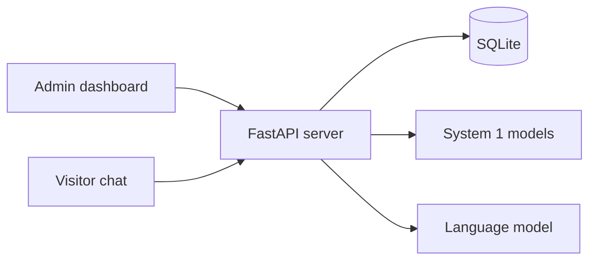
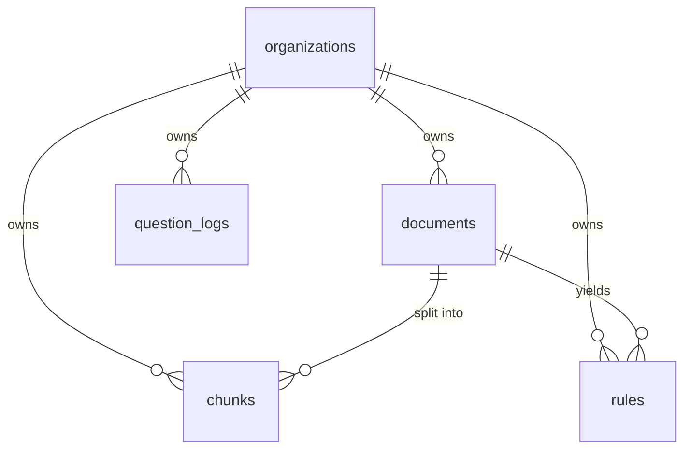
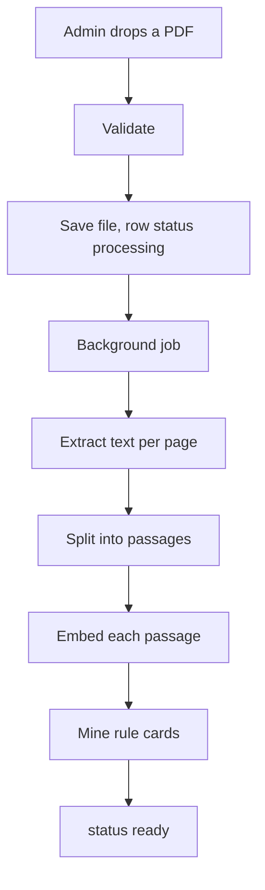
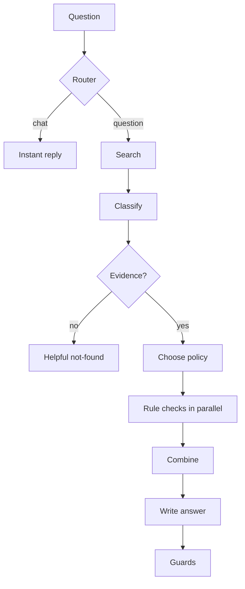

# Lumen: implementation guide (the code, the logic, the setup)

This guide shows **how Lumen is actually built**. For every feature you get the idea, the real code, and the reasoning behind it, plus the backend setup, the AI setup, how the parts connect, and how it is hosted.

All code blocks are **extracted automatically from the source files** when this document is built, so they always match the real code. Where a function is long, the block shows the important part and says so.

**How to read it:** Part 1 to 3 give the big picture and the foundations. Parts 4 to 9 follow the life of a PDF and a question through the code. Part 10 is the AI setup. Parts 11 to 14 cover the frontend, tests and hosting. Part 15 traces three complete journeys function by function.

---

## 1. System overview

Lumen is **one Python process** (FastAPI) plus a **React website** that the same process serves. The data lives in **SQLite**. Two small machine-learning models run **inside** the process (embeddings and a reranker). A **language model** is reached over HTTP (Groq online, or Ollama on the same PC).



**The three layers of intelligence**

| Layer | What it does | Where it lives |
|---|---|---|
| Language model | Understands wording, extracts stated facts, writes the final sentence | `llm.py` (called from `engine.py`) |
| System 1 (small models and rules) | Search, question type, which policy, does each rule pass, evidence score | `retrieval.py`, `models_s1.py`, `classifier.py`, `rules.py`, parts of `engine.py` |
| Application logic | Routing, thresholds, refusing, combining decisions, missing information, safety guards | `smalltalk.py`, `engine.py`, `suggest.py` |

**Design rule:** the language model never decides. It receives a finished verdict and explains it.

**The five tables:** `organizations`, `documents`, `chunks`, `rules`, `question_logs`. Every table except the first has an `org_id`.

**Two kinds of caller**

| Caller | Proves who they are with | Can reach |
|---|---|---|
| Admin (dashboard) | A signed login token (JWT) in the `Authorization` header | Only their own organization's admin endpoints |
| Visitor (chat page or widget) | A secret assistant token in the request body | Only the public question endpoints of one organization |

---

## 2. Startup and how the app is served

When the server starts, FastAPI runs the `lifespan` function once. It prepares the database and starts three background jobs: warm up the language model (Ollama only), load the machine-learning models so the first question is not slow, and create the demo organizations if demo seeding is on.

@@py backend/app/main.py lifespan unhandled

- **CORS is open** (`allow_origins=["*"]`). This is deliberate: the public endpoints must be callable from customers' own websites (the embedded widget). The admin endpoints use a bearer token in a header (not a cookie), so another site cannot make a browser send it by itself.
- **`unhandled`** is the safety net. Any unexpected error returns a friendly message with status 500 and never a stack trace.

**Serving the website.** After the API routes, the file ends by mounting the built React app. Any path that is not an API path returns `index.html`, so React Router can handle `/login`, `/app/usage` and `/a/<token>` in the browser.

@@between backend/app/main.py ||| ^DIST = 

---

## 3. Configuration

Every setting lives in one class. Values come from environment variables or from `backend/.env`; the names are the upper-case versions of the fields.

@@py backend/app/config.py Settings

A real `.env` for the live setup (the template shipped in the repository):

@@file backend/.env.example

**Why this matters:** the same code runs with a local model, a hosted model, or a mock model just by changing `LLM_PROVIDER`. Nothing is hard-coded.

---

## 4. The database

Five tables. **Every table below `organizations` carries `org_id`.** That column is the whole tenant-isolation design: any query that touches tenant data filters by it.



**Connecting to the database.** SQLite is a single file. Foreign keys are off by default in SQLite, so a connection event switches them on; that makes `ON DELETE CASCADE` work (deleting a document deletes its passages and rules).

@@between backend/app/db.py ||| ^connect_args ||| ^def now

**The tables.**

@@py backend/app/db.py new_token Organization Document Chunk Rule QuestionLog

- `Organization` is the tenant **and** its admin account (email and password hash are here). That is why there is one login per organization today.
- `Chunk.embedding` holds 384 numbers as raw bytes (`float32`, 1,536 bytes per passage).
- `Rule` is a typed rule card, for example benefit "Merit Scholarship", field `gpa`, operator `>=`, value `3.5`, with the evidence sentence and page.
- `QuestionLog` stores what the visitor typed, the answer, the sources, the type, the outcome and the time. It powers Usage and the full history.

**Creating and upgrading tables.** `init_db` creates missing tables and adds new columns to an older SQLite file, so upgrades never lose data. `get_db` gives each request its own session and always closes it.

@@py backend/app/db.py init_db get_db

**How the tenant filter looks in practice.** Listing documents:

@@py backend/app/main.py list_documents

Note that `org` comes from `Depends(current_org)`, which is built from the verified login token (see Part 5), never from anything the browser sends.

---

## 5. Authentication and security

### Passwords and login tokens

@@py backend/app/security.py hash_password verify_password make_jwt current_org

- **bcrypt** hashes the password with a random salt and is deliberately slow. (bcrypt only reads the first 72 bytes, hence the slice.)
- **`make_jwt`** signs a small JSON object with the server secret (`HS256`): the organization id (`sub`), a type (`typ: admin`) and an expiry of 24 hours.
- **`current_org`** is a FastAPI *dependency*. Any endpoint that lists it as `Depends(current_org)` is protected. It checks the header, verifies the signature and expiry, requires `typ == "admin"`, and loads the organization. The assistant token is not a JWT, so it can never pass this check.

### Sign up and sign in

@@py backend/app/main.py register login

### The public assistant token

The secret in the public link is created with Python's `secrets` module (cryptographically strong):

```python
def new_token() -> str:
    return "ast_" + secrets.token_urlsafe(24)    # 24 random bytes = 192 bits
```

Finding the organization from that token, used by every visitor endpoint:

@@py backend/app/main.py _org_by_token

Regenerating the link simply writes a new token, so the old one stops matching:

@@py backend/app/main.py regenerate

### Rate limiting

A simple sliding window kept in memory: at most 30 questions a minute per assistant token and visitor address. (In a multi-server setup this would move to Redis.)

@@py backend/app/main.py rate_limit

---

## 6. The API layer

The endpoints are all in `main.py`.

| Method and path | Who | What |
|---|---|---|
| `POST /api/auth/register`, `/login`, `GET /me` | public / admin | Account and session |
| `GET/POST /api/kb/documents`, `PUT/DELETE .../{id}`, `GET .../{id}/file`, `GET /api/kb/rules` | admin | The knowledge base |
| `GET/PATCH /api/assistant`, `POST /api/assistant/regenerate` | admin | Settings, link, embed code |
| `GET /api/usage`, `/usage/history`, `/usage/history.csv` | admin | Numbers and the full history |
| `GET /api/public/assistant/{token}` | token | Name, colour, welcome, starter questions |
| `POST /api/ask`, `POST /api/ask/stream` | token | Ask a question (JSON, or a live stream) |
| `GET /api/health`, `GET /api/public/demo` | public | Status; demo logins when seeding is on |

### Uploading, replacing and deleting documents

Uploads are checked **immediately** (so errors are instant and clear), then processed **in the background**.

@@py backend/app/main.py _accept_upload upload_document replace_document delete_document

- The file is saved under a **random name** (`uuid`), not the user's file name, and is never served publicly.
- Every lookup uses both `Document.id` and `Document.org_id`, so one organization cannot touch another's file by guessing an id.
- `background.add_task(process_document, doc.id)` runs the heavy work after the response is sent; the dashboard polls the status.

### Assistant settings and the public page

@@py backend/app/main.py assistant_out update_assistant public_assistant

### Usage and the full history

@@py backend/app/main.py _history_query usage_history

- The search escapes `%` and `_` so a visitor-typed or admin-typed `%` is searched literally.
- Times are stored in UTC; the API marks them as UTC so the browser shows the viewer's local time.

### Asking a question

The request model, the preparation step, and the two endpoints (plain JSON and streaming):

@@py backend/app/main.py Turn AskIn _prepare _with_context ask ask_stream

- `context` is the previous question (sent when the visitor is answering a "need more information" reply or asking a short follow-up); `_with_context` joins it to the new text for searching, after stripping filler words such as "tell me more".
- `history` is the last few question and answer pairs. It is passed to the language model only to understand references.
- `_prepare` turns "what?" or "I don't understand" into "explain the previous question again, more simply".
- `ask_stream` returns **Server-Sent Events**: each yielded engine event becomes one `data: {...}` line.

---

## 7. PDF ingestion: from a file to searchable knowledge



### Step 1: validate and read pages

@@py backend/app/pdfproc.py validate_and_read clean

Each check has its own plain-language message (not a PDF, empty, too big, encrypted, corrupted, no pages, too many pages, no extractable text). The result is the text of each page, with its page number.

### Step 2: split pages into passages

@@py backend/app/pdfproc.py chunk_page

A passage is at most about 650 characters, built from blank-line blocks and sentences, and **never crosses a page boundary**. That single rule is what lets every answer cite an exact page.

### Step 3: the background job

@@py backend/app/ingest.py process_document _fail

- Passages are embedded in one batch, then saved with their vectors.
- Rule cards are mined with patterns (and optionally proposed by the LLM, then filtered by a gate).
- Any failure marks the document `failed` with a readable reason; nothing crashes. Stage names ("Indexing passages", "Reading policy rules") are written to the row so the dashboard can animate progress.

### Step 4: mining rule cards

A rule card is a typed condition found in a sentence such as "must be in at least their second year", "GPA of at least 3.5", or "must not hold a sports scholarship".

@@py backend/app/rules.py RuleCard mine_page

The logic: split the page into sentences, remember the **heading** each sentence sits under (that heading names the benefit, for example "Merit Scholarship"), then match patterns for numbers with comparison words (at least, minimum, no more than), ordinals (second year), and yes/no holdings. Each match becomes a card with the evidence sentence and page.

A card, as stored (example):

```text
benefit = "Merit Scholarship"   field = "gpa"   label = "Cumulative GPA"
operator = ">="                 value = "3.5"   page = 1
evidence = "...must have a cumulative GPA of 3.5 or higher."
```

### Step 5: evaluating a card (the Boolean decision)

Pure code, no AI, no randomness:

@@py backend/app/rules.py evaluate describe

The result is `pass`, `fail` or `unknown` (the visitor never stated that fact). `unknown` is never treated as a pass: the assistant asks for it.

---

## 8. Search: finding the right passages

### Everyday words to policy words

People say "money back if I quit"; policies say "refund" and "withdraw". Before searching, the query gets policy words appended. Only the search query is widened; the answer is still written only from passages that were found.

@@between backend/app/query.py ||| ^SYNONYMS ||| ^\]
@@py backend/app/query.py expand

### The models

`models_s1.py` wraps two ONNX models that run on the CPU through the `fastembed` library, downloaded once and cached: the embedder `BAAI/bge-small-en-v1.5` (384 numbers per text) and the cross-encoder reranker `ms-marco-MiniLM-L-6-v2`. A deterministic "hash" stand-in is used by the offline tests.

@@py backend/app/models_s1.py tokens embed rerank warmup

### Hybrid retrieval

@@py backend/app/retrieval.py retrieve lexical_support

How `retrieve` works, step by step:

1. Load **only this organization's ready passages** (`WHERE org_id = ?`). Nothing else is ever read.
2. **BM25** scores keyword matches; the **embedding dot product** scores meaning (the vectors are normalised, so a dot product is cosine similarity).
3. **Reciprocal Rank Fusion** merges the two rankings: each passage gets `1/(60+rank)` from each list.
4. The best candidates go to the **reranker**, which reads question and passage together and scores 0 to 1.
5. `lexical_support` adds a floor: if every specific word of a short question appears in a passage, its score is at least 0.4, so short generic questions such as "What is the refund policy?" are not refused.

---

## 9. The question engine

The function `engine.run` is an **async generator**: it yields events as it works (a step started or finished, a piece of text, a replacement, the final result). The API forwards each event to the browser, which is how the "How I decided" panel animates.



### 9.1 The router (before any search)

Greetings, thanks, "who are you", injection attempts, gibberish, other languages, "talk to a human", vague or frustrated messages and so on are answered by plain code. It is instant, free, and a casual message never hits the "not found" guard.

@@py backend/app/smalltalk.py route is_overview

The stage in `run` that calls it:

@@between backend/app/engine.py ||| # 0\. Small talk ||| # 1\. Retrieval

### 9.2 Search and classification

@@between backend/app/engine.py ||| # 1\. Retrieval ||| # 2\. Classification

The **question-type classifier** is a logistic regression trained at startup on about 40 example questions embedded with the same embedder. It is tiny and takes milliseconds.

@@py backend/app/classifier.py _train classify

### 9.3 The grounding guard

If there are no passages, or the best score is under `MIN_SUPPORT` (0.12) and no policy matches, the assistant does **not** guess. It writes a helpful reply itself.

@@between backend/app/engine.py ||| # 2\. Classification ||| # 3\. Decide whether

The reply names what was asked, offers the closest section if any, and lists what each document covers (built from rule benefit names and section titles):

@@py backend/app/suggest.py not_found_message menu_text

### 9.4 Do we need a decision?

A decision is only attempted when the visitor states facts about themselves, or asks "can I / am I eligible". "What GPA do I need?" is an information question and gets a plain answer.

@@between backend/app/engine.py ||| # 3\. Decide whether ||| if use_decisions:

**Choosing the policy** (a *Choice* decision): compare the question with each benefit's description by word overlap and embedding similarity.

@@py backend/app/engine.py choose_policy

### 9.5 Facts: patterns first, the language model second

The assignment wants the language model to understand the question, so it runs in parallel with the evidence-score model, but its output is **fenced in**:

- `pattern_facts` (regular expressions) finds GPA, year (including "year one"), attendance, months of service and yes/no holdings, with negation handled.
- `llm_facts` asks the model to extract the same fields as JSON.
- `ground_facts` throws away any model-made number that does not literally appear in the question.
- On a conflict the pattern wins: `facts.setdefault(k, v)` only fills gaps.

@@py backend/app/engine.py pattern_facts:1-30 ground_facts

### 9.6 The decisions, the combination, and the parallelism

@@between backend/app/engine.py ||| ^    if use_decisions: ||| ^    else:$

@@py backend/app/engine.py decide_boolean decide_score combine

- `asyncio.create_task` starts the language-model call and the evidence scoring **at the same time**; `asyncio.gather` runs every rule check **at the same time**.
- `combine` is the whole decision logic: any `fail` gives `not_eligible`; otherwise any `unknown` gives `need_info`; otherwise `eligible`.

**Amount tiers** are a second Choice decision made by code, because models are unreliable with numbers ("Who approves a $900 expense?" must give Director, not Finance Committee):

@@py backend/app/engine.py amount_tier

### 9.7 Writing the answer and keeping the model honest

The prompts differ by situation:

@@between backend/app/engine.py ||| ^ANSWER_SYSTEM ||| ^VERDICT_TEXT

The stage that builds the prompt, streams the answer, and applies the guards:

@@between backend/app/engine.py ||| # 6\. LLM writes the answer ||| ^def _followups

The guards:

@@py backend/app/engine.py reason contradicts fix_citations

- **`reason`**: the explanation sentences for each rule are written by the app, not the model.
- **`contradicts`**: if the model's wording says "eligible" when the verdict is "not eligible" (or the reverse), the answer is replaced by the app's own text and a `replace` event is sent.
- **`fix_citations`**: a file name the model invents is snapped to a real document.
- **Fallback**: if the model is unavailable the answer is built from the verdict or the best sentence, and the response is flagged `degraded`.

### 9.8 The final result and the log

@@py backend/app/engine.py _final _log build_references

The final object sent to the browser contains the answer, status (`answered`, `needs_info`, `no_knowledge`, `error`), references with snippets, the question type, the decisions with every rule check, the steps with timings, follow-up buttons, and whether it was degraded.

### 9.9 Follow-up buttons and starter questions

@@py backend/app/suggest.py followups auto_questions all_suggestions

Buttons come from the answer's own document: "Tell me about <another section>", then related questions. Starter questions are the owner's own plus ones generated from rule benefits and document titles (maximum six).

---

## 10. The AI setup: language model, Groq, Ollama

### What the language model does here

1. Reads the visitor's wording and extracts stated facts (as JSON).
2. Writes the final answer from a finished verdict and the retrieved passages.

It never searches, never decides, never sees other organizations' text.

### The client (`llm.py`)

@@py backend/app/llm.py _openai_models _openai_payload chat_json

@@py backend/app/llm.py stream_text

- **Providers** are chosen by `LLM_PROVIDER`: `openai_compat` (Groq or any OpenAI-style service), `ollama` (local), or `mock` (tests).
- **Failover:** free tiers limit tokens per minute per model. On 429, 404 or a server error, the same request is retried on each model in `OPENAI_FALLBACK_MODELS`. A genuine error such as a wrong API key is not hidden.
- **Streaming** reads the response line by line and yields text as it arrives.

### Setting up Groq (hosted, free tier)

1. Create an account at https://console.groq.com and make an API key.
2. In `backend/.env`:

```text
LLM_PROVIDER=openai_compat
OPENAI_BASE_URL=https://api.groq.com/openai/v1
OPENAI_API_KEY=<your key>
OPENAI_MODEL=qwen/qwen3.8-27b
```

3. Check which models your key can use: open `https://api.groq.com/openai/v1/models` with the key. A wrong model name makes every call fail and answers fall back to plain text.
4. Restart the server and open `/api/health`: it should say `"ok": true`.

Limits to know: about 1,000 requests a day and about 8,000 tokens a minute per model on the free tier. Your documents' text sent as context is processed by the provider.

### Setting up Ollama (local, free, private)

1. Install Ollama from https://ollama.com.
2. Download a model: `ollama pull qwen2.5:3b` (about 2 GB).
3. In `backend/.env`:

```text
LLM_PROVIDER=ollama
OLLAMA_URL=http://localhost:11434
OLLAMA_MODEL=qwen2.5:3b
```

4. Ollama runs a local web server on port 11434. The app sends chat requests to it and keeps the model loaded for 30 minutes (`keep_alive`) so replies stay quick.

| | Groq | Ollama |
|---|---|---|
| Where it runs | Provider's servers | Your own computer |
| Cost | Free tier, then pay per use | Free |
| Speed | About 1 second | About 5 to 15 seconds on a CPU |
| Quality | Larger models | Small models, more guard rails needed |
| Needs | Internet and an API key | Disk space and RAM |
| Privacy | Passages go to the provider | Everything stays on the machine |

### Where the small models come from

The embedder and reranker download once on first use into a cache folder (in Docker they are baked into the image) and run on the CPU. No GPU and no key are needed.

---

## 11. The frontend

React single-page app built with Vite. Pages: landing, sign in and sign up, the dashboard with four tabs, and the public chat.

### Routes and protection

@@file frontend/src/App.jsx

`Protected` sends visitors without a session to `/login`. The dashboard is loaded lazily so the public chat stays light.

### Session state

@@file frontend/src/auth.jsx

On load, if a token exists, the app calls `/auth/me`. A 401 from any call clears the session (the API client fires a `kda:logout` event).

### The API client

@@js frontend/src/api.js api

The login token is added automatically as a bearer header. Streaming a question:

@@js frontend/src/api.js askStream

### The chat

@@js frontend/src/components/ChatPanel.jsx send

`send` decides whether to attach `context`, builds `history`, starts the stream, and updates the last message live as `step`, `token`, `replace` and `final` events arrive. The same component powers the public page, the iframe, and the live preview in the dashboard.

### The dashboard

The dashboard loads documents, assistant settings and usage once, shares them through a React context, and polls while any document is still processing:

@@between frontend/src/pages/Dashboard.jsx ||| const loadDocs ||| const value = useMemo

### The embeddable widget

`public/embed.js` is plain JavaScript with no dependencies. A customer pastes one script tag with their token; it adds a floating button that opens the assistant in an iframe (`/a/<token>?embed=1`).

@@between frontend/public/embed.js ||| var btn = document

### The guided tour

`Tour.jsx` has 11 steps. Each step names a page and a CSS selector (`data-tour="..."` markers placed in the pages). It navigates, waits for the element, scrolls to it, and draws a spotlight; the card is placed beside it, or as a bottom sheet on phones. Completion is remembered in `localStorage`.

@@js frontend/src/components/Tour.jsx place

---

## 12. Tests and quality checks

| Check | Command | Size |
|---|---|---|
| Unit and API tests (offline, fake embeddings, mock model) | `cd backend && uv run pytest -q` | 119 tests |
| Assignment evaluation (real models, running server) | `uv run python ../scripts/seed_and_eval.py` | 19 questions |
| Scenario battery (typos, off-topic, cross-tenant) | `uv run python ../scripts/scenario_battery.py` | 44 scenarios |

The test setup forces an offline, deterministic environment **before** the app is imported, and gives each test file two ready organizations:

@@file backend/tests/conftest.py

The isolation proof (organization B cannot read A's knowledge, and retrieval is scoped at the query level):

@@py backend/tests/test_isolation.py test_org_b_cannot_get_org_a_knowledge

A model-failover test that uses a fake HTTP server instead of a real model:

@@py backend/tests/test_features.py test_streaming_answer_falls_back_to_the_next_model_when_rate_limited

---

## 13. Hosting and operations

### How it is hosted today

The app runs on a PC. FastAPI serves both the API and the website on port 8000. A free **Cloudflare quick tunnel** (`cloudflared`) gives it a public `https://....trycloudflare.com` address that forwards to `localhost:8000`.

```text
Visitor -> https://....trycloudflare.com -> Cloudflare -> cloudflared on the PC -> localhost:8000 -> Lumen
```

Why not a normal free cloud host: the two machine-learning models need about 550 MB while a PDF is processed, but free tiers give 512 MB; Hugging Face now charges for Docker spaces; serverless hosts cannot hold the models or the database.

Starting and updating:

@@file scripts/update_live.bat

@@file scripts/share_public.bat

- `update_live.bat` rebuilds the frontend, frees port 8000, starts the server in a minimised window and waits until `/api/health` answers. The tunnel keeps running, so the link stays the same.
- `share_public.bat` does the same and then starts the tunnel, printing the public link.

### Docker

The Dockerfile has two stages: build the React app with Node, then a Python image with the backend, the built website, the sample data, and the two models pre-downloaded. It runs as a non-root user.

@@file Dockerfile

`docker-compose.yml` adds an Ollama container and a one-off job that downloads the model, so one command (`docker compose up --build`) runs everything with no account or key:

@@file docker-compose.yml

### Demo seeding

With `SEED_DEMO=true`, a background task creates the two demo organizations through the app's own API on start (safe to repeat), so reviewers can sign in with one click.

@@py backend/app/demo_seed.py seed_demo

### What production would look like

- Several stateless app containers behind a load balancer, with HTTPS.
- Postgres with a vector extension (pgvector) instead of SQLite; Alembic for migrations.
- PDFs in object storage (for example S3) instead of local disk.
- A job queue and workers for PDF processing.
- Redis for rate limiting and caching; secrets in a secret manager.
- Logs and monitoring; per-organization quotas.
- A model service with enough capacity, or a self-hosted model for sensitive data.

---

## 14. Main files at a glance

@@filetable

---

## 15. Three complete journeys, function by function

### Journey 1: sign up

| Step | Where | What happens |
|---|---|---|
| 1 | `AuthPage.jsx` | Validates the form, calls `register()` from `auth.jsx` |
| 2 | `api.js` `api()` | `POST /api/auth/register` with no token |
| 3 | `main.py` `register` | Checks the email, `hash_password`, creates the `Organization` (with `new_token`) |
| 4 | `security.py` `make_jwt` | Signs a 24-hour token with the organization id |
| 5 | `auth.jsx` | Saves the token in `localStorage`, stores the organization, navigates to `/app` |

### Journey 2: upload a PDF

| Step | Where | What happens |
|---|---|---|
| 1 | `Knowledge.jsx` + `api.js` `uploadFile` | Sends the file with progress |
| 2 | `main.py` `upload_document` | `current_org` finds the organization from the token |
| 3 | `_accept_upload` | Counts documents, `validate_and_read`, saves under a random name, creates the row (`processing`) |
| 4 | `background.add_task(process_document)` | Response is sent; the job starts |
| 5 | `ingest.py` `process_document` | `chunk_page` per page, `models_s1.embed`, save `Chunk` rows; `rules.mine_page`, save `Rule` rows; status `ready` |
| 6 | `Dashboard.jsx` | Polls `/api/kb/documents` every 1.2 seconds and animates the stage |

### Journey 3: a visitor asks "I'm in year 2 with a 3.6 GPA and no sports scholarship. Am I eligible for the Merit Scholarship?"

| Step | Where | What happens |
|---|---|---|
| 1 | `ChatPanel.jsx` `send` | Builds `context` and `history`, calls `askStream` |
| 2 | `main.py` `ask_stream` | `_org_by_token`, `rate_limit`, `_prepare`, then streams `engine.run` |
| 3 | `engine.run` stage 0 | `smalltalk.route` returns nothing, so it is a real question |
| 4 | stage 1 | `load_context` then `retrieve`: this organization's passages, BM25 plus embeddings, rerank |
| 5 | stage 2 | `classifier.classify` says `eligibility`; the grounding guard passes |
| 6 | stage 3 | `choose_policy` picks Merit Scholarship; `pattern_facts` finds year, GPA and the holding; a decision is needed |
| 7 | stage 4 | Language-model fact extraction runs in parallel with `decide_score`; `ground_facts` filters it |
| 8 | stage 5 | `asyncio.gather` runs one `decide_boolean` per rule; `combine` gives the verdict |
| 9 | stage 6 | The prompt is built from the verdict and reasons; `llm.stream_text` streams the wording |
| 10 | guards | `contradicts` and `fix_citations` check the text; `_followups` builds the buttons |
| 11 | end | `final` event with sources; `_log` stores the question, answer and sources |
| 12 | `ChatPanel.jsx` | Shows the live steps, the answer, source chips and follow-up buttons |
